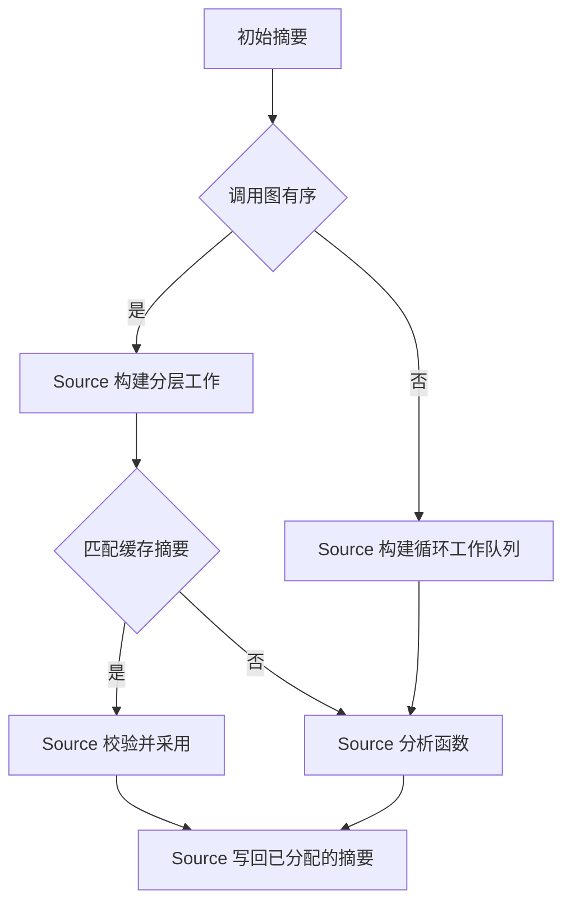

# 所有权流摘要发布自举

## Intent

将函数所有权流摘要的候选校验、结果发布和分层工作选择迁入 Source，贯通缓存命中、首次计算与循环调用图三条路径。

## Data

函数槽摘要的三组布尔向量分别记录结果保留的输入、文本结果保留的输入与可能原地写入的输入。正式 Source 编译器在 `Flow.create` 初始化摘要，通过分层依赖或循环工作队列分析函数。已有 Source 负责推导位值。暂由 Zig 比较缓存形状、复制命中记录和发布新摘要。分层队列还提交了只需保留初始摘要的原生函数。

## Edges

每次缓存采纳先校验三组长度，再写入任何一个字段。函数分析在临时空间完成，只有成功才发布结果。目标向量由分析结果持有，临时和缓存向量仍由原有分配器管理。线程只读已完成层的摘要，同层任务各写自己的行。宿主保留线程同步和缓存表生命周期。

## Answer

以实际 Source 引导器、现有所有权和缓存回归、与初始引导器对照、固定生成清单的性能数据作为验收证据。

### 实现

- 缓存命中走 `adopt.rx`。三列形状均匹配才执行发布，返回是否接受给同层宿主工作项。命中采用在工作线程内完成，缓存表的保留和新记录写入仍在同层任务全部返回后进行。[采用缓存](../../packages/genz/src/analysis/uniqueness/flow/memo/adopt.rx)
- 无缓存的分层分析和循环图求解都经过 `visit.rx`。分析完成后，通过同一个发布函数写入最终摘要。内部内存模块提供固定布尔切片写入，来源和目标已经共享存储时直接返回。调用侧提供现有向量的借用描述符，无需新建列或行。[分析与发布](../../packages/genz/src/analysis/uniqueness/flow/body/visit.rx) · [内部布尔切片写入](../../packages/core/src/memory/root.zig)
- 分层计划将原生函数保留在依赖图中，用其深度计算调用者的依赖层。计划只提交需要后续分析的函数。宿主跳过没有工作的空层，仍使用现有线程池和层间屏障。[分层计划](../../packages/genz/src/analysis/uniqueness/layers/plan.rx) · [宿主执行入口](../../packages/genz/src/zx/uniqueness/flow.zig)

### 正确性

Source 引导构建完成 25 步，初始 Zig 引导器构建完成 14 步。735 个入口的 11,753 个生成文件与上一代逐字节相同，排除工具身份戳。热重建与各自的冷生成一致。v18 所有权缓存正文 SHA-256 为 `cdf9fa7e0f33002a95dc097b2837de781d67e6e519a452fb97f89f7c0bbf3a23`，与上一代一致。

六入口清单覆盖首次生成、编辑读索引、去掉调用和恢复。上一代和候选在常驻进程的各状态均生成 22 个与独立冷生成一致的文件。初始状态的 22 个文件与 Zig 引导器一致。

直接运行生成的 Source 缓存采用函数，验证任一列长度不匹配时三列值均保持原状。零容量分配器可执行拒绝、接受与来源已经是目标三种情况。直接运行分层入口，核对混合原生与 Source 函数的层边界、同层顺序、全原生图的空计划，以及循环图进入回退路径的返回值。

九组既有回归完成 376 个构建步骤，共通过 776 项测试，涵盖函数分析及运行时、缓存所有权、字段事实、所有权契约、对象追加、聚合循环、原生借用和循环调用来源。

### 性能

macOS arm64，Zig 0.17.0，ReleaseSmall，16 分区，关闭常驻。候选由 `76dc45ff1` 生成。三套工具都执行 Source 分析和生成，使用同一固定 735 入口清单交错测量三轮，表中为中位数。

| 指标                     |  固定基线 |    上一代 |      候选 |
| ------------------------ | --------: | --------: | --------: |
| 冷生成墙钟               |    2.85 s |    2.56 s |    2.57 s |
| 冷生成 CPU               |   12.45 s |   12.15 s |   12.17 s |
| 冷生成进程树采样峰值 RSS | 885.42 MB | 703.18 MB | 700.38 MB |
| 冷生成单进程系统峰值 RSS | 969.02 MB | 733.32 MB | 743.21 MB |
| 热重建墙钟               |    2.21 s |    1.98 s |    1.96 s |
| 热重建 CPU               |    8.46 s |    8.26 s |    8.23 s |
| 无改动墙钟               |    0.04 s |    0.03 s |    0.03 s |

冷生成首轮候选与固定基线的墙钟分别为 3.83 秒和 3.26 秒。候选三轮冷生成 CPU 落在 12.15 至 12.20 秒。较上一代，候选进程树峰值下降 2.80 MB，单进程峰值上升 9.90 MB。相对固定基线，候选冷生成墙钟和 CPU 均下降 0.28 秒，进程树峰值下降 185.04 MB。这些数据覆盖 zxc 分析、生成及写出。

### 自我审查

首次引导发现隔离的 ordered 清单不包含 flow 主体。类型复用沿当前依赖方向进行，由 flow 引用已有摘要记录定义，ordered 无需加载新的分析模块。Source 已接管形状检查、发布和工作项选择。并行执行、缓存表查找与保留以及最终向量存储仍通过宿主完成。
