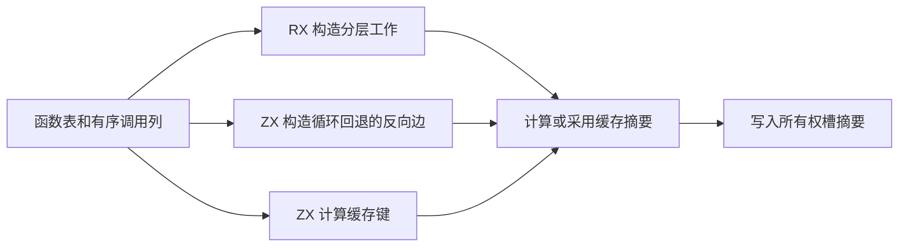
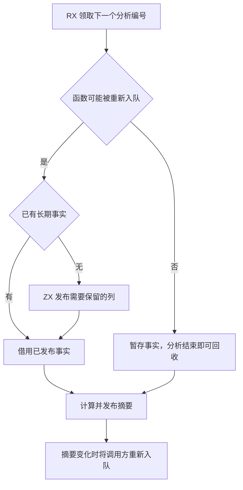

# 所有权流摘要调度与事实保留

## Intent

由 Source 选择流摘要的分层工作和循环回退需要保留的事实。减少缓存键计算和反向边登记中的表达式扫描，同时保持调用次序、重复调用和缓存记录的语义。

## Data

正式入口是 `Basis.create → Flow.create`。同一套函数槽摘要提供结果借用来源、文本返回借用和可能的原地写入。依赖顺序可用时按层执行，遇到递归或向后依赖时从工作队列重复分析。IR 校验要求各表达式载荷在对应的列中连续并按表达式顺序出现。缓存键可直接顺序读取调用列，回退队列可直接逆序读取同一列。[表达式表校验](../../packages/core/src/expression_table/validate.zig)

## Edges

有持久缓存时，空槽函数仍参与查找和刷新使用标记。无缓存时，分层只提交有输入槽的源码函数，但计算依赖深度仍考虑原图。每层的相对顺序，以及缓存键中的调用次序和重复项继续沿用。

循环回退按函数编号从小到大开始访问。只有被调用函数的摘要变化会将调用方重新入队。如果函数所有参与求解的直接和间接调用沿着较小编号下降，这些摘要会在首次访问该函数前完成，之后无法将其重新入队。ZX 由小到大计算待保留标记。遇到自身、较大编号或已经标记的被调用函数，标记调用方。原生函数与空槽函数没有进入回退队列，也不会引发重新入队。

## Answer

- 分层计划在 Source 中选择函数并压缩空边界，宿主直接按发布的范围分配线程。缓存键在命中前只借用调用列，命中时可省去构造完整函数描述符。[分层计划](../../packages/genz/src/analysis/uniqueness/layers/plan.rx) · [缓存键](../../packages/genz/src/analysis/uniqueness/flow/key/callees.zx)
- 循环回退直接用调用列登记反向边。Source 判断事实是否需要保留。需要长期事实的函数，将准备结果借给 Source 发布到工作队列的拥有者。准备和分析共用一个可重置的工作区。宿主为每个编号保存一个可空指针，原 Zig 通用字段复制已移除。只返回值的布尔摘要直接在最终拥有者处分配。[工作队列初始化](../../packages/genz/src/analysis/uniqueness/flow/fixpoint/create.rx) · [保留规则](../../packages/genz/src/analysis/uniqueness/flow/fixpoint/retention.zx) · [事实发布](../../packages/genz/src/analysis/uniqueness/flow/body/save.zx)

### 正确性与性能

最终 Source 引导构建通过 25 步。冻结 735 个入口的 11,753 个文件与上一代逐字节一致，排除工具身份戳。v18 所有权缓存正文也一致，SHA-256 为 `cdf9fa7e0f33002a95dc097b2837de781d67e6e519a452fb97f89f7c0bbf3a23`。热重建与各自的冷生成结果一致。单独对照包含自调用和叶子函数的回退样本，九个输出文件一致。

前一版实现通过七组回归的 635 项检查。最终候选复跑受队列状态改动影响的函数分析、所有权缓存和所有权契约三组，共通过 103 个构建步骤和 252 项检查。初始种子通过 14 步构建，在六入口清单上与最终候选生成的 22 个文件一致。该清单的初次生成、修改读取位置、修改调用和恢复四种常驻状态也分别与独立冷生成一致。

macOS arm64，Zig 0.17.0，ReleaseSmall，16 分区，关闭常驻。同一冻结清单交错三轮并取中位数。候选由 `68780b401` 的 Source 引导器生成，三套参与对照的工具均通过 Source 引导，执行 Source 分析与生成。固定基线沿用引导声明准备阶段。RSS 使用十进制 MB。

| 指标                     |  固定基线 |    上一代 |      候选 |
| ------------------------ | --------: | --------: | --------: |
| 冷生成墙钟               |    2.83 s |    2.56 s |    2.55 s |
| 冷生成 CPU               |   12.44 s |   12.19 s |   12.13 s |
| 冷生成进程树采样峰值 RSS | 885.08 MB | 708.84 MB | 700.63 MB |
| 冷生成单进程系统峰值 RSS | 944.59 MB | 774.49 MB | 746.08 MB |
| 热重建墙钟               |    2.22 s |    1.96 s |    1.96 s |
| 热重建 CPU               |    8.43 s |    8.22 s |    8.23 s |
| 无改动墙钟               |    0.04 s |    0.03 s |    0.03 s |

相对上一代，冷生成墙钟减少 0.01 秒、CPU 减少 0.06 秒。进程树和单进程峰值的中位数分别下降 8.21 MB 和 28.41 MB。单进程峰值最高一轮为 817.84 MB，上一代最高为 798.64 MB。相对固定基线，冷生成墙钟和 CPU 分别减少 0.28 秒和 0.31 秒。

中间实现逐项写入布尔保留表时，生成器在进入写入前已将表降为共享视图，随后为每次写入分配并复制整列。最终实现将保留标志并入已有的队列状态字节。单独检查最终两项生成，标记规则只读写该队列列，分层边界压缩直接修改原边界列。两处均省去了额外数组分配。

### 自我审查

保留条件使用工作队列顺序能直接证明的首次访问规则。标记了可能重新入队的函数仍可能只访问一次。已保存的列需要跨临时区域重用，因此在发布边界复制。线程池、层间屏障、缓存的宿主调用和初始种子仍有 Zig 实现。

诊断构建曾观测到类型文件生成使用约 249.6 MB 的临时 arena 容量，生命周期内存峰值也会受到流分析之外的工作影响。诊断构建加入了日志，数值只用于定位分配边界。表中数据来自正式候选，范围止于分析和 Zig 文件输出。
