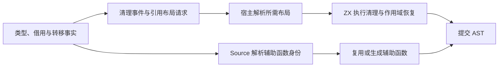
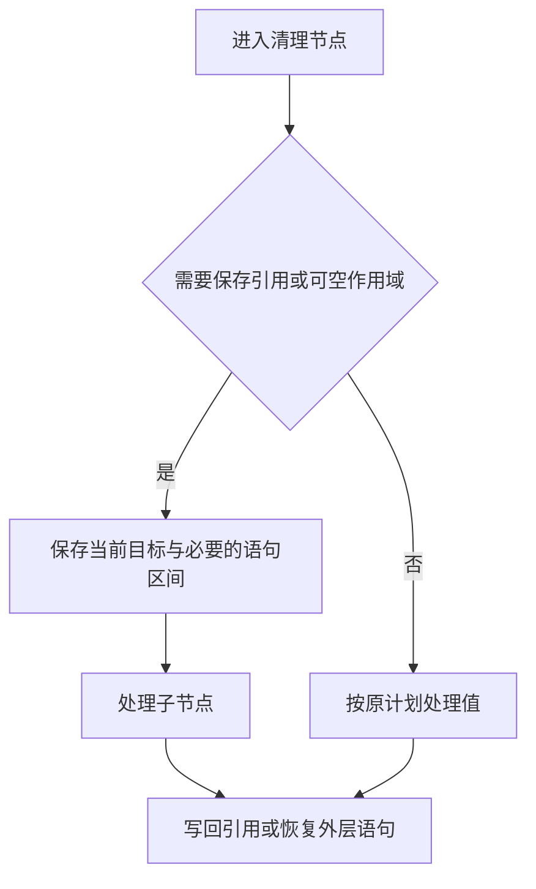

# 所有权清理计划与辅助函数复用自举

## Intent

将所有权清理的引用布局请求、作用域恢复和辅助函数复用交给 Source。宿主只解析计划需要的布局，并把生成的 AST 提交到存储。

## Data

正式清理路径有两个入口。显式清除所有权标记由 `ownership.clear` 生成。返回或写入字段时由 `ownership.projected` 选择内联或辅助函数。两条内联路径都曾让 Zig 遍历清理节点，对非引用节点填入零布局。Source 的清理执行器为所有节点预留目标和值，以及仅在可空分支使用的语句保存区。辅助函数名称由 Source 计算，之前由 Zig 复制后才检查登记表。

## Edges

布局请求按进入引用节点的顺序发出。父节点值在遍历中继续可用，保存的目标和值域状态在引用或可空分支结束时按嵌套顺序恢复。静态辅助函数只适用于原规则允许的清理计划。已登记名称随当前函数的辅助声明存储有效，可直接借用。新名称仍在临时区回收前获得稳定存储。

## Answer

用冻结清单核对生成文件、所有权缓存、墙钟、CPU 和峰值内存。现有回归覆盖跨分支字段所有权、临时引用、循环和 Store 状态，并检查引导器与常驻生成的一致性。

### 固定清单对照

macOS arm64，Zig 0.17.0，ReleaseSmall，16 分区，关闭常驻。候选由 `1febaab70` 构建。三套工具均执行 Source 分析和生成。用同一份 735 入口冻结清单交错运行三轮，取中位数。热重建移除输出并保留缓存。

| 指标                   |  固定基线 |    上一代 |      候选 |
| ---------------------- | --------: | --------: | --------: |
| 冷生成墙钟             |    2.86 s |    2.59 s |    2.69 s |
| 冷生成 CPU             |   12.46 s |   12.17 s |   12.18 s |
| 进程树采样峰值 RSS     | 884.95 MB | 706.10 MB | 707.51 MB |
| 单进程系统记录峰值 RSS | 921.93 MB | 741.13 MB | 749.31 MB |
| 热重建墙钟             |    2.23 s |    1.97 s |    1.98 s |
| 热重建 CPU             |    8.49 s |    8.26 s |    8.28 s |
| 无改动墙钟             |    0.04 s |    0.03 s |    0.03 s |

相对上一代，冷墙钟增加 0.10 秒、CPU 增加 0.01 秒，进程树采样峰值增加 1.41 MB，单进程系统记录峰值增加 8.18 MB。候选三轮冷生成墙钟为 4.57、2.69、2.57 秒。较固定基线，冷墙钟减少 0.17 秒，CPU 减少 0.28 秒，两种峰值分别下降 177.44 MB 和 172.62 MB。

排除工具身份戳后，11,753 个生成文件与上一代逐字节一致。所有权缓存 v18 正文 SHA-256 均为 `cdf9fa7e0f33002a95dc097b2837de781d67e6e519a452fb97f89f7c0bbf3a23`。三套工具各自的热重建与冷生成一致。

### 清理与辅助名称探针

两版均触发 2,055 份内联清理计划，共 4,812 个节点，其中 93 个需要引用布局。上一代按节点数保留布局槽，候选只解析 93 个引用布局。1,390 次辅助函数请求中有 252 次命中当前声明表，候选直接使用已登记的名称。

同一冻结清单各记录 4,604 次独立函数开始打印时的工作区。容量之和从 324.86 MB 降至 324.78 MB，中位数和最大值分别保持 48,502 B 和 1,396,854 B。两版语句头部均为 517,837 项。此探针覆盖打印前的函数工作区，整轮峰值增加的来源仍未定位。

### 引导与增量

候选完成 25 步 Source 引导。沿用上一批通过验证的 seed。六个已有输入上，候选与该 seed 生成的 22 个文件逐字节一致。常驻初次生成、编辑读取位置、修改调用依赖及恢复源码，四次请求均与独立冷生成一致，上一代和候选的输出逐次匹配。

九个回归入口完成 405 步构建，882 项检查全部通过，覆盖字段借用重叠、嵌套缓冲、循环更新、Store 所有权证明、初始化与分配失败，以及源码和归档库调用。

收口时删除已退出正式路径的布尔辅助名称查找注册，保留 seed 的原查找规则。重新构建 Source 和 seed 后，Source 的 11,753 个文件、所有权缓存正文及 seed 的 22 个文件分别与清理前逐字节一致。计时数据沿用删除该闲置入口前的候选。

### 自我审查

清理计划提供所需引用布局。辅助函数分支在 Source 选择，宿主保留引用布局解析、分配、AST 载荷提交及声明登记。当前性能对照覆盖分析与生成，完整冷构建的 Zig 后端开销仍需独立核验。
