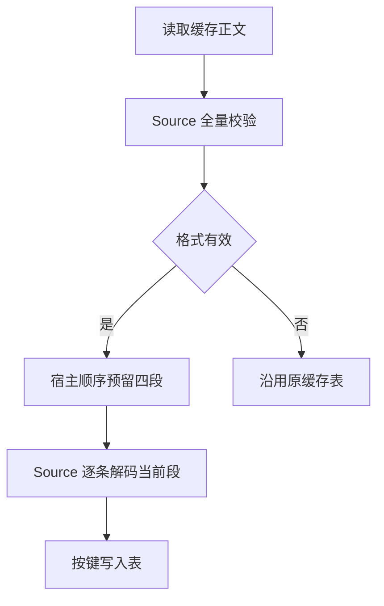

# 所有权磁盘缓存批量加载自举

## Intent

迁移所有权磁盘缓存的记录遍历、索引安装与值发布，覆盖结算、需求、计划和流摘要四段。

## Data

正式入口从磁盘读取 v18 缓存，先由 Source 校验整个字节流。Zig 再为每段预留容量，对每条记录调用 Source 解码，并将键值安装到表中。每段的目标键、值与索引桶已有独立存储，能直接借用预留的空间。

## Edges

校验完成前无需分配缓存表。每条记录的所有变长字段准备完成后才写入键、索引或值。重复键覆盖原行，完成的前缀在后续分配失败时仍可查询。源文件字节在加载返回后即释放，发布的变长数据仍由缓存拥有者保留。

## Answer

核对固定清单的生成物和缓存字节、磁盘复用、常驻编辑、重复摘要、失效输入和分配失败后的前缀，再对照固定性能基线。

### 实现

- 四种缓存记录各有一个 Source 段入口。循环在 Source 中推进字节游标，沿用解码模块与现有摘要索引。校验阶段仍在容量预留之前。遇到重复摘要时，发布到原有位置。[结算段](../../packages/genz/src/analysis/uniqueness/memo/disk/load/section/settled.zx) · [需求段](../../packages/genz/src/analysis/uniqueness/memo/disk/load/section/demanded.zx) · [计划段](../../packages/genz/src/analysis/uniqueness/memo/disk/load/section/planned.zx) · [流摘要段](../../packages/genz/src/analysis/uniqueness/memo/disk/load/section/flowed.zx)
- 嵌套行的分配仍归缓存 arena。内存模块转移行缓冲对应的切片描述符，然后使该缓冲可供下一条记录使用。成功写入的新键追加到可见前缀。已有键保留原编号，使用标志随加载结果写入。[行描述符转移](../../packages/core/src/memory/write_column.zig) · [位置选择](../../packages/genz/src/analysis/uniqueness/memo/disk/load/section/claim.zx) · [前缀提交](../../packages/genz/src/analysis/uniqueness/memo/disk/load/section/complete.zx)
- 宿主按原顺序预留四段，借出键、值和桶并同步有效长度。每个非空段只调用一次生成的解码入口。保留的宿主职责是内存容量和类型布局适配。表的普通访问继续使用同一套 Source 摘要索引。[宿主调用](../../packages/genz/src/zx/uniqueness/memo/loading.zig)

### 正确性

Source 引导构建完成 25 步，初始 Zig 引导器完成 14 步。固定 735 个入口的 11,753 个生成文件逐字节相同，排除工具身份戳。热重建与各自冷生成一致。两代的 v18 缓存正文 SHA-256 同为 `cdf9fa7e0f33002a95dc097b2837de781d67e6e519a452fb97f89f7c0bbf3a23`。

六入口清单分别经过首次生成、改动读索引、去掉调用以及恢复。两代常驻工具在每种状态下的 22 个输出文件均与独立冷生成一致。初始 Zig 引导器和 Source 候选对未编辑清单的 22 个产物也一致。

专项核验通过正式 `Memo.load` 读出四类记录，并在已有记录的表中加载重复摘要。重复摘要沿用原位置，保留最后一次写入。截断或多余字节不会改变已有记录。清空输入字节后仍可读出所有已发布字段。逐个注入分配失败，确认至少一处失败保留了同段的完整前缀，所有可见记录仍可按键查询，缓存释放后计入的分配字节都已回收。

既有七组回归完成 290 个构建步骤，635 项测试全部通过，覆盖函数分析及其运行时、缓存所有权、字段事实、所有权契约、对象追加和聚合循环。

### 性能

macOS arm64，Zig 0.17.0，ReleaseSmall，16 分区。候选由 `712b4033c` 生成。三套工具都执行 Source 分析与生成，对同一 735 入口清单交错测量三轮，关闭常驻。表中为中位数。

| 指标                     |  固定基线 |    上一代 |      候选 |
| ------------------------ | --------: | --------: | --------: |
| 冷生成墙钟               |    2.85 s |    2.56 s |    2.60 s |
| 冷生成 CPU               |   12.44 s |   12.16 s |   12.24 s |
| 冷生成进程树采样峰值 RSS | 885.19 MB | 702.15 MB | 700.69 MB |
| 冷生成单进程系统峰值 RSS | 926.96 MB | 727.96 MB | 774.21 MB |
| 热重建墙钟               |    2.21 s |    1.97 s |    1.96 s |
| 热重建 CPU               |    8.47 s |    8.22 s |    8.27 s |
| 热重建单进程系统峰值 RSS | 934.28 MB | 698.37 MB | 699.27 MB |
| 无改动墙钟               |    0.04 s |    0.03 s |    0.03 s |

前三轮两代工具的单进程峰值差异为 46.25 MB。回归结束后用相同配置补测四对冷生成，复测峰值中位数为上一代 777.22 MB、候选 728.28 MB。合并七轮，冷生成墙钟均为 2.57 秒，CPU 从 12.16 秒变为 12.19 秒，进程树峰值从 702.15 MB 降至 700.35 MB，单进程峰值从 736.08 MB 降至 732.50 MB。上一代单进程峰值区间为 723.08 至 791.99 MB，候选区间为 723.22 至 828.26 MB。

与固定基线相比，候选七轮冷生成墙钟低 0.28 秒，CPU 低 0.25 秒，进程树峰值低 184.84 MB。热重建墙钟低 0.25 秒。测量覆盖 zxc 分析、生成和写出，热重建才读取预存的磁盘缓存。

### 自我审查

初次构建暴露了内部内存接口中的同名不透明类型。行描述符写入复用列模块的类型，其他字段继续使用原有写列契约。每条记录的字段准备完成后才写入并提交有效长度。

冷生成的单进程峰值有轮次波动。复测同时保留墙钟、CPU、进程树内存和单进程峰值区间。该结果覆盖固定清单上的整体开销，磁盘加载的独立耗时尚未拆分。
