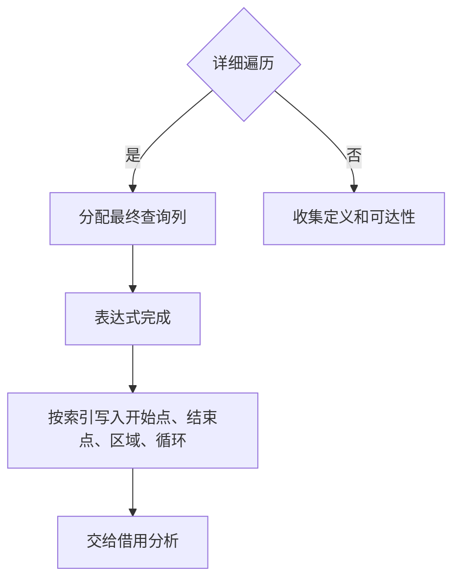

# 所有权程序点直接写入

## Intent

降低 zxc 推导借用结束点时的内存和遍历成本。调用者继续使用普通 ZX 值，编译器按原规则判断借用结束和原地复用。

## Data

Morphic §3.4 用程序点描述借用的有效期，§5.1 用函数摘要表示输入与返回值的联系。MVS §4.4 通过访问路径判断冲突，Perceus §2.2 和 §2.4 将最后使用与独占复用关联起来。zxc 已实现相关的跨调用、字段投影和最后观察分析。三篇论文的实验分别依赖各自的语言语义及基线。[论文原文与既有实现](../所有权推导论文.md)

He 等在 OOPSLA 2026 讨论了按可达性区分短期分配和跨作用域数据。§3.2 和 §3.4 给出成批跟踪与释放的条件，§7 说明该系统依赖显式作用域，自动推断和实验实现仍有待研究。这里借用同一个判断原则，先确定遍历结束后还有哪些数据被消费，再让遍历直接构造这些数据。[When Lifetimes Liberate](https://doi.org/10.1145/3798254)

原实现每完成一个表达式就在增长数组追加节点 ID、开始点、结束点、区域及循环。遍历结束后按 ID 散写到四个最终查询列。表达式索引和列长度从进入遍历时就已知。生成的 Zig 在原完成事件内调用 `zxReserve`，构造五字段记录，之后再读取这份记录。

## Edges

详细遍历进入时分配最终四列。每个表达式依原顺序发出一次完成事件，在事件内写入自己的索引。初始哨兵、不可达表达式、分支和循环的求值顺序保持一致。只需要定义和可达性的流分析走轻量遍历，四列为空且没有完成事件。缓存键和布局保持原有契约。

## Answer

Source 在 `order/walk.zx` 的完成事件中直接写最终程序点列，RX 归集最终结果。生成 Zig 的四个写入均就地更新已持有缓冲。原来的节点记录、扩容和列转换从正式编译路径移除。[遍历实现](../../packages/genz/src/analysis/uniqueness/order/walk.zx) · [RX 编排](../../packages/genz/src/analysis/uniqueness/order/build.rx)

### 生成代码与行为

每个已完成表达式原先写入一条由五个 `u32` 组成的 20 B 记录，扩容时可能复制此前的记录。修改后直接写四个最终列中的对应位置，省掉完整的临时数组及其转换遍历。四列本身在两个版本都存在。生成 Zig 中四处写入直接使用已持有切片的底层存储。轻量遍历的四个空列不申请元素存储。

Source 引导构建通过 25 个步骤。冻结的 735 入口清单生成的 11,753 个文件与上一代逐字节一致，排除工具身份戳。v18 所有权缓存正文的 SHA-256 仍为 `cdf9fa7e0f33002a95dc097b2837de781d67e6e519a452fb97f89f7c0bbf3a23`。热重建等于各自的冷生成。六个入口在常驻进程中完成首次生成、修改索引、删除调用和恢复源码，每次各产出 22 个与独立冷生成相同的文件。初始引导器与候选对初始状态生成的 22 个文件一致。

七组现有回归通过 290 个构建步骤和 635 项检查，覆盖函数分析及执行、缓存、字段效果、所有权契约、对象追加和聚合循环。

复用跨调用借用的六入口分配对照。与引入多次转交推导以前相比，候选在连续转交、两条视图均已读取和嵌套读取三种情况下，均从两次分配、160 B 降为一次分配、80 B。晚读和外逃的分配及应用输出均符合原有契约。这些应用收益来自此前的借用推导，本阶段复核了它们。

### 性能

macOS arm64，Zig 0.17.0，ReleaseSmall，16 分区。上一代是 `c63008563`，候选由上一代引导。固定基线沿用引导声明准备阶段。三套工具均由 Source 引导，并在测量中执行 Source 分析和生成。关闭常驻，固定清单交错三轮取中位数。

| 指标                     |  固定基线 |    上一代 |      候选 |
| ------------------------ | --------: | --------: | --------: |
| 冷生成墙钟               |    2.85 s |    2.57 s |    2.58 s |
| 冷生成 CPU               |   12.43 s |   12.16 s |   12.21 s |
| 冷生成进程树采样峰值 RSS | 894.57 MB | 714.24 MB | 712.11 MB |
| 冷生成单进程系统峰值 RSS | 922.08 MB | 771.51 MB | 776.26 MB |
| 热重建墙钟               |    2.21 s |    1.98 s |    1.96 s |
| 热重建 CPU               |    8.47 s |    8.24 s |    8.26 s |
| 无改动墙钟               |    0.04 s |    0.03 s |    0.03 s |

相对上一代，冷生成墙钟增加 0.01 秒、CPU 增加 0.05 秒，进程树采样峰值下降 2.13 MB，单进程系统峰值上升 4.75 MB。相对固定基线，冷生成墙钟减少 0.27 秒、CPU 减少 0.22 秒，两种峰值分别减少 182.45 MB 和 145.82 MB。候选首轮冷生成墙钟 5.20 秒，CPU 12.21 秒，后两轮墙钟均为 2.58 秒。

补查上一阶段的峰值时，两个工具的冷生成物理内存峰值均出现在首个输出目录被观察到以前。三轮物理内存采样峰值中位数为 709.25 → 711.76 MB。采样只能把峰值限制在写出前，无法区分发射后期和写出准备。该路径关闭常驻，未录制所有权回放访问日志。

### 自我审查

移除的是编译器内部的临时记录。输出一致性也表明本次优化保持现有应用的借用和复用行为。进程内其他阶段仍同时活跃，两个 RSS 口径方向不同，整轮峰值改善缺少清晰信号。数据覆盖 zxc 分析、发射和文件写出。完整冷构建的 Zig/LLVM 峰值与同负载 Rust 对照没有计入。
