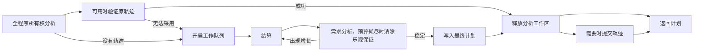
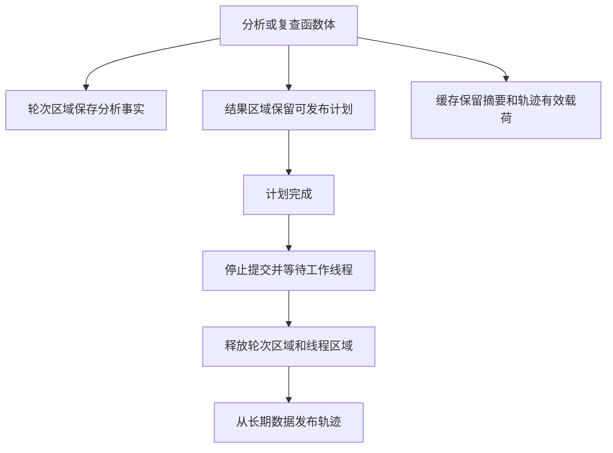

# 所有权程序轮次与计划发布自举

## Intent

由 Source 调度全程序所有权分析的回放、常规求解、预算耗尽后的需求分析、计划发布和轨迹提交。计划和轨迹保留自己的数据，轮次工作区在最后一次使用后释放。

## Data

正式程序分析进入 `Context.run`。原 RX 只选下一个分析阶段。开启工作队列、传递预算耗尽、轮次结束时停止预取及释放工作区等决定由宿主作出。常规计划与快捷回放都会先初始化整张计划表，再覆盖已经分析过的行。

## Edges

结算预算耗尽时，出队及已发布反馈保持原有顺序。此次不访问出队函数，也不再提交会随轮次结束而作废的预取。普通访问按本轮实时的轨迹状态决定是否预取。上一访问的变更记录在队列推进完成后才允许重用。

常规计划队列包含全部活跃编号。快捷回放发布前已验证每个活跃编号拥有对应的计划。两条路径都在返回前写入所有活跃行。默认的独立入口单独初始化。结果及轨迹中的有效载荷持有长期分配器，允许释放轮次数据后再提交轨迹。

## Answer

RX 选择开启、结算、普通或保守需求分析、计划、释放、提交及返回等步骤。工作队列选择接受访问及预取。常规分析和快捷回放共用 Source 计划表初始化，只对不由正式访问写入的函数行写默认值。快捷回放的候选替换记录也在复查结束时释放。

[程序调度](../../packages/genz/src/analysis/uniqueness/program/run.rx) · [队列推进](../../packages/genz/src/analysis/uniqueness/work/round/advance.rx) · [计划存储](../../packages/genz/src/analysis/uniqueness/program/visit/initialize.zx) · [宿主工作区](../../packages/genz/src/zx/uniqueness/program/host.zig)

### 一致性与性能

Source 引导构建通过 25 步，初始种子构建通过 14 步。固定 735 入口的 11,753 个生成文件与上一代逐字节一致，排除工具身份戳。v18 所有权缓存正文也一致，SHA-256 为 `cdf9fa7e0f33002a95dc097b2837de781d67e6e519a452fb97f89f7c0bbf3a23`。初始种子与候选在六入口清单上的 22 个文件一致，该清单的初次生成、修改读取位置、修改调用关系和恢复也分别与独立冷生成一致。

直接调用生成的入口验证预算耗尽仍按序处理队首、终止时不提交预取、回放时不提交预取，以及普通分析和回放的发布次序。另用混合活跃与不活跃编号核对计划表的边界及默认行。三组临时核验均通过。

八组现有回归通过 312 个构建步骤和 681 项检查，覆盖所有权契约、缓存、函数分析、字段效果、数组与对象更新，以及公开库的链接和执行。

macOS arm64，Zig 0.17.0，ReleaseSmall，16 分区。候选由 `656688cb4` 的 Source 引导器生成。固定基线沿用引导声明准备阶段。三套工具均经过 Source 引导，并执行 Source 分析与生成。关闭常驻，同一冻结清单交错三轮，取中位数。RSS 使用十进制 MB。

| 指标                     |  固定基线 |    上一代 |      候选 |
| ------------------------ | --------: | --------: | --------: |
| 冷生成墙钟               |    2.77 s |    2.54 s |    2.48 s |
| 冷生成 CPU               |   12.23 s |   12.13 s |   11.99 s |
| 冷生成进程树采样峰值 RSS | 885.96 MB | 712.61 MB | 712.16 MB |
| 冷生成单进程系统峰值 RSS | 960.17 MB | 755.92 MB | 772.90 MB |
| 热重建墙钟               |    2.19 s |    1.92 s |    1.95 s |
| 热重建 CPU               |    8.33 s |    8.14 s |    8.19 s |
| 无改动墙钟               |    0.04 s |    0.03 s |    0.03 s |

较上一代，冷生成墙钟和 CPU 分别下降 0.06 秒和 0.14 秒，进程树采样峰值下降 0.44 MB。单进程系统峰值中位数上升 16.97 MB。上一代三轮范围为 738.98–799.34 MB，候选为 731.38–801.96 MB。较固定基线，冷生成墙钟和 CPU 分别减少 0.29 秒和 0.24 秒。

### 自我审查

正式路径仍由宿主执行线程、分配器和 ABI 访问。Source 决定这些操作的调用次序。计划表的默认行依赖原有的活跃编号约定和完整发布条件，因此失败时直接退出并由所属区域清理，返回时才将已发布行交给调用者。

轮次释放的收益来自两个内存区域的生命周期不再重叠。上表记录整段分析及 Zig 输出，未独立测量常驻轨迹提交节省的峰值。完整 Zig/LLVM 冷构建也不在这组测量范围内。
