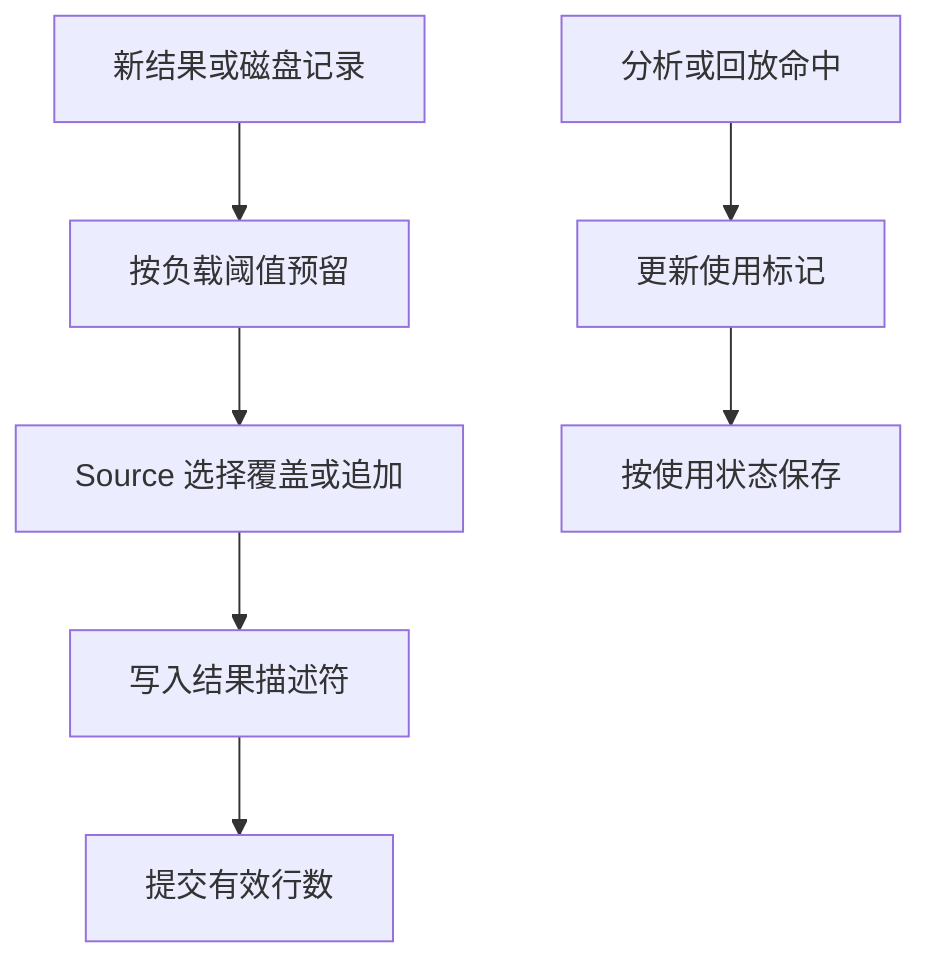

# 所有权缓存表状态自举

## Intent

让所有权缓存的常规写入、磁盘加载、扩容与使用标记采用同一套 Source 表规则。

## Data

正式缓存使用稳定的连续键值行与独立的摘要桶。磁盘加载已在 Source 中安装记录，常规写入仍由 Zig 选择覆盖或追加、调整长度。扩容顺序与使用标记也由宿主管理。缓存正文按实际使用情况筛选记录。

## Edges

行号稳定。扩容保留已发布的键值前缀，临时桶完成重建后才替换旧桶。容量分配失败保留已有记录和索引，后续可继续使用或重试。复制限于键和有类型的行描述符，结果引用的载荷继续归原有持有者。

## Answer

核对常规写入与磁盘回放，验证重复键、命中标记、扩容失败重试及桶重建。比较固定清单的字节与性能，保留复现配置。

### 实现

- 常规分析结果与磁盘记录共用 Source 的槽位选择和前缀提交逻辑。重复摘要覆盖原行，新摘要才递增计数。宿主借出同一形态的键、桶和长度视图，直接接收 Source 写入的行描述符。[普通发布](../../packages/genz/src/analysis/uniqueness/memo/table/publish.zx) · [位置选择](../../packages/genz/src/analysis/uniqueness/memo/table/claim.zx) · [视图绑定](../../packages/genz/src/zx/uniqueness/memo/table/publication.zig)
- Source 计算容量、预留键值行、分配新桶，再按原键顺序重建索引。定长扩容复用内部行缓冲的重映射操作，需换址时只复制已提交的行。只有 Source 成功返回才替换旧桶，宿主同步键值缓冲地址与容量。[扩容编排](../../packages/genz/src/analysis/uniqueness/memo/table/reserve.rx) · [定长扩容原语](../../packages/core/src/memory/write_column.zig) · [宿主适配](../../packages/genz/src/zx/uniqueness/memo/table/reserve.zig)
- 普通命中和回放命中通过 Source 标记记录，供下一次加载使用。磁盘保存前判断是否还有未用行，也由 Source 读取用量列。只读的查找和推测查询保持原有使用标志。[命中标记](../../packages/genz/src/analysis/uniqueness/memo/table/touch.zx) · [未使用记录检查](../../packages/genz/src/analysis/uniqueness/memo/table/unused.zx)

### 正确性

修订后的 Source 引导构建完成 25 步，初始 Zig 引导器完成 14 步。六入口清单经过首次生成、改动读索引、去掉调用及恢复。两代工具每种状态的 22 个输出均与对应的独立冷生成一致。初始 Zig 引导器与修订后的候选对未编辑清单的 22 个生成文件一致。

通过正式缓存表逐个注入键容量、值容量和新桶分配失败。每种失败都保留已发布行、有效行数和旧索引，随后重试能完成。复查哈希冲突的数据维持插入行号，重复键可在已预留空间内更新，超过 u32 的容量请求按分配失败处理。所有分配在析构后均已回收。使用标记与 v18 的保存、加载和再次保存也已核对。

固定清单中，735 个入口的 11,753 个生成文件与上一代逐字节一致，排除工具身份戳。热重建与各自冷生成一致。v18 缓存正文 SHA-256 为 `cdf9fa7e0f33002a95dc097b2837de781d67e6e519a452fb97f89f7c0bbf3a23`，两代正文完全一致。

既有八组回归完成 298 个构建步骤，661 项测试全部通过。覆盖函数分析及其运行时、缓存所有权、字段事实、所有权契约、对象追加、聚合循环和编译库初始化器。触发初版泄漏的已有用例在修订版通过。

### 性能

macOS arm64，Zig 0.17.0，ReleaseSmall，16 分区，关闭常驻。候选由 `3198c0ff5` 生成。三套工具均执行 Source 分析与生成。固定基线复用本阶段最初按同配置采集的三个样本。修订后的候选与上一代用同一 735 入口清单交错测量三轮。

| 指标                     |  固定基线 |    上一代 |      候选 |
| ------------------------ | --------: | --------: | --------: |
| 冷生成墙钟               |    2.84 s |    2.56 s |    2.59 s |
| 冷生成 CPU               |   12.37 s |   12.19 s |   12.23 s |
| 冷生成进程树采样峰值 RSS | 895.94 MB | 711.72 MB | 714.98 MB |
| 冷生成单进程系统峰值 RSS | 921.24 MB | 743.34 MB | 764.81 MB |
| 热重建墙钟               |    2.23 s |    1.97 s |    1.97 s |
| 热重建 CPU               |    8.42 s |    8.26 s |    8.26 s |
| 无改动墙钟               |    0.04 s |    0.03 s |    0.03 s |

补测四对冷生成后合并七轮。墙钟从 2.57 秒变为 2.58 秒，CPU 从 12.16 秒变为 12.17 秒。进程树峰值从 700.79 MB 变为 714.18 MB，单进程峰值中位数从 738.21 MB 变为 764.81 MB。两代单进程峰值区间分别为 730.09～779.58 MB 和 738.02～795.12 MB。相比固定基线，候选冷生成快 0.26 秒，CPU 少 0.20 秒，进程树峰值低 181.76 MB。

用 18,547 次缓存表写入单独核对扩容账目。强制走换址复制，在每次写入后与上一代的定长数组扩容实现比较两组行容量、桶数、已分配和已释放字节。两者的累计分配均为 4,874,720 字节，结束时保留 2,437,904 字节。单项结果解释了缓存表扩容的分配成本，整进程冷生成的峰值差仍待定位。

### 自我审查

初版将容量对象从 RX 的一个步骤传到下一个步骤。生成器为这个对象分配了 16 字节，故障注入观察到分配未回收。修订后，分配函数只将上限值交给 RX，重建从已分配的桶读取实际容量。生成的分配入口只在栈上构造尺寸记录，正式缓存表的故障注入检查通过。

Zig 仍管理分配器和有类型的键值缓冲，发布过程同步有效长度。宿主以已提交的容量上限作快速检查。需要扩容时，Source 决定新尺寸、分配次序和重建范围。测试的开销覆盖 zxc 分析、生成与写出。
