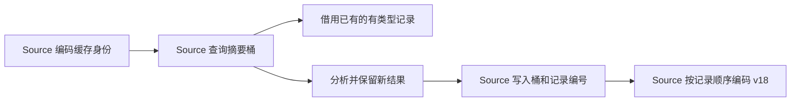
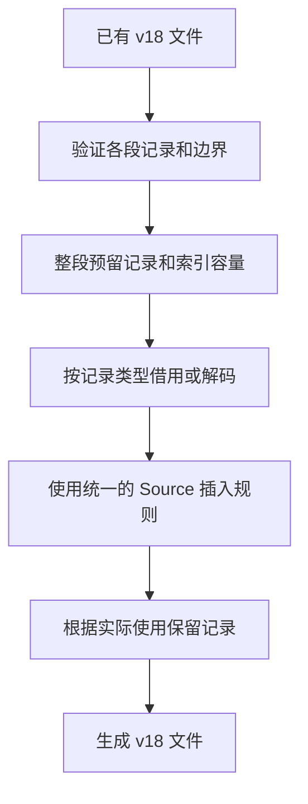

# 所有权缓存记录索引自举

## Intent

将所有权缓存的查找、插入、索引重建及磁盘记录遍历迁入 ZX。结算、需求、计划和调用流向共用固定宽度摘要索引。

## Data

正式的程序分析、回放及工作线程通过 `Memo` 查找四类结果。已有 Source 编码查询身份和磁盘记录，Zig 哈希表仍管理键、桶及结果。写盘为读取条目借用了 Zig 标准库哈希表的占用字节和桶顺序。缓存身份已经是 SHA-256，摘要前缀可以直接定位首桶，键相等继续比较完整摘要。

## Edges

四类结果各有独立的索引和连续记录。宿主管理有类型的缓冲和分配器，完成容量预留后才允许索引发布新记录。扩容保留旧记录编号。流向分析的并行查询只读，层结束后再写入。磁盘仍在加载边界完整校验；记录顺序调整为插入顺序，缓存语义通过解码后的键值对比较。

## Answer

正式 `Memo` 路径统一使用 Source 查找与插入。常规分析、回放复查、流向缓存及磁盘加载都共享同一索引。每个桶只存记录编号，摘要与结果分别连续存放。重建索引只改写桶，记录编号保持稳定。磁盘写出直接遍历连续记录，省去 Zig 标准库占用标记和空桶扫描。

宿主管理键、值、桶的物理缓冲及载荷 arena。正式路径的索引缓冲由该 arena 的上一级分配器直接管理，扩容和销毁时释放缓冲。记录载荷仍由 arena 保留。初始种子保留原来的哈希表。

### 正确性和磁盘兼容

Source 候选引导构建通过 25 步，初始种子引导构建通过 14 步。两种引导器生成的 21 个补充清单文件逐字节一致。冻结的 735 入口在两代 Source 工具下生成的 11,753 个文件逐字节一致，排除工具身份戳。生成清单 SHA-256 为 `7248304214a4e61487c037e6ebc0017ce4f9adb96d7071e985dc963a8c43dc4b`。热重建分别与各自的冷生成一致。

固定清单上的 v18 文件分别解码并按完整摘要比较。18,547 条结算、4,983 条需求和 4,371 条计划的键和载荷均逐字节一致。本清单中的流向表为空。五入口补充清单的四类记录分别为 29、14、8、8 条，键和载荷同样一致。用目标工具的缓存信封装载另一代工具的 v18 正文，两代均复用该记录，保留文件未被重写，21 个生成文件均与各自的冷生成一致。常驻工具对共享读取函数修改和恢复的两个状态也与独立冷生成一致。

函数分析与执行、所有权缓存、字段事实、模块生成和调用借用视图六组回归全部通过，共 167 个构建步骤和 277 项测试。

### 性能

macOS arm64、Zig 0.17.0、ReleaseSmall、16 分区，关闭常驻。三套工具均由 Source 引导，执行 Source 分析和 Zig 生成。候选由 `81e602941` 引导。固定基线沿用引导声明准备阶段。735 个入口按三轮交错中位数比较。

| 指标                 |  固定基线 |    上一代 |      候选 |
| -------------------- | --------: | --------: | --------: |
| 冷生成墙钟           |    2.83 s |    2.56 s |    2.58 s |
| 冷生成 CPU           |   12.42 s |   12.16 s |   12.19 s |
| 冷生成进程树采样峰值 | 895.99 MB | 714.80 MB | 700.58 MB |
| 冷生成单进程系统峰值 | 930.27 MB | 785.65 MB | 747.45 MB |
| 热重建墙钟           |    2.22 s |    1.97 s |    1.98 s |
| 热重建 CPU           |    8.43 s |    8.22 s |    8.21 s |
| 无改动墙钟           |    0.04 s |    0.03 s |    0.03 s |

较上一代，冷生成墙钟和 CPU 分别增加 0.02 秒和 0.03 秒，进程树采样峰值下降 14.22 MB，单进程系统峰值下降 38.19 MB。相对固定基线，冷生成墙钟和 CPU 分别减少 0.25 秒和 0.23 秒，进程树采样峰值下降 195.41 MB。

### 自我审查

第一版把索引数组和结果载荷一起分配在 memo arena 中，冷生成进程树采样峰值较同组上一代增加 11.35 MB。索引通过独立的可释放存储配合统一扩容后，最终对照中的两个峰值均下降。系统峰值随后台环境波动，整进程差值无法全部归到索引分配。

v18 的记录次序由旧桶顺序改为插入顺序，按摘要比较内容可以核对两套布局。宿主仍管有类型的记录缓冲、实际值的拷贝和反序列化调用。本轮的计时覆盖生成和缓存路径，完整 Zig/LLVM 构建与阶段自编译闭包未包含在这组验证内。
