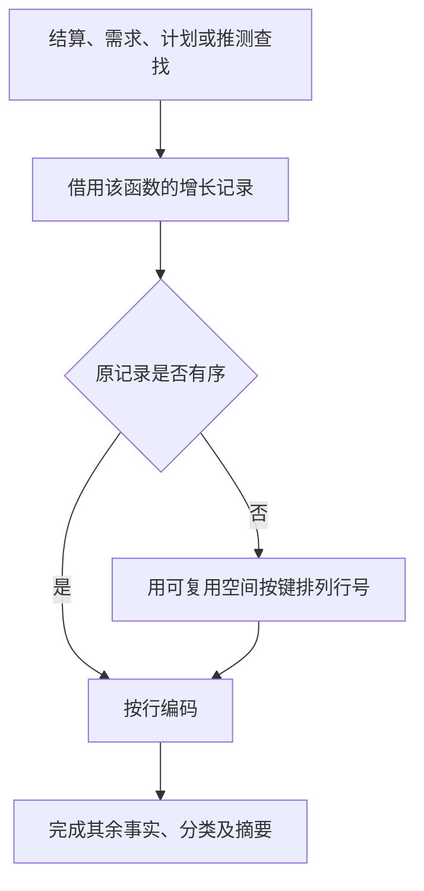
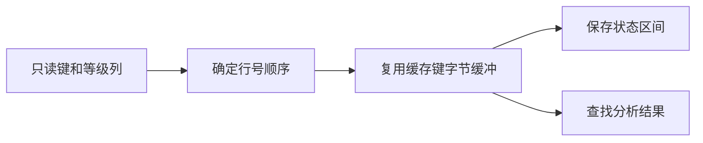

# 所有权缓存键增长记录自举

## Intent

迁移所有权缓存键的增长记录准备、排序和编码。让结算、需求、计划及推测查找共用原有格式与状态边界。

## Data

`Memo.keyed` 使用 Source 编码状态。编码前，Zig 为每个超过一行的增长记录组创建可写副本，以便按键排序。函数分析、后台需求和缓存回放继续读原记录。缓存键必须保持四字节或八字节小端键、低三位等级及原有记录分类。

## Edges

排序只操作行号。原行、已有缓存正文和分析中观察记录的顺序保持原有契约。两组记录顺序消费同一个工作空间，缓存释放时回收。键仍由小端字段构成，摘要和回放状态边界沿用现有格式。

## Answer

比较有序和乱序记录的键与原记录，核对可复用空间、首次引导与常驻缓存回放，在固定清单上集中测量。

### 实现

- 结算、需求、计划及只查询缓存的推测路径都使用同一个 Source 编码入口。宿主用与函数分析相同的列借用方法提供原始记录，去掉按组保存的 Zig 行副本。需求入口的输出需求行也由 Source 按函数编号选择。[编码入口](../../packages/genz/src/analysis/uniqueness/memo/encoding/key.rx) · [宿主适配](../../packages/genz/src/zx/uniqueness/memo/encoding.zig)
- 有序记录直接写入。乱序记录把行号装入同一个可复用的 u32 缓冲，以原始键为比较依据做堆排序。最大额外工作空间与单组行数成正比，排序保有 O(n log n) 上界，原行及其存储不发生变化。每组编码完成后才处理下一组。[增长记录编排](../../packages/genz/src/analysis/uniqueness/memo/encoding/growth/encode.rx) · [行号排序](../../packages/genz/src/analysis/uniqueness/memo/encoding/growth/arrange.zx)
- 已有的字节编码、记录分类及回放边界保持相同。缓存析构同时释放行号缓冲。源记录和行号缓冲分别由其已有持有者管理。

### 正确性

Source 引导构建完成 25 步，初始 Zig 引导器完成 14 步。固定 735 个入口的 11,753 个生成文件与上一代一致，排除工具身份戳。热重建与各自冷生成一致。两代的 v18 缓存正文 SHA-256 同为 `cdf9fa7e0f33002a95dc097b2837de781d67e6e519a452fb97f89f7c0bbf3a23`。

直接运行生成的生产编码器，逐字节与独立的排序和编码实现对照。覆盖三种缓存记录分类、零条到 4,096 条记录、窄键、超过 32 位的键、最大的 64 位键、等级高位、入口无输出需求以及正序和乱序。排序失败保留原记录，已有字节容量充足时，有序编码可在零容量分配器下完成，重复乱序编码复用已分配的行号空间。

同一六入口清单在常驻进程中经过首次生成、修改读索引、去掉被调函数、恢复四种状态。两个工具在每种状态的 22 个文件与对应独立冷生成一致。初始 Zig 引导器与候选对同一未编辑清单的 22 个文件一致。

既有七组回归完成 290 个构建步骤，635 项测试全部通过，覆盖函数分析及运行时、缓存所有权、字段事实、所有权契约、对象追加和聚合循环。

### 性能

macOS arm64，Zig 0.17.0，ReleaseSmall，16 分区。候选由 `41f598fde` 生成。三套工具都执行 Source 分析与生成，对相同 735 入口清单交错测量三轮，关闭常驻。表中为中位数。

| 指标                     |  固定基线 |    上一代 |      候选 |
| ------------------------ | --------: | --------: | --------: |
| 冷生成墙钟               |    2.84 s |    2.56 s |    2.58 s |
| 冷生成 CPU               |   12.46 s |   12.09 s |   12.15 s |
| 冷生成进程树采样峰值 RSS | 885.42 MB | 709.07 MB | 712.75 MB |
| 冷生成单进程系统峰值 RSS | 921.60 MB | 739.66 MB | 741.92 MB |
| 热重建墙钟               |    2.22 s |    1.96 s |    1.96 s |
| 热重建 CPU               |    8.45 s |    8.17 s |    8.21 s |
| 无改动墙钟               |    0.03 s |    0.03 s |    0.03 s |

较上一代，冷生成墙钟增加 0.02 秒，CPU 增加 0.06 秒，进程树峰值高 3.69 MB，单进程峰值高 2.26 MB。相对固定基线，墙钟低 0.26 秒，CPU 低 0.31 秒，进程树峰值低 172.67 MB。测量涵盖 zxc 分析、生成和写出。

### 自我审查

固定清单的缓存正文包含 4,983 条需求记录。其中窄键多行组有 75 组，36 组乱序，最大 12 行。宽键多行组有 77 组，12 组乱序，最大 8 行。这反映缓存中保留的记录组成。较大组由独立正确性对照覆盖。宿主仍提供通用整数缓冲和标准 SHA-256 实现，记录排序、编码与需求行选择由 Source 执行。
