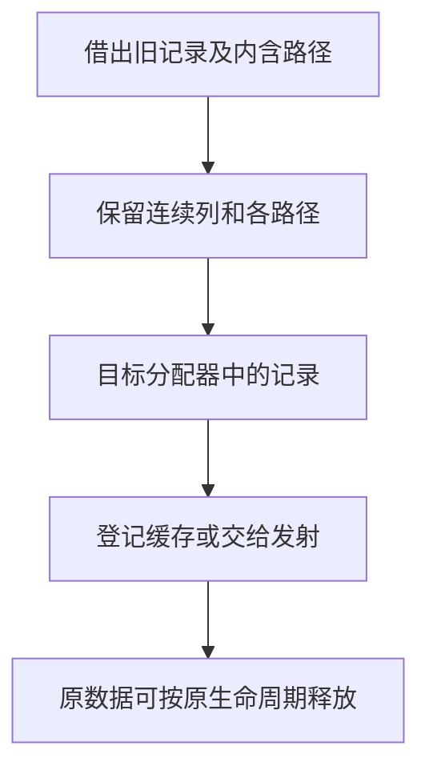

# 所有权记录跨生命周期保留自举

## Intent

在正式所有权分析和回放中，由 Source 决定结算、需求、流向、最终计划和访问记录跨生命周期时保留哪些数据。

## Data

主线程消化后台分析结果时，后台缓冲会随工作轮次结束而释放。memo 的计划也可能在发射或下一次分析前失效。正式路径此前仍由宿主复制需求标记、增长记录、最终计划与内含路径、流向结果和访问状态。结算的部分列已在 Source 保留。

## Edges

先保留数据，再发布记录。旧结果、拒绝回放和提前分析未被采用时沿用原访问顺序。复制发生在实际所有者不同时。保留路径持有自身的元素数据，由目标工作区承担生命周期。初始种子继续拥有独立的结果规则。

## Answer

结算由同一个 Source 入口保留贡献行、行内级别和输出级别。需求标记与两类增长记录共享对齐的行缓冲，整列按原布局复制。流向数组在 memo 的拥有者内生成。普通分析、后台分析和常驻快捷回放使用同一计划保留入口，连续复制标志、槽位、转移和更新键，并为需要保留的内部路径申请对应存储。访问状态及程序身份的保存沿用等长的字节复制。

### 正确性

Source 引导构建通过 25 步，初始引导构建通过 14 步。两个引导器对五个所有权入口生成的 21 个文件逐字节一致。

735 入口的固定清单在前后两代工具下生成的 11,753 个文件逐字节一致，排除工具身份戳。每套工具的暖重建都和各自的冷生成相同。v18 缓存正文的 SHA-256 均为 `1ade009f07ef878cacf5dba4c875266f536bac4c6e2c8f329aeb02d44d0ffd69`。五入口补充清单覆盖 29 条结算、14 条需求、8 条计划和 8 条流向记录。两代工具双向读取缓存正文后生成全部 21 个文件，记录文件保持原状。同一个被多个入口使用的函数修改和恢复后，常驻生成分别等于对应的冷生成。

函数分析与运行、所有权缓存、字段事实、模块生成和调用借用视图六组回归通过 167 个构建步骤及 277 项测试。

### 分配与阶段计时

直接把需求标记和增长记录作为 ZX 对象数组返回时，公开入口会把数组元素改为引用布局，不能再直接借用原来的连续记录。最终通过既有行缓冲传入字节和对齐，生成代码一次分配并成批复制。生成 Zig 中，计划的三个连续列对应三处 `@memcpy`，更新部分按键和路径复制，流向的三列各有一处 `@memcpy`。

macOS arm64、Zig 0.17.0、ReleaseSmall、16 分区、关闭常驻。三套工具均由 Source 引导并执行 Source 分析和 Zig 生成。候选由 `2542699a0` 引导。固定基线沿用引导声明准备阶段。735 个入口三轮交错取中位数。

| 指标                 |  固定基线 |    上一代 |      候选 |
| -------------------- | --------: | --------: | --------: |
| 冷生成墙钟           |    2.84 s |    2.56 s |    2.56 s |
| 冷生成 CPU           |   12.42 s |   12.15 s |   12.12 s |
| 冷生成进程树采样峰值 | 896.55 MB | 711.64 MB | 698.12 MB |
| 冷生成单进程系统峰值 | 976.54 MB | 761.33 MB | 801.73 MB |
| 热重建墙钟           |    2.24 s |    1.98 s |    1.98 s |
| 热重建 CPU           |    8.45 s |    8.23 s |    8.22 s |
| 无改动墙钟           |    0.04 s |    0.03 s |    0.03 s |

相较上一代，冷生成墙钟持平，CPU 下降 0.03 秒，进程树采样峰值降低 13.52 MB。相对固定基线，冷生成墙钟减少 0.28 秒、CPU 减少 0.30 秒、进程树采样峰值减少 198.43 MB。

首组单进程系统峰值增加 40.40 MB。回归退出后用同一清单额外执行三组交错冷生成，每约 2 毫秒采样同一进程的 RSS 和物理内存，减少短峰漏采。RSS 峰值中位数为 730.64 → 726.24 MB，物理内存采样峰值为 725.32 → 720.90 MB，系统记录峰值为 755.83 → 733.15 MB。首组上升未在这次采样中复现。

### 自我审查

连续向量使用现有的 ZX 数组拼接，生成的缓冲仍有增长头与容量舍入。标量记录改用精确长度的已对齐行缓冲。程序级工作队列和缓存提交仍由宿主推进。本次对照覆盖所有权分析和生成，实际 Zig/LLVM 完整冷构建及引导阶段闭包需要各自的验证。
