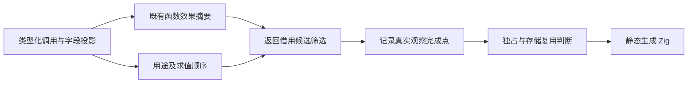
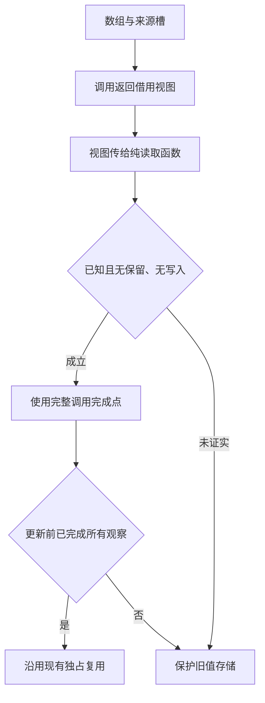

# 所有权论文与跨调用借用结束

## Intent

让 ZX 调用者继续使用普通的值、字段与函数调用，由编译器推导借用何时结束。先修复一个能在生成代码中复现的跨调用复制，再用实际分配计数和固定生成清单衡量收益与编译代价。

## Data

### 三篇论文与 ZX 的差异

- **Morphic 的借用和生命周期推导。** §3 将程序点的先后关系用于检查借用是否仍活跃。§5.1 在函数边界使用生命周期变量的并集，保留返回分量对输入的依赖，递归调用用不动点求解。§6.2 解释了按借用模式特化能保持模块内推导精度，以及合并行为相同变体的空间。其形式化核心只处理共享借用。推导会插入引用计数操作来补足无法静态借用的场景，论文将生成程序的健全性与推导完备性明确区分。§7 的 75%～100% 指有引用计数增量的基准中消除的增量比例，1.48 倍是相对未启用存储复用的 Perceus 式基线的几何平均加速。 [论文原文](../fully_automatic_borrow_inference.pdf)
- **MVS 的值独立性与路径借用。** §3、§4.4 对 Swiftlet 的 `inout` 路径证明不重叠，路径包含关系或无法静态区分的索引限制原地更新。其独立值模型让编译器把固定尺寸结构放在栈上，借用只在调用边界隐式形成。实现以写时复制维持动态容器的独立值语义。ZX 已有按槽范围表示字段与子对象的用途，可以直接沿用这一证明边界，在源码中保持当前不可变接口。 [论文原文](../mutable_value_semantics.pdf)
- **Perceus 的最后使用与复用。** §2.2 从显式控制流放置精确释放，§2.4 将释放与就地重建联系起来，§2.5 消除保持相同的字段写入。其 Koka 实现可以在运行时用引用计数确认独占。ZX 采用对应的静态条件：候选存储仍归来源所有，所有观察已结束，没有逃逸或重叠，更新因而可以复用该存储。这个条件由 genz 已有的顺序与独占证明承担。 [论文原文](../perceus.pdf)

Morphic 的内部生命周期变量适合说明跨函数的来源依赖，MVS 的路径独占说明哪些子对象应隔离，Perceus 的最后使用点说明何时允许更新。ZX 可以把这些事实限定在编译器内部。实测目标是同样的输入与结果下省去具体的分配或数据复制，保持静态生成 Zig 和无指针、无生命周期标注的用户接口。

### 现有实现与复现

前端所有权检查负责值的使用和迁移合法性。genz 再用 `held`、`written` 与 `return_only` 摘要、投影槽及用途完成点，决定生成借用、转移，还是为旧值保留独立存储。上一阶段已能在索引读取结束后恢复来源复用，见[借用观察完成点与来源复用](../2026-11-08/借用观察完成点与来源复用.md)。

基线 `e53918752` 对 `const value = view[0]` 会生成原地 `reverse`，对 `const value = read(view)` 会调用 `zxReserve` 为 `reverse` 另配缓冲区。两者的 `view` 都由纯函数从同一数组返回，`read` 只取第一个标量。根因是返回借用结果的用途检查遇到任意 Call 就拒绝结束借用，即使函数摘要已证明该调用只读且没有保留输入。

## Edges

原借用必须具有已知的返回来源，结果用途必须全是已解析的观察。作为观察的后续函数调用还必须有完整效果摘要，无参数写入、无返回借用、无外部保留。观察位置记录完整调用的结束时间，包括其所有操作数的求值。若后续更新可能早于观察完成，则由既有检查继续保护旧值。Store、Task、并行捕获及未知原生调用保持原有边界。

`borrow_only` 与 `Role.observe` 的交集提供这项证明。`Role.observe` 也可能来自结果被弃用的返回借用，因而需要检查函数原始效果。候选沿用既有的槽映射与完成时间规则。只在原本会拒绝的调用用途上查两列已计算的摘要，无需再扫描调用图、维护新的生命周期表或给生成程序加入引用计数。

## Answer

正式 Source 规则写在 genz 的 `borrow_uses/eligible.zx`，初始引导规则同步。缓存程序身份升到 v17，让新规则重新计算持久用途与独占结果。

### 运行结果

`read(view)` 后的普通和 State 两种生成路径都在只读调用结束后原地执行 `reverse`。
两种路径的输出对照均通过。State 路径使用计数分配器，记录以下分配次数和申请字节，包含后续的 `push`：

| 用法                        |       修改前 |       修改后 |
| --------------------------- | -----------: | -----------: |
| 先读 `view[0]`，再更新      |  1 次 / 80 B |  1 次 / 80 B |
| 先调用 `read(view)`，再更新 | 2 次 / 160 B |  1 次 / 80 B |
| 先更新，再调用 `read(view)` | 2 次 / 160 B | 2 次 / 160 B |

延后读取、同次调用的操作数内更新、旧视图仍活跃的样本保留原来的生成代码和结果。
现有七组回归通过 299 个构建步骤和 865 项检查，包含生命周期、不可变列表、缓存、值返回、
嵌套缓冲区及原生借用。生命周期原型的 416,710 次具体存储比较也通过。Source 引导器构建通过
25 个步骤，初始引导器构建通过 14 个步骤，两者对六个相关入口生成的 25 个文件逐字节一致，
比较时排除工具身份戳。

### 生成器成本

以下为 macOS arm64、Zig 0.17.0、ReleaseSmall、16 分区的三轮交错中位数。三套工具通过 Source
引导且执行 Source 分析与生成。上一代为 `7c9b225c3` 的 Source 引导器，候选由该引导器生成。
固定基线沿用引导声明准备阶段。三者使用同一冻结清单，包含 735 个入口，关闭常驻。

| 指标                 |  固定基线 |    上一代 |      候选 |
| -------------------- | --------: | --------: | --------: |
| 冷生成墙钟           |    2.88 s |    2.61 s |    2.62 s |
| 冷生成 CPU           |   12.47 s |   12.22 s |   12.25 s |
| 冷生成进程树采样峰值 | 885.74 MB | 696.01 MB | 715.36 MB |
| 冷生成单进程系统峰值 | 933.61 MB | 787.68 MB | 756.04 MB |
| 热重建墙钟           |    2.25 s |    2.02 s |    2.03 s |
| 热重建 CPU           |    8.50 s |    8.33 s |    8.28 s |
| 无改动墙钟           |    0.04 s |    0.03 s |    0.03 s |

相对上一代，冷生成墙钟增加 0.01 秒、CPU 增加 0.03 秒，累计分别减少 0.26 秒和 0.22 秒。
进程树采样峰值较上一代增加 19.35 MB，仍低于固定基线 170.38 MB，单进程系统峰值较上一代减少
31.64 MB。两种峰值的采集口径不同，分别记录。相邻两代的 11,758 个输出文件逐字节一致，
排除工具身份戳。每套工具的暖缓存重建结果等于各自的冷生成结果。本组计时覆盖分析及 Zig 写出。

### 自我审查

本阶段只接受整项函数摘要都能证明不保留、不写入的读取调用。某个返回字段是否仍引用特定输入槽，
仍需更精细的来源摘要；贸然放宽会把活视图和未知逃逸错误地提前释放。当前实测覆盖具体程序的分配、
复制、输出及 Source 生成开销。完整冷构建的 Zig/LLVM 峰值与同负载 Rust 对照尚未测量。
