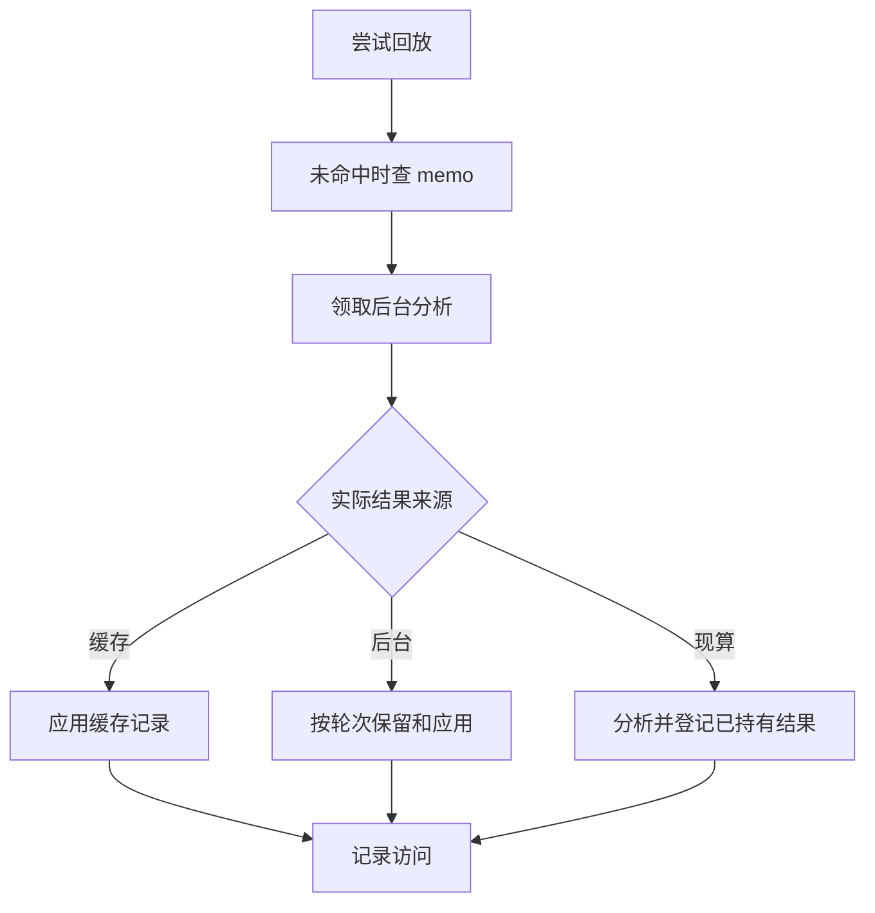

# 所有权访问流程静态自举

## Intent

把所有权分析每次访问的读取、应用和发布顺序迁入 Source，覆盖结算、需求传播和最终计划。分配器、借用列及线程适配继续由宿主提供。

## Data

Source 已负责选择缓存、后台分析或现算结果，并有独立的摘要和增长写回入口。正式轮次此前仍由三段 Zig 流程决定何时回放、何时读取 memo、是否领取后台工作的结果、何时发布以及哪个计划需要留给发射。结算必须先保留后台数据再应用摘要，需求必须先应用增长和摘要再登记结果。[已有结果采用规则](所有权函数访问结果采用自举.md)

## Edges

回放命中时可跳过同次 memo 查找。后台工作始终需要领取，以保持锁、等待和失败行为。缓存和后台需求仍沿已有 RX 次序写入增长记录和摘要。临时计划直接使用发射分配器，有持久记录的计划先从 memo 所用分配器构造，再为发射保留必要载荷。计划在原有位置复用运行工作区。初始种子独立执行原访问顺序。

## Answer

访问步骤使用现有的 `staticSequence` 在构建引导器时展开，执行期间没有指令数组解释或每步间接调用。运行时采用现有的结果选择规则。Zig 侧的每个动作提供原分析、写入或分配接口，跟踪变量只保存同次访问的结果和借用。

[读取及摘要流程](../../packages/genz/src/analysis/uniqueness/program/visit/sequence.rx) · [计划流程](../../packages/genz/src/analysis/uniqueness/program/visit/plan_steps.rx) · [宿主接线](../../packages/genz/src/zx/uniqueness/program/visits.zig)

### 结果一致性

Source 引导构建通过 25 步。冻结的 735 入口清单与上一代生成的 11,753 个文件逐字节一致，排除工具身份戳。热重建与各自的冷生成相同，v18 所有权缓存正文的 SHA-256 均为 `cdf9fa7e0f33002a95dc097b2837de781d67e6e519a452fb97f89f7c0bbf3a23`。

常驻六入口清单覆盖首次生成、修改索引、删除调用和恢复。两代工具在每个状态各生成 22 个与独立冷生成相同的文件。恢复已有输入时继续复用保留的分析。初始种子构建通过 14 步，种子与候选在初始状态生成的 22 个文件逐字节一致。七组既有回归完成 290 个构建步骤，635 项检查通过，覆盖函数分析、运行、缓存和所有权契约、字段效果、聚合循环及对象追加。

### 性能

macOS arm64，Zig 0.17.0，ReleaseSmall，16 分区。候选由 `69bd58fef` 引导，固定基线沿用引导声明准备阶段。三套工具都由 Source 引导，运行时执行 Source 分析与生成。关闭常驻，735 入口交错三轮取中位数。

| 指标                     |  固定基线 |    上一代 |      候选 |
| ------------------------ | --------: | --------: | --------: |
| 冷生成墙钟               |    2.84 s |    2.56 s |    2.57 s |
| 冷生成 CPU               |   12.46 s |   12.17 s |   12.18 s |
| 冷生成进程树采样峰值 RSS | 884.31 MB | 703.20 MB | 700.17 MB |
| 冷生成单进程系统峰值 RSS | 920.76 MB | 757.04 MB | 734.87 MB |
| 热重建墙钟               |    2.22 s |    1.97 s |    1.97 s |
| 热重建 CPU               |    8.47 s |    8.23 s |    8.29 s |
| 无改动墙钟               |    0.04 s |    0.03 s |    0.03 s |

冷生成墙钟和 CPU 较上一代各增加 0.01 秒，进程树及单进程峰值分别下降 3.03 MB 和 22.17 MB。相对固定基线，冷生成墙钟和 CPU 分别下降 0.27 秒和 0.28 秒，进程树峰值下降 184.14 MB。候选首轮冷生成墙钟为 3.79 秒，随后两轮分别为 2.56 和 2.57 秒。首轮推导、发射和写出分别耗时 1.113、0.847、0.325 秒，与上一代首轮的 1.117、0.845、0.328 秒接近。额外墙钟落在这三个计时区间之外。

### 自我审查

迁移的是三类访问的实际读取、分析、应用和发布次序。线程等待、内存借用适配、原子分析调用以及外层轮次调度由 Zig 继续接线。测量覆盖正式生成的 CPU、墙钟与内存，未对单种访问来源独立计时，也未测量完整 Zig 后端冷构建。
