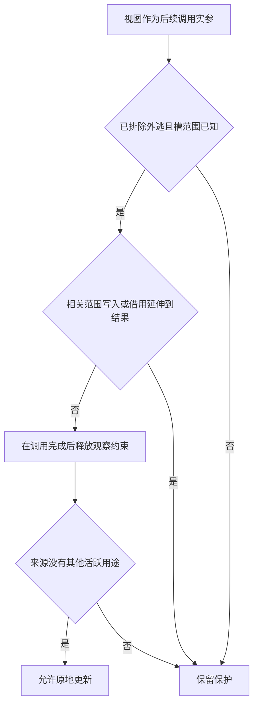

# 按字段写入效果结束跨调用借用

## Intent

调用可以读一个数组视图，同时更新另一份数组。让编译器在相关借用最后一次观察结束后复用原存储，沿用普通 ZX 值和函数调用。分别验证创建借用与读取借用的两种调用边界。

## Data

Morphic 用结果类型记录借用来源，在生命周期允许的最早位置释放。MVS 用访问路径判断重叠。Perceus 利用最后一次使用与独占性复用存储。
[Morphic §5.1 和 §6.3](../fully_automatic_borrow_inference.pdf) · [MVS §3 和 §4.4](../mutable_value_semantics.pdf) · [Perceus §2.2 和 §2.4](../perceus.pdf)

ZX 的摘要已经按输入槽记录返回保留和可能写入，视图用途也能映射到实参槽的区间。原判断在区间查询之前检查整个函数是否有写入，独立字段的写入因此阻止来源复用。

## Edges

沿用原有逃逸资格与已知槽范围。返回借用要求当前范围有保留且没有写入。后续调用能够结束借用时，相关用途无保留、无写入。若整项函数只读且结果已弃用，沿用原来的观察判定。一个来源出现在多个槽时检查所有用途。当前规则按已知的字段范围做静态判断，继续用调用结束点涵盖所有操作数的求值。

## Answer

Source 在识别返回借用和识别后续观察两处复用同一字段范围查询。生成器沿用原来的用途顺序和独占判断。初始 seed 同步规则。所有权程序缓存身份升到 v19，旧结果由新规则重新计算。
[返回借用候选筛选](../../packages/genz/src/analysis/uniqueness/sites/borrow_uses/eligible.zx) · [后续观察判定](../../packages/genz/src/analysis/uniqueness/sites/borrow_uses/observes.zx)

### 生成代码和应用分配

对照工具为 `3debc7cb8` 的 Source 引导器，候选由对照工具生成。五个入口分别使用计数分配器和 Arena 执行。计数覆盖数组构造、调用中另一字段的反转、原数组反转和后续追加。

| 场景                                 |       修改前 |       修改后 |
| ------------------------------------ | -----------: | -----------: |
| 返回视图的函数更新独立字段           | 3 次 / 240 B | 2 次 / 160 B |
| 读取视图的函数更新独立字段           | 3 次 / 240 B | 2 次 / 160 B |
| 先更新来源，再调用读取视图           | 3 次 / 240 B | 3 次 / 240 B |
| 返回视图和更新实参共享同一来源       | 3 次 / 240 B | 3 次 / 240 B |
| 读取视图时同时传入来源供另一字段更新 | 3 次 / 240 B | 3 次 / 240 B |

两个受益的入口删掉了原数组反转前的 `zxReserve`，直接在原缓冲区执行 `std.mem.reverse`。其他入口的生成实现逐字节一致。五个入口的结果相同，调用者传入的另一数组内容也保持不变。

Source 引导构建通过 25 步，初始引导器构建通过 14 步。两者对五个入口生成的 21 个文件逐字节一致，排除工具身份戳。同一份输入沿用旧工具的缓存后，输出也与候选的冷生成逐字节一致。

借用视图、不可变列表、数组反转、函数效果、所有权缓存、原生边界及两组借用分析回归通过 319 个构建步骤和 997 项检查。

### 编译器开销

macOS arm64，Zig 0.17.0，ReleaseSmall，16 分区，关闭常驻。相同冻结清单覆盖 735 个入口，三轮交错取中位数。三套工具都由 Source 引导，运行时都使用 Source 分析和发射。固定基线沿用引导声明准备阶段。

| 指标                 |  固定基线 |    上一代 |      候选 |
| -------------------- | --------: | --------: | --------: |
| 冷生成墙钟           |    2.92 s |    2.60 s |    2.59 s |
| 冷生成 CPU           |   12.45 s |   12.22 s |   12.21 s |
| 冷生成进程树采样峰值 | 893.14 MB | 699.30 MB | 699.66 MB |
| 冷生成单进程系统峰值 | 928.24 MB | 798.65 MB | 786.83 MB |
| 热重建墙钟           |    2.25 s |    1.99 s |    1.99 s |
| 热重建 CPU           |    8.50 s |    8.29 s |    8.27 s |
| 无改动墙钟           |    0.04 s |    0.03 s |    0.03 s |

相对上一代，冷生成墙钟和 CPU 各下降 0.01 秒，进程树采样峰值增加 0.36 MB，单进程系统峰值下降 11.83 MB。相对固定基线，墙钟下降 0.33 秒、CPU 下降 0.24 秒、进程树采样峰值下降 193.48 MB。相邻两代的 11,753 个输出文件逐字节一致，排除工具身份戳。暖缓存重建输出与各自的冷生成一致。

相邻两代的输出清单 SHA-256 均为 `7248304214a4e61487c037e6ebc0017ce4f9adb96d7071e985dc963a8c43dc4b`。

### 自我审查

同一借用值同时作为读取和反转参数时，独立的复现样本暴露了既有的代码生成错误。借用函数本身声明空错误集，却被返回值的独占要求插入可能报 `OutOfMemory` 的分配。前后工具对该输入生成的 8 个文件逐字节一致，排除工具身份戳。该例未计入运行分配表。表内使用直接来源重叠输入以及创建借用时输入重叠，覆盖两条可执行的别名保护路径。

本阶段的容量与时间对照覆盖分析和 Zig 生成。完整冷构建的 Zig 后端内存峰值，以及同负载 Rust 的运行时间和内存，仍缺配对数据。

借用能省分配，也可能让大对象驻留更久。后续衡量冷构建要记录底层存储最后使用的位置和所属 arena 何时释放，分别观察生成器与 Zig 后端的峰值。
[Reference Counting with Frame Limited Reuse §4.2](https://www.microsoft.com/en-us/research/wp-content/uploads/2023/07/flreuse.pdf)
