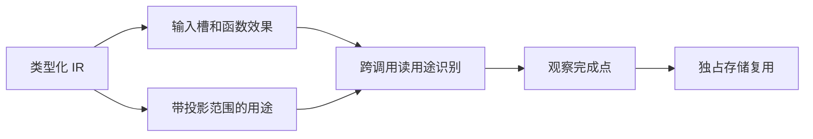
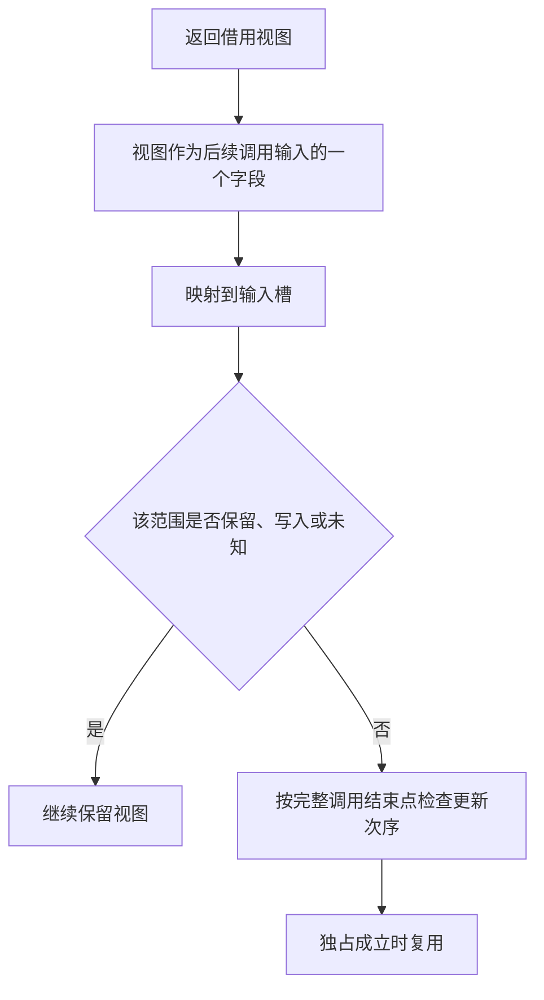

# 按字段结束跨调用借用

## Intent

在静态调用中按输入字段判断借用是否结束。一个调用可以读取数组视图，并在返回值中携带另一份数据。只要视图在调用结束后不再被观察，就让已有的独占判断决定能否复用来源数组。

## Data

现有 genz 用扁平槽表示对象、元组和数组字段。函数效果摘要按输入槽记录是否保留、是否可能写入。用途检查已有对应的投影范围，但判断调用能否结束借用时使用整项函数的效果。一个无关字段被返回，也会阻止视图结束。

[Morphic §5.1](../fully_automatic_borrow_inference.pdf)说明如何跨函数保存借用的来源依赖。[MVS §4.4](../mutable_value_semantics.pdf)按访问路径识别重叠。[Perceus §2.2 和 §2.4](../perceus.pdf)用最后使用和独占确定复用机会。本阶段沿用 zxc 已有的槽和用途结束时间，不引入额外的运行时机制。

## Edges

对投影应用用途偏移得到被调用者的输入槽区间。只对效果完整、区间内无保留且满足原有写入与外逃限制的用途结束借用。调用结果仍持有相关槽，或者更新发生在该调用之前时，继续保护旧值。初始 seed 对齐同一判定。持久化的所有权结果要重新推导。

## Answer

正式路径先把用途归为读取、消耗或混合传参。对于一项混合传参，
[跨调用用途判断](../../packages/genz/src/analysis/uniqueness/sites/borrow_uses/observes.zx)
只查视图对应的输入槽区间。现有函数效果摘要已记录这些槽的保留情况，无需在全程序再构建一份来源图。
借用结束时间仍取整个调用的完成点，包含所有操作数的求值。初始 seed 使用同一规则，所有权缓存程序身份升至 v18。

这个判定要求视图的每条使用路径都符合条件。同一视图传入两个字段时，返回任一字段都足以维持借用。
其他持有同一存储的值仍由原有独占分析检查。原生调用、Store、并行以及可能写入输入的被调用函数继续沿用原有保守规则。

### 生成物和分配

对照工具为 `e9c315888` 的 Source 引导器。四个入口分别通过公开 allocator 和 arena 接口执行，
并核对结果。计数包含数组的构造和后续追加。

| 场景                                 |       修改前 |       修改后 |
| ------------------------------------ | -----------: | -----------: |
| 先读视图，返回独立字段，再更新原数组 | 2 次 / 160 B |  1 次 / 80 B |
| 先更新，再读视图                     | 2 次 / 160 B | 2 次 / 160 B |
| 两个参数字段引用同一视图             | 2 次 / 160 B | 2 次 / 160 B |
| 返回字段仍持有视图                   | 2 次 / 160 B | 2 次 / 160 B |

首个场景删去了 `reverse` 前的缓冲区分配与复制，原地生成 `std.mem.reverse`。
后面三个场景保留原来的生成输出。Source 引导器构建通过 25 个步骤，初始 seed 构建通过 14 个步骤。
两者对这四个入口的 17 个输出文件逐字节一致，排除工具身份戳。

现有借用视图、不可变集合、反转、效果摘要、缓存及原生调用边界等八组回归通过
319 个构建步骤和 997 项检查，包含借用生命周期原型的 416,710 次具体存储比较。

### 编译器开销

使用同一冻结清单的 735 个入口，macOS arm64、Zig 0.17.0、ReleaseSmall、16 分区，关闭常驻。
三轮交错运行后取中位数。固定基线沿用引导声明准备阶段，上一代为 `e9c315888` 的 Source 引导器。
候选由上一代 Source 生成，三套工具均执行 Source 分析和生成。热重建删除输出并复用同次冷生成的缓存。

| 指标                 |  固定基线 |    上一代 |      候选 |
| -------------------- | --------: | --------: | --------: |
| 冷生成墙钟           |    2.77 s |    2.54 s |    2.50 s |
| 冷生成 CPU           |   12.25 s |   12.12 s |   12.01 s |
| 冷生成进程树采样峰值 | 886.03 MB | 697.94 MB | 698.83 MB |
| 冷生成单进程系统峰值 | 938.13 MB | 724.58 MB | 739.34 MB |
| 热重建墙钟           |    2.18 s |    2.00 s |    1.92 s |
| 热重建 CPU           |    8.35 s |    8.21 s |    8.05 s |
| 无改动墙钟           |    0.04 s |    0.03 s |    0.03 s |

相对上一代，冷生成墙钟减少 0.04 秒、CPU 减少 0.11 秒，进程树采样峰值增加 0.88 MB，
单进程系统峰值增加 14.76 MB。相对固定基线，墙钟和 CPU 分别减少 0.27 秒和 0.24 秒，
两种峰值分别减少 187.20 MB 和 198.79 MB。各工具的热重建输出与各自冷生成逐字节一致。

和上一代相比，未分区的生成实现中仅 ZX 分析器的
[失败结果构造](../../packages/compiler/src/zx/analysis/analyzer/failure.zx)发生变化。
编译器省去了两处将字段存储标为共享的操作。分区按生成体积划分，因此相关分区文件及索引随之变化。
用候选工具重新生成前端后，前端回归通过 18 个构建步骤和 313 项检查。

### 自我审查

当前精度是函数的输入字段。写入限制仍按整项函数判断，返回值继续携带该字段的场景由原有保守规则处理。
还需同负载 Rust 对照才能判断运行时间差距。这组编译器计时覆盖分析和 Zig 生成，完整冷构建的后端编译、
链接和内存峰值未纳入本次测量。
