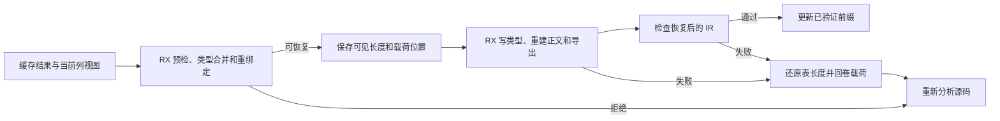
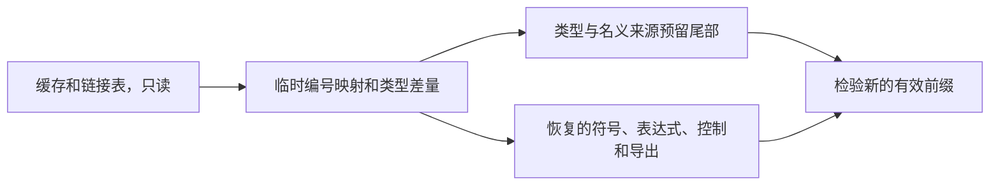

# 普通语义缓存事务与类型写回自举

## Intent

让普通语义缓存的预检、重绑定和类型写回在正式 Source 路径执行。保持缓存可见状态、所有权和失败后重新分析源码的行为。

## Data

`Project.finishInput` 调用普通缓存恢复。原实现用一份静态枚举表在 Zig 调度预检、重绑定、类型写入、正文恢复和验证。预检与重绑定分别组装缓存签名和原生模块视图。类型表初始化和写入由 Zig 调用两套入口，正文恢复再独立调用 Source。

## Edges

预检拒绝时不执行映射缓冲区预留，也不保存持久状态。准备阶段的映射和类型差量借用各自的临时工作区。类型标量列和差量依次追加到同一持久表，标量列借用静态文本，差量文本归载荷区域。验证前释放准备工作区。失败时先还原函数、类型和名义来源的有效长度，再回卷载荷区域。

仍在宿主执行的部分包括保存实际 arena 位置、将递归正文描述符登记到原生函数列，以及装配并验证 `ir.Program`。函数表的原生行 ABI 使用 opaque 描述符。本次保持既有 ABI。原生接口缓存和初始 seed 在各自原路径执行。[自举收敛计划](自举收敛计划.md)

## Answer

普通缓存恢复的枚举调度、独立预检调用和 Zig 类型提交入口已退出正式路径。预检与重绑定共享签名和原生模块视图。RX 发布链在还原正文之前完成标量初始化、差量写入和名义来源提交。

### 回归

候选由 `62b0edb9b` 的 Source 引导器构建，25 个构建步骤通过。使用单一候选完成语义缓存、磁盘缓存、缓存编解码、原生声明、原生联结、名义来源、联结边界及库联结回归，151 个构建步骤、199 项 Zig 测试、5 项磁盘缓存端到端检查通过。

### 性能与产物

三套 Source 工具均运行 Source 分析与生成。macOS arm64、Zig 0.17.0、ReleaseSmall、关闭常驻，固定清单为 735 个入口与 16 个分区。交错三轮取中位数。RSS 以十进制 MB 计。

| 指标                 |  固定基线 |    上一代 |      候选 |
| -------------------- | --------: | --------: | --------: |
| 冷生成墙钟           |    2.86 s |    2.62 s |    2.62 s |
| 冷生成 CPU           |   12.49 s |   12.57 s |   12.66 s |
| 冷生成进程树峰值 RSS | 891.34 MB | 716.51 MB | 713.11 MB |
| 冷生成单进程峰值 RSS | 966.56 MB | 742.60 MB | 732.68 MB |
| 热生成墙钟           |    2.23 s |    1.97 s |    1.96 s |
| 热生成 CPU           |    8.47 s |    8.27 s |    8.23 s |
| 无改动墙钟           |    0.04 s |    0.03 s |    0.03 s |

冷生成 CPU 较上一代增加 0.09 秒，相对固定基线累计增加 0.17 秒，墙钟较固定基线缩短 0.24 秒。11,753 份生成文件逐字节一致，工具身份戳除外。冷暖产物一致，v18 所有权缓存正文哈希沿用 `cdf9fa7e0f33002a95dc097b2837de781d67e6e519a452fb97f89f7c0bbf3a23`。本批计时覆盖生成阶段。

正式 CLI 对照使用 99 个源码缓存项和 2 个原生接口缓存项，交错各测 12 次。两版热运行全部命中，冷暖应用及 ABI 文件逐字节一致。墙钟中位数从 36.93 毫秒变为 36.76 毫秒，CPU 从 38.47 毫秒变为 38.31 毫秒，单进程峰值 RSS 从 12.95 MB 变为 12.94 MB。

候选 Source 引导器的 SHA-256 为 `82ba9b825d2738cb85115c5f7b4575af619fa2c804beba33ecb8b075fca7b330`。原始日志与对照在 `.zig-cache/verification-tmp/semantic-restore-transaction/` 中。
