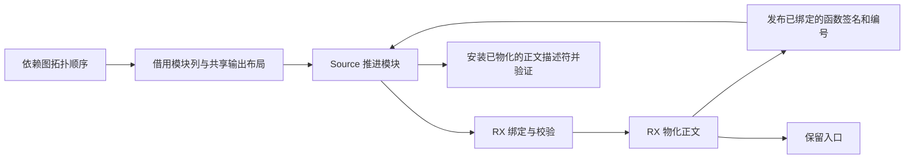
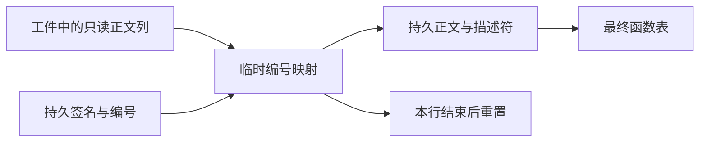

# 模块联结批量遍历与工作区自举

## Intent

让正式联结的 Source 路径掌握依赖顺序、模块间状态推进和临时区回收。普通模块、原生签名和递归入口继续使用同一份可见函数表。

## Data

上一批把正文请求和入口描述迁入 Source。宿主仍逐模块调用绑定与发布，维护逐模块的推进，并负责重置临时区。现在 Source 按宿主提供的连续借用窗口消费既定拓扑顺序，执行每行的准入、原生联结、签名校验、正文物化和函数编号写回。

## Edges

绑定阶段分配于可重置的模块临时区。完成绑定后，正文分配于联结结果的持久区。Source 在成功的依赖行结束后回收临时区，包括跨越借用窗口时。函数表容量仍在原有准入位置预留，后续依赖只读取已绑定的签名和编号。每批完成后宿主把已物化的描述符装入函数表。视图窗口预算为 64 KiB，随着联结推进反复使用。

## Answer

Source 批量入口替代了逐模块独立调用。宿主仍准备借用视图、提供分配与列内存、安装持久正文描述符。递归入口的原生行适配保持原路径。剩余边界继续在[自举收敛计划](自举收敛计划.md)记录。

### 引导与回归

使用 `d4c326702` 的 Source 引导器构建候选和初始 seed，共 27 步通过。窗口版通过普通与原生联结、工件提取与槽位、联结执行和原生执行六组，共 218 项测试。重新生成发现部分索引入口使用借用指针 ABI。统一空索引和切片视图适配后，以同一批规则补验库联结、工件导入执行、Store 执行三组，共 121 项测试通过。

用最终候选生成安装版 `zxc` 后，以同一产物通过原生 ABI、冷暖与增量执行、损坏产物恢复及缓存键校验，两组共 4 项集成检查、74 个构建步骤通过。

### 联结性能与产物

沿用 128 模块依赖链，交错七轮，每次执行 120 遍正式联结。两版均使用 Source 生成的分析与联结规则。联结墙钟中位数由 102.22 ms 变为 104.51 ms，进程 CPU 由 180.32 ms 变为 182.46 ms，单进程峰值 RSS 由 17.42 MB 变为 17.60 MB。首版预先保留所有模块视图时 RSS 增加 0.66 MB，复用视图窗口后增加 0.18 MB。两版联结生成的 Zig 逐字节一致，SHA-256 为 `3b835e64650bb1d3da3dfe5ed58e46f8a2e7c03bdd1df901c9f3a620d39c146c`。

### 固定清单回测

第一次全量生成的冷峰值升至 4.84 GB。分配跟踪发现输出清单和分区扫描使用的不可变索引在借用 ABI 下逐项复制数组。两处改用同一个批量构建函数，借用路径列，按路径数一次分配值和桶，再原位写入。路径相同的条目继续由最后一行覆盖。复测单次冷生成的峰值为 740 MB。

以 macOS arm64、Zig 0.17.0、ReleaseSmall、735 个入口、16 个分区为共同设置，关闭常驻。以三轮交错运行的中位数比较固定基线、`d4c326702` 和本批候选。三套工具均由 Source 引导器生成，并执行 Source 分析与生成。RSS 以十进制 MB 计。

| 指标                 |  固定基线 |    上一代 |      候选 |
| -------------------- | --------: | --------: | --------: |
| 冷生成墙钟           |    2.82 s |    2.60 s |    2.60 s |
| 冷生成 CPU           |   12.40 s |   12.60 s |   12.52 s |
| 冷生成进程树峰值 RSS | 886.87 MB | 726.20 MB | 712.74 MB |
| 冷生成单进程峰值 RSS | 926.86 MB | 737.49 MB | 732.79 MB |
| 热生成墙钟           |    2.20 s |    2.03 s |    1.95 s |
| 热生成 CPU           |    8.42 s |    8.35 s |    8.22 s |
| 热生成单进程峰值 RSS | 933.97 MB | 694.86 MB | 695.30 MB |
| 无改动墙钟           |    0.04 s |    0.03 s |    0.03 s |

相对固定基线，冷生成墙钟减少 0.22 秒，累计 CPU 增加 0.12 秒，进程树峰值 RSS 下降 174.13 MB。上一代和候选的 11,753 份生成文件逐字节一致，工具身份戳除外。候选冷暖产物一致，v18 所有权缓存正文哈希与上一代一致，为 `cdf9fa7e0f33002a95dc097b2837de781d67e6e519a452fb97f89f7c0bbf3a23`。

候选引导器 SHA-256 为 `0eae916f625956192d4806d7a3137a181592cef44f1a87c5be1d95abad7309d3`。配对结果和分配诊断保存在 `.zig-cache/verification-tmp/artifact-binding-batch/`。
