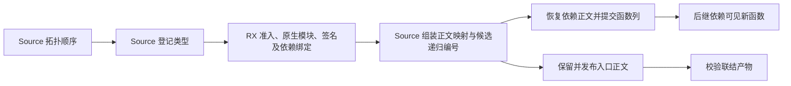
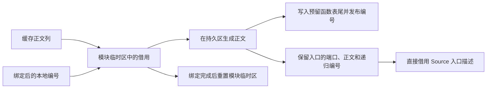

# 模块联结正文与入口发布自举

## Intent

让正式模块联结在 Source 中决定何时追加依赖正文、何时保留入口，以及如何用已绑定的编号恢复正文。入口发布直接借用 Source 的结果。保持依赖顺序、共享列、递归入口、错误顺序和分配生命周期。

## Data

`link.link` 从依赖图取得拓扑顺序，完成类型登记后进入模块绑定。此前，Zig 逐模块调用 Source 查询当前行，执行绑定规则后再以原始函数和映射重建一份正文输入。保留的入口先转成 `ir.Function`，随后发布宿主把正文列转回 Source 形状。

## Edges

正文输入借用既有符号、表达式、合约和控制表。绑定规则先写入本地编号映射，Source 随后从这些映射构造正文请求。追加正文沿用绑定期间已保留的函数表尾部。提交列长度后才发布该模块的函数编号。原生模块和签名也沿用现有独立的容量预留与写入路径。

正式联结宿主仍逐模块借用输入并管理临时和持久分配器。Source 的两段调用分别使用这两个分配器。递归入口需要原生函数行 ABI 的适配。初始 seed 沿用原绑定实现。继续迁移的边界在[自举收敛计划](自举收敛计划.md)中维护。

## Answer

删除运行时的逐行 Source 查询和编译期阶段枚举表。绑定准备生成完整的正文请求和发布位置，宿主通过实际函数表尾部应用结果。将入口端口与保留的正文统一为发布模型，一般入口直接传递这些列。递归入口沿用原有函数行登记与转发包装。

### 引导与回归

以 `908170946` 的 Source 引导器构建候选，通过 25 个构建步骤。初始 seed 通过 14 步。用候选再次生成测试所需的 Source 编译器后，使用同一份产物完成联结边界、工件提取、工件槽位、原生联结、库联结、联结执行、工件导入执行和原生执行的八组回归。166 个构建步骤及 300 项测试通过。

首轮候选自编译暴露了保留入口和写入依赖列的 ABI 形态差异。依赖写入使用现有独占状态入口，回归会验证写回的列仍指向原尾部。最终入口使用常规借用描述符入口，发布阶段读取已归持久区的描述符。

### 联结性能与产物

沿用 128 模块依赖链，交错七轮，每次联结 120 遍。两版均由 Source 生成分析与发布规则，并运行正式工件联结。联结墙钟中位数由 104.49 ms 变为 105.59 ms，进程 CPU 由 184.84 ms 变为 185.95 ms，单进程峰值 RSS 由 17.43 MB 变为 17.42 MB。两版输出的 Zig 逐字节一致，SHA-256 为 `3b835e64650bb1d3da3dfe5ed58e46f8a2e7c03bdd1df901c9f3a620d39c146c`。

### 固定清单回测

三套工具运行 Source 分析与生成。使用 macOS arm64、Zig 0.17.0、ReleaseSmall、735 个入口、16 个分区，关闭常驻，交错三轮取中位数。RSS 以十进制 MB 计。

| 生成指标             |  固定基线 |    上一代 |      候选 |
| -------------------- | --------: | --------: | --------: |
| 冷生成墙钟           |    2.86 s |    2.62 s |    2.63 s |
| 冷生成 CPU           |   12.48 s |   12.62 s |   12.65 s |
| 冷生成进程树峰值 RSS | 893.17 MB | 710.74 MB | 708.84 MB |
| 冷生成单进程峰值 RSS | 939.41 MB | 742.06 MB | 735.69 MB |
| 热生成墙钟           |    2.24 s |    1.97 s |    1.98 s |
| 热生成 CPU           |    8.51 s |    8.28 s |    8.29 s |
| 无改动墙钟           |    0.04 s |    0.03 s |    0.03 s |

冷生成墙钟较上一代增加 0.01 秒，CPU 增加 0.03 秒，进程树峰值下降 1.90 MB。相对固定基线，冷生成墙钟减少 0.23 秒，CPU 累计增加 0.17 秒。两代的 11,753 份生成文件逐字节一致，工具身份戳除外。冷暖产物一致，v18 所有权缓存正文哈希均为 `cdf9fa7e0f33002a95dc097b2837de781d67e6e519a452fb97f89f7c0bbf3a23`。测量覆盖 Source 生成和独立联结路径。

候选 Source 引导器的 SHA-256 为 `9d56c33a6a3696eb4de41375fe2048d52332c58c66cdb922e4f596e7bf32c401`。原始日志与对照在 `.zig-cache/verification-tmp/artifact-binding-publication/` 下。
