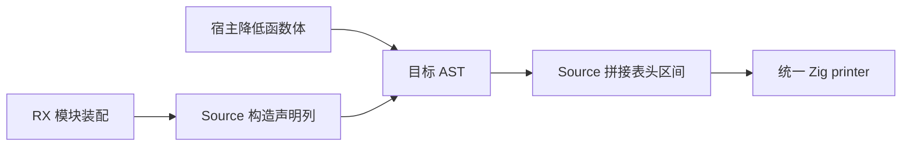
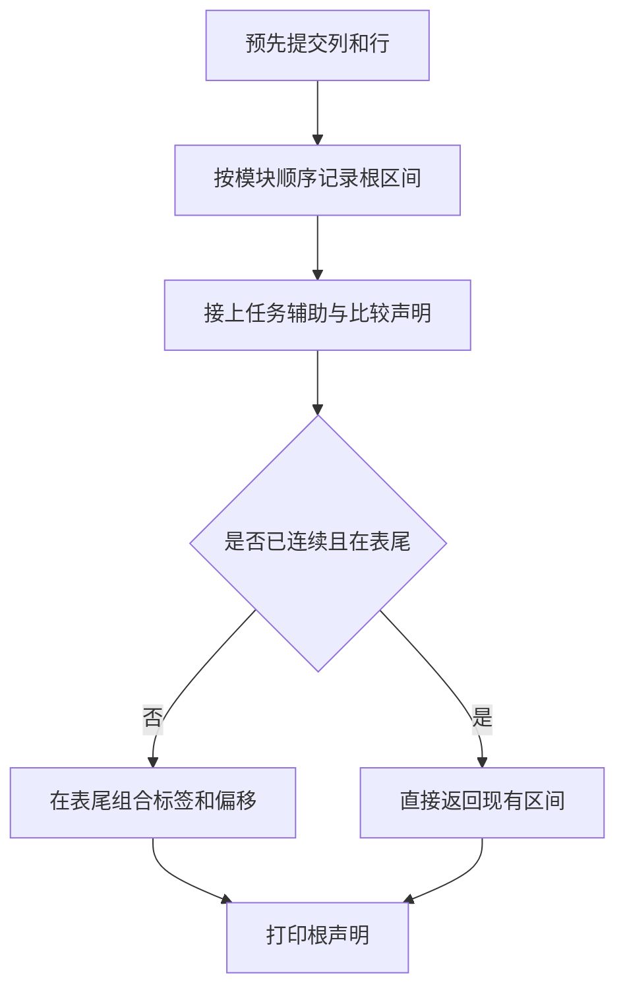

# 目标模块声明直接发布自举

## Intent

入口、独立函数和签名文件将 Source 生成的声明列直接提交到 AST。既有生成规则提供内容和引用顺序，最终模块只按区间组装声明。

## Data

正式 `Lower.declarations`、`modules.functionDeclarations` 和 `signatureFiles` 原先维护 Zig 临时声明数组。标准库导入、原生别名、类型、形状、Store、并行分配器和签名的 Source 输出需要还原为 Zig 行。列表增长辅助声明还会从 AST 物化，再写回 AST。

## Edges

嵌套作用域和签名函数可以在根声明之间写入。逻辑输出区间只登记本模块需打印的根声明。需要重排时追加标签和载荷偏移，载荷保留原节点。任务辅助定义仍位于根声明和比较函数之间。原生别名用实际声明行号指向已提交的常量，从 AST 取得同一份拥有的名称字节。

## Answer

核对单文件、分离文件及签名的声明顺序、原生导入、Store、增长、并行和别名。比对未修改的生成产物和所有权缓存，使用固定清单回测冷暖生成。

### 迁移边界

声明区间沿用 Source 已实现的连续判断和表头写入。类型生成直接复用声明列，列表增长直接登记已提交区间。原生导入在 ZX 生成绝对行号，保留先出现在前缀中的匹配。初始 seed 继续使用原有行布局。宿主负责 AST 容量、外部文本生命期和具体函数体的递归降低。

### 固定清单回测

macOS arm64，Zig 0.17.0，ReleaseSmall，16 分区，关闭常驻。用 `a7a53dcbf` 的 Source 引导器生成候选，三套工具分别执行自己的 Source 分析和生成。735 入口冻结清单交错跑三轮，表内为中位数。

| 指标               |  固定基线 |    上一代 |      候选 |
| ------------------ | --------: | --------: | --------: |
| 冷生成墙钟         |    2.86 s |    2.60 s |    2.58 s |
| 冷生成 CPU         |   12.44 s |   12.10 s |   12.19 s |
| 进程树采样峰值 RSS | 885.11 MB | 710.82 MB | 709.38 MB |
| 单进程系统峰值 RSS | 924.86 MB | 737.59 MB | 734.86 MB |
| 热重建墙钟         |    2.23 s |    1.97 s |    1.97 s |
| 热重建 CPU         |    8.54 s |    8.26 s |    8.23 s |
| 无改动墙钟         |    0.04 s |    0.03 s |    0.03 s |

较上一代，冷生成墙钟减少 0.02 秒，CPU 增加 0.09 秒，进程树采样峰值下降 1.44 MB，单进程系统峰值下降 2.74 MB。相对固定基线，冷生成墙钟和 CPU 分别减少 0.28 秒和 0.25 秒，单进程峰值下降约 190 MB。本批对照覆盖生成器流程。

排除工具身份戳后，上一代和候选的 11,753 个生成文件逐字节一致。三套工具各自的冷暖结果一致。上一代和候选所有权缓存 v18 正文 SHA-256 同为 `cdf9fa7e0f33002a95dc097b2837de781d67e6e519a452fb97f89f7c0bbf3a23`。

### 引导与回归

候选 Source 引导器和初始 seed 分别完成 25 步和 14 步构建。新旧 seed 和候选 Source 对六个集合和排序输入生成的 21 个文件逐字节一致。

八个回归目标共通过 281 个构建步骤、470 项 Zig 测试和 46 项应用入口检查。用两代正式 CLI 关闭磁盘缓存生成 `control/last.rx` 与 `aggregate.rx`，两个单文件输出逐字节一致。聚合用例生成列表增长定义和普通与值 ABI 函数，回归另覆盖原生引用、模块签名、Store、并行和资源不足后的清理。

### 自我审查

这批去掉入口、独立函数及签名文件根声明的临时行数组。需要重排时，仍为最后的连续输出区间写入表头。函数原型的宿主参数存储及比较函数的递归降低沿用当前 AST 边界。Gateway 和 Store 服务外层的独立模块装配仍有旧的物化路径。完整 Zig 后端冷构建未在本批计时。
