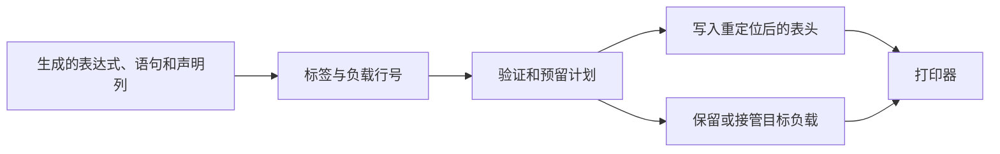
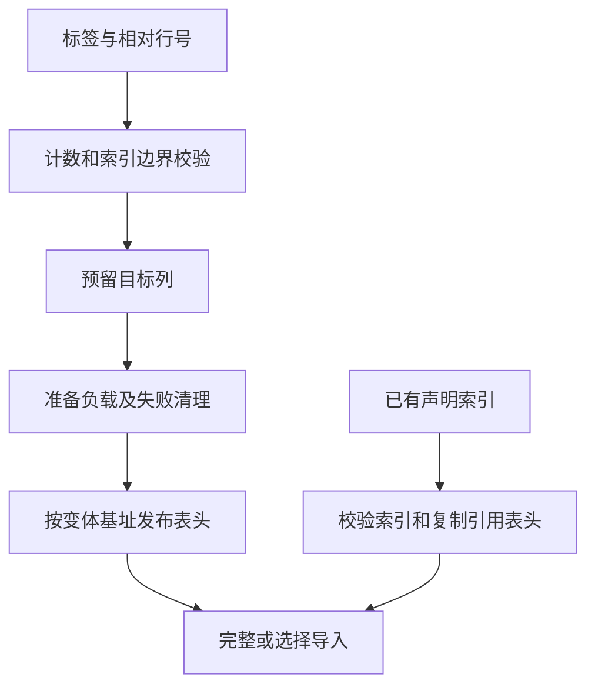

# 目标节点表头验证与发布自举

## Intent

迁移 GenZ 目标 AST 的批量表头处理。表达式、语句和声明共用标签、负载行号和按变体分列的存储。正式生成路径由 Source 计数、校验并重定位这些行号。

## Data

`genz/src/node/import_module.zig` 将 Source 生成的目标 AST 列导入打印器的存储。完整负载走 `import_rows`，共享列的选中行走 `import_selected`，另有语句和常量的直接列表导入。之后 `selectDeclarations` 可按已存声明的序号重排或重复引用负载。

## Edges

完整导入要求负载形状与各标签的行数一致，允许合法的重复或乱序行号。选择导入只检查选中行具备所需负载。引用已有声明时只写标签和行号，继续共用已有负载。Source 以原有列为输入，在栈工作区统计并写入已预留的输出。Zig 保留编译期列布局检查、分配及嵌套负载所有权处理。

## Answer

确认应用、库、引导生成的中间 AST 和目标文本一致，并运行负载回收、生成及安装版相关回归。固定清单对照冷生成、热重建、峰值内存和生成产物。说明仍使用 Zig 的类型适配和所有权边界。

### 正式路径

- [批量表头校验](../../packages/genz/src/analysis/node_headers/check.rx) 先检查两列长度，再统计变体并检查选择列的边界。完整导入还按实际行数核对每个相对行号。语句列表共用这一校验入口。
- [完整导入](../../packages/genz/src/analysis/node_headers/rebase.zx) 直接向预留尾部写入重定位后的行号。[选择导入](../../packages/genz/src/analysis/node_headers/selected.zx) 按变体从原有负载尾部顺序编号。如果复制嵌套负载失败，宿主回滚当前行，然后只发布已完成的前缀。
- [声明选择](../../packages/genz/src/analysis/node_headers/references.zx) 复制索引对应的标签和行号。源标签、行号和负载保持借用，重复选择沿用同一个负载行。

Source 候选引导器通过 25 个构建步骤，初始 seed 通过 14 个步骤。对四个已有入口分别生成的 17 个文件
逐字节一致，排除工具身份戳。格式和 lint 核对通过。

使用候选引导器重新生成后，模块生成、值返回、循环列、不可变列表、库联结和 Gateway 六组回归通过
306 个构建步骤、861 项 Zig 测试和 86 项 Gateway 运行检查。框架现有回归包含分配失败重试、
路由失败恢复、循环数据列转移和共享 Store 生命周期。

### 性能与产物

冻结清单包含 735 个入口。三套工具均使用 Source 分析和生成，使用 macOS arm64、Zig 0.17.0、
ReleaseSmall、16 分区并关闭常驻。候选由上一代 `b8636c12c` 的 Source 引导器生成。
固定基线沿用引导声明准备阶段。以下为三轮交错运行的中位数。

| 指标                 |  固定基线 |    上一代 |      候选 |
| -------------------- | --------: | --------: | --------: |
| 冷生成墙钟           |    2.84 s |    2.59 s |    2.59 s |
| 冷生成 CPU           |   12.40 s |   12.15 s |   12.21 s |
| 冷生成进程树采样峰值 | 888.24 MB | 714.05 MB | 700.86 MB |
| 冷生成单进程系统峰值 | 921.29 MB | 797.03 MB | 803.75 MB |
| 热重建墙钟           |    2.22 s |    1.97 s |    1.97 s |
| 热重建 CPU           |    8.48 s |    8.21 s |    8.21 s |
| 无改动墙钟           |    0.04 s |    0.03 s |    0.03 s |

相对上一代，冷生成墙钟持平，CPU 增加 0.06 秒，进程树采样峰值减少 13.19 MB，单进程系统峰值增加
6.72 MB。相对固定基线，冷生成墙钟和 CPU 分别减少 0.25 秒和 0.19 秒，两种峰值分别减少
187.38 MB 和 117.54 MB。

候选与上一代的 11,753 个输出文件及所有权 memo 逐字节一致，排除工具身份戳。每套工具的热重建
复用同一次冷生成的缓存，输出分别与各自冷生成一致。前后输出清单 SHA-256 均为
`7248304214a4e61487c037e6ebc0017ce4f9adb96d7071e985dc963a8c43dc4b`。

### 自我审查

Source 接管批量表头的规则和编号。宿主仍负责在具体布局上校验列成员、预留容量、写入不同类型的负载
以及清理部分失败。直接常量列表和语句允许的变体仍由对应 Zig 适配器校验。性能口径覆盖分析和 Zig
生成。本阶段沿用此前 LLVM 全冷构建证据。
