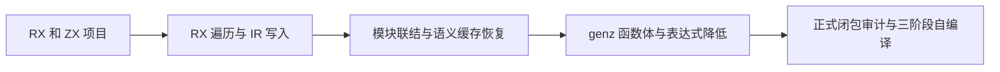

# 自举收敛计划

## Intent

优先完成能让正式编译器退出手写 Zig 状态和调用的整段迁移。按下面的顺序推进，连续在本计划记录实际退出、保留的依赖和下一步。最终让正式编译器自身的算法、规则和状态由 RX/ZX 提供。

## Data

正式 RX 入口的帧栈和语句推进已由 Source 执行。模块联结的拓扑排序、批量类型登记、窗口内的绑定推进和完整函数行写入已由 Source 执行。普通语义缓存恢复已在 Source 完成前缀快照、函数登记、发布后校验和回滚规则。原生缓存恢复也由一条 Source 路径完成合并、尾部写入和可见长度提交。函数生成已在 Source 发布多个声明列和结果，函数体的递归上下文仍在 Zig。

## Edges

完成一批时沿原正式入口证明旧 Zig 职责退出，核对冷暖路径、共享状态和失败清理。保留的通用分配、平台 I/O、ABI 与初始 seed 要能说明归属。通用能力补齐围绕当前链路展开，复用已验收的 Source 引导器和验证产物。每批集中回归并对照受影响路径的性能，沿用固定基线跟踪累计变化。[执行约定](../../WAY.md) · [自举完成标准](../../rules/自举完成标准.md)

## Answer

### 迁移顺序

| 顺序 | 优先模块                      | 要贯通的完整职责                                                           | 完成信号                                                                                                          | 进度               |
| ---- | ----------------------------- | -------------------------------------------------------------------------- | ----------------------------------------------------------------------------------------------------------------- | ------------------ |
| 1    | RX 语句遍历和 IR 写入         | 顺序调用、Task、Parallel、分支的开闭和结果汇合，连同帧栈、作用域和失败清理 | 正式 RX 入口由 RX/ZX 持有游标和帧，写回分支及作用域 IR。同职责的 Zig 遍历与帧栈撤出。                             | **正式遍历已迁移** |
| 2    | 模块联结和语义缓存恢复        | 类型登记、普通与原生模块绑定、结果与缓存提交、失败回滚                     | 正式联结和恢复步骤由 RX 调用，状态与提交约定由 ZX 持有。旧 Zig 阶段状态机和同职责桥撤出。                         | **推进中**         |
| 3    | genz 函数体、表达式与语句降低 | 普通函数、值 ABI 函数与共享特殊构造的递归上下文、符号、引用块和 AST 发布   | 源码入口以 RX/ZX 执行降低。同职责的 Zig Lower 状态、递归调度和临时适配撤出。                                      | 待迁移             |
| 4    | 编译器全入口收尾              | 词法与语法、语义、所有权、诊断、优化、后端和缓存等剩余传递依赖             | 逐项核对剩余手写原生边界的归属。完成 seed、stage 1、stage 2、stage 3 的自编译，核对固定输入下的产物、行为与性能。 | 待核对             |

第 1 项先贯通共享游标和作用域状态的全部分支。第 2 项从联结入口及语义缓存恢复切入，统一核对普通与原生写回。第 3 项一起验收共享控制、值 ABI 和普通生成路径。[RX 语句降低](../../packages/compiler/src/rx/analysis/program/statements/traversal.zig) · [IR 写入](../../packages/compiler/src/rx/analysis/program/control/writer.zig) · [联结入口](../../packages/compiler/src/zx/modules/link.zig) · [Lower 工作区](../../packages/genz/src/zx/lower.zig)

#### 第 2 项执行顺序

1. **普通语义缓存预检和类型提交已迁移。** 预检与重绑定共用一条 RX 路径，类型写入与正文恢复在同一条发布链执行。
2. **普通与原生模块的联结推进已迁入 Source。** Source 在固定大小的借用窗口内逐模块绑定，发布函数编号并回收临时区。
3. **共享函数列与普通缓存提交。** 依赖正文、递归入口和普通缓存恢复共用函数行构造。检查普通缓存的函数、类型和名义来源前缀，验证成功后交付新前缀。
4. **原生缓存发布。** 同一条 RX 恢复路径推进准入、类型合并、尾部登记和提交。无缓存的原生导入复用最终写入规则。
5. **收口联结末端。** 让正式工件联结借用已发布的函数与类型列，在结果发布路径内完成最终 IR 验证。核对共享类型状态和剩余宿主职责，随后进入 genz。

模块联结仍从宿主借用固定窗口、函数存储和分配器。缓存恢复由宿主提供列内存、物理分配位置与错误解绕，Zig 继续负责项目级缓存索引和原生导入后的验证标记失效。

下一批沿 `link.link` 到 `publish.rx`，复用普通缓存恢复已在使用的 IR 验证、函数列和导出借用。完成信号是正式联结的最终验证由结果发布链调用，宿主只组装成功结果并收口资源。验证依赖、递归入口和原生绑定提交后的完整 IR。[联结入口](../../packages/compiler/src/zx/modules/link.zig) · [结果发布](../../packages/compiler/src/zx/modules/link/result/publication/publish.rx) · [普通缓存验证](../../packages/compiler/src/zx/modules/semantic_cache/restoring/publication/verify.rx)

#### 第 3 项执行顺序

1. 从 `Lower.function` 和 `Lower.valueMode` 的共用函数体入口开始，迁移每个函数的符号、引用块、暂存状态以及进入和退出时的恢复。
2. 在同一上下文接管表达式与语句的递归推进，包括分支、循环、调用和所有权相关的生成路径。
3. 从普通函数、值 ABI 和递归入口验证相同输入的 AST 与 Zig 产物，确认正式生成闭包退出旧 `Lower` 调度。第 4 项再逐类清点剩余的编译器自有实现和允许保留的原生边界。[Lower 工作区](../../packages/genz/src/zx/lower.zig)

### 收敛门槛

第 1 项完成是核心调用链开始收敛的可验证信号。第 1 至第 3 项完成后，主要工作转入剩余依赖清点和最终验收。第 4 项通过后才能关闭自举目标。

每批收口时在这里更新优先项状态和进度，写明退出的 Zig 函数和状态、仍在执行的过渡接口，以及同输入回归、产物和性能证据。随后写明下一条正式入口和它的退出信号。恢复会话从该入口接续，复用对应阶段已经通过的验收。初始 seed 单列。各项完成以实际调用和状态归属为准。

### 进度

| 日期       | 阶段                          | 已退出的职责及证据                                                                                                                                                                                              | 当前余量                                                                               |
| ---------- | ----------------------------- | --------------------------------------------------------------------------------------------------------------------------------------------------------------------------------------------------------------- | -------------------------------------------------------------------------------------- |
| 2026-11-20 | Gateway 存储契约与 Store 状态 | Zig 还原常量、合并四份 AST 并选择根的步骤退出正式入口。移除四条分段生成适配。已推送 `89b703dd2`。[验收](Gateway存储契约与Store状态直接打印自举.md)                                                              | 宿主保持输出缓冲与借用 ABI                                                             |
| 2026-11-20 | 应用宿主直接打印              | 八条入口退出 Zig 声明装配和打印接线。97 份生成文件一致。已推送 `3be9dcdb2`。[验收](应用宿主生成与直接打印自举.md)                                                                                               | 库构建、元数据和 ABI 视图另在正式发布链                                                |
| 2026-11-20 | 共享类型命名空间              | 计划和声明生成合并到 RX，退出逐声明索引和表头复制。七组回归通过，最终 11,753 份生成文件一致。冷生成 CPU 比上一代减少 2.72 秒。[阶段记录](共享类型命名空间声明与输出区间自举.md)                                 | AST 仍由宿主借用和追加，逐声明工作区由宿主复用                                         |
| 2026-11-20 | RX 语句遍历和 IR 写入         | 正式正文入口退出 Zig 帧栈及逐事件往返。Source 决定作用域位置和分支 IR 写入范围。八组回归、1,481 项测试通过，11,753 份生成文件一致。[验收](RX语句遍历帧栈与分支写入自举.md)                                      | 表达式求值、调用导入、实际绑定长度及 IR 列的内存适配保留在 Zig。初始 seed 保留旧遍历。 |
| 2026-11-20 | 普通语义缓存事务与类型写回    | 正式路径移除枚举调度、独立预检调用和 Zig 类型提交入口。八组回归、199 项 Zig 测试和 5 项磁盘检查通过。99 个源码缓存项和 2 个原生接口缓存项全部命中。[验收](普通语义缓存事务与类型写回自举.md)                    | 递归函数登记及验证前缀仍有 Zig 宿主代码。下一批迁移联结绑定游标和共享函数表写入。      |
| 2026-11-20 | 模块联结正文与入口发布        | 移除按模块查询当前行、阶段枚举，以及保留正文经过 Zig 函数再转回 Source 的往返。八组回归和 300 项测试通过，128 模块联结结果及 11,753 份固定清单产物一致。[验收](模块联结正文与入口发布自举.md)                   | 拓扑顺序迭代、模块工作区切换和递归入口行 ABI 仍在 Zig。                                |
| 2026-11-20 | 模块联结遍历与临时区          | Source 接管逐模块绑定、编号发布和临时区回收。339 项回归和 4 项安装版集成检查通过。冷生成墙钟与上一代持平，进程树峰值 RSS 下降 13.46 MB，11,753 份产物一致。[验收](模块联结批量遍历与工作区自举.md)              | Zig 仍安装最终正文描述符、装配递归入口行并持有缓存回滚边界。                           |
| 2026-11-20 | 函数行发布与普通缓存提交      | 去掉依赖正文补写队列和递归入口 Zig 行装配。普通缓存的发布后验证归同一条 RX 链。199 项回归、5 项磁盘缓存集成检查通过。11,753 份固定清单产物和 14,247 份当前清单产物一致。[验收](函数行发布与语义缓存提交自举.md) | 原生缓存还需贯通合并、尾部登记和最终成员可见长度。宿主提供列借用、分配位置和错误解绕。 |
| 2026-11-20 | 原生缓存与成员提交            | Zig 的合并与发布之间的往返以及缓存路径上的独立最终登记已退出。135 项回归和 9 项安装版检查通过，14,253 份当前清单产物一致。[验收](原生缓存与成员提交自举.md)                                                     | 项目级缓存索引与异常清理由宿主持有。下一批把联结结果的 IR 验证接入 Source 发布链。     |
