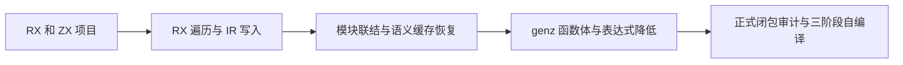

# 自举收敛计划

## Intent

优先迁移能让多个正式入口同时退出手写 Zig 的共享状态和调用。以本文件为持续更新的计划，每批集中验收后更新模块状态、实际退出的职责和下一批入口，随该批代码提交。最终让正式编译器自身的算法、规则和状态由 RX/ZX 提供。

## Data

正式 RX 入口的帧栈和语句推进已由 Source 执行。模块联结的拓扑排序、批量类型登记、窗口内的绑定推进和完整函数行写入已由 Source 执行。普通语义缓存恢复已在 Source 完成前缀快照、函数登记、发布后校验和回滚规则。原生缓存恢复也由一条 Source 路径完成合并、尾部写入和可见长度提交。genz 的函数正文、语句帧及 AST 导入均通过 Source 确定执行与发布顺序。普通、值 ABI 和迭代入口已由 Source 执行表达式分派、读取、运算数求值及作用域、聚合与匹配分支的遍历。调用、循环回退及 Task 分支的执行也已交给 Source。函数正文、值 ABI 作用域、模块声明和签名请求已同批转由 Source 执行，正式生成路径退出原 Zig 步骤表和请求循环。

## Edges

完成一批时沿原正式入口证明旧 Zig 职责退出，核对冷暖路径、共享状态和失败清理。保留的通用分配、平台 I/O、ABI 与初始 seed 要能说明归属。通用能力补齐围绕当前链路展开，复用已验收的 Source 引导器和验证产物。每批集中回归并对照受影响路径的性能，沿用固定基线跟踪累计变化。[执行约定](../../WAY.md) · [自举完成标准](../../rules/自举完成标准.md)

## Answer

### 当前状态与下一批

**已进入集中收尾，当前优先联结、导入与项目缓存。** 所有权的常规工作轮、memo 重放和 genz 三路旧递归调度已退出正式路径。按第 4 项依次清除正式编译器中剩余的专用 Zig 职责，在最终审计中核实传递依赖。

| 优先级       | 迁移批次                            | 状态与退出信号                                                                                                                                                   |
| ------------ | ----------------------------------- | ---------------------------------------------------------------------------------------------------------------------------------------------------------------- |
| 已验收       | 所有权工作轮与缓存重放              | Source 推进领取、分析反馈、重放复算和提交。Zig 继续绑定表列与线程，worker 启动后接续预取窗口。[阶段验收](../2026-11-21/所有权外层调度自举.md)                    |
| 已验收       | genz 三路表达式分派、读取与运算数   | Source 决定表达式分派、共用读取、投影段及运算数次序。本阶段提交为 `4d3a66eda`。[阶段验收](../2026-11-21/genz表达式递归入口自举.md)                               |
| 已验收       | genz 作用域、聚合与匹配             | Source 消费绑定请求，执行对象和序列子项、匹配分支的逐项求值。借用原 IR 与 AST 存储，保留错误退出的资源清理。[阶段验收](../2026-11-21/genz复合表达式递归自举.md)  |
| 已验收       | genz 调用、循环与 Task              | Source 执行三路调用、循环初值和更新、布局请求、循环消费回退、投影与并行分支。匹配主体与默认分支也已接入。[阶段验收](../2026-11-21/genz调用循环与任务执行自举.md) |
| 已验收       | genz 函数正文、值作用域与模块声明   | 普通及值 ABI 正文、作用域转换、整模块与独立函数声明、签名遍历和请求推进由 Source 执行。[阶段验收](../2026-11-21/genz函数正文与模块声明执行自举.md)               |
| 当前         | 项目联结与缓存                      | 从缓存命中和重算贯通单元发布、入口验证前缀及写回。详细入口和验收信号见第 4.1 项。                                                                                |
| 集中收尾后续 | RX/ZX 前端与诊断 → 校验、优化和输出 | 依第 4 项逐条退出正式 Zig 职责，逐项核对初始 seed、平台 ABI、Zig 标准库和外部工具。                                                                              |
| 最终验收     | 传递依赖与三阶段自编译              | 专用 Zig 语义和状态退出正式闭包，固定输入的三阶段产物、行为和性能通过。                                                                                          |

当前从 `Project.finishInput` 和 `analyzeWithCaches` 接续。集中收尾只处理能让这些正式调用链退出专用 Zig 的职责和通用能力缺口。

### 迁移顺序

| 顺序 | 优先模块                      | 要贯通的完整职责                                                           | 完成信号                                                                                                          | 进度                                   |
| ---- | ----------------------------- | -------------------------------------------------------------------------- | ----------------------------------------------------------------------------------------------------------------- | -------------------------------------- |
| 1    | RX 语句遍历和 IR 写入         | 顺序调用、Task、Parallel、分支的开闭和结果汇合，连同帧栈、作用域和失败清理 | 正式 RX 入口由 RX/ZX 持有游标和帧，写回分支及作用域 IR。同职责的 Zig 遍历与帧栈撤出。                             | **正式遍历已迁移**                     |
| 2    | 模块联结和语义缓存恢复        | 类型登记、普通与原生模块绑定、结果与缓存提交、失败回滚                     | 正式联结和恢复步骤由 RX 调用，状态与提交约定由 ZX 持有。旧 Zig 阶段状态机和同职责桥撤出。                         | **正式发布与验证已贯通**               |
| 3    | genz 函数体、表达式与语句降低 | 普通函数、值 ABI 函数与共享特殊构造的递归上下文、符号、引用块和 AST 发布   | 源码入口以 RX/ZX 执行降低。同职责的 Zig Lower 状态、递归调度和临时适配撤出。                                      | **共用递归调度、正文和声明请求已迁移** |
| 4    | 编译器全入口收尾              | 词法与语法、语义、所有权、诊断、优化、后端和缓存等剩余传递依赖             | 逐项核对剩余手写原生边界的归属。完成 seed、stage 1、stage 2、stage 3 的自编译，核对固定输入下的产物、行为与性能。 | **进行中，当前 4.1**                   |

第 1 项先贯通共享游标和作用域状态的全部分支。第 2 项从联结入口及语义缓存恢复切入，统一核对普通与原生写回。第 3 项一起验收共享控制、值 ABI 和普通生成路径。[RX 语句降低](../../packages/compiler/src/rx/analysis/program/statements/traversal.zig) · [IR 写入](../../packages/compiler/src/rx/analysis/program/control/writer.zig) · [联结入口](../../packages/compiler/src/zx/modules/link.zig) · [Lower 工作区](../../packages/genz/src/zx/lower.zig)

#### 第 2 项执行顺序

1. **普通语义缓存预检和类型提交已迁移。** 预检与重绑定共用一条 RX 路径，类型写入与正文恢复在同一条发布链执行。
2. **普通与原生模块的联结推进已迁入 Source。** Source 在固定大小的借用窗口内逐模块绑定，发布函数编号并回收临时区。
3. **共享函数列与普通缓存提交。** 依赖正文、递归入口和普通缓存恢复共用函数行构造。检查普通缓存的函数、类型和名义来源前缀，验证成功后交付新前缀。
4. **原生缓存发布。** 同一条 RX 恢复路径推进准入、类型合并、尾部登记和提交。无缓存的原生导入复用最终写入规则。
5. **联结结果验证。** 正式工件联结借用已发布的函数、类型和导出，在 RX 发布路径内完成最终 IR 验证。普通缓存恢复复用同一入口。

模块联结仍从宿主借用固定窗口、函数存储和分配器。缓存恢复由宿主提供列内存、物理分配位置与错误解绕，Zig 继续负责项目级缓存索引和原生导入后的验证标记失效。

工件联结先完成递归入口登记，再刷新函数和导出视图。已组装程序的直接追加也在 Source 内验证，宿主继续负责创建借用视图与资源清理。正式联结和缓存恢复的剩余原生接口随第 4 项梳理传递闭包。[联结入口](../../packages/compiler/src/zx/modules/link.zig) · [结果发布](../../packages/compiler/src/zx/modules/link/result/publication/publish.rx) · [共用验证](../../packages/compiler/src/zx/modules/artifact/validation/verify.rx)

#### 第 3 项执行顺序

1. 从 `Lower.function` 和 `Lower.functionValue` 的共用函数体入口开始，迁移每个函数的符号、引用块、暂存状态以及进入和退出时的恢复。
2. 在同一上下文接管表达式与语句的递归推进，包括分支、循环、调用和所有权相关的生成路径。
3. 从普通函数、值 ABI 和递归入口验证相同输入的 AST 与 Zig 产物，确认正式生成闭包退出旧 `Lower` 调度。第 4 项再逐类清点剩余的编译器自有实现和允许保留的原生边界。[Lower 工作区](../../packages/genz/src/zx/lower.zig)

普通入口、同文件函数与独立函数文件已共用 Source 的工作区预留和初始化。正文的 `If`、`Switch`、块边界与分段顺序，以及普通和值 ABI 的缓存读取、增长和表示转换计划均由 Source 决定。普通、值 ABI 和迭代共用条件表达式的求值计划与发布入口。匹配表达式的默认结果、分支计划和汇合也在正式路径接入 Source，宿主继续执行单次递归求值、临时缓存的安装和 AST 写入。[正文计划](../../packages/genz/src/analysis/statements/traversal/build.rx) · [条件与匹配](genz条件与匹配表达式自举.md)

下表记录已接入共享降低路径的职责和各自的退出判据。下面的阶段记录注明哪些宿主依赖仍在执行，当前优先项见本节末尾。

| 顺序 | 共享职责                               | 本组退出信号                                                                                                                                      |
| ---- | -------------------------------------- | ------------------------------------------------------------------------------------------------------------------------------------------------- |
| 3.1  | 聚合表达式的操作数与字段求值           | 从普通、值 ABI 和迭代的对象、元组入口入手。将操作数顺序、临时缓存、失效引用和字段表示的决策接到同一条 Source 路径。常规与迭代保留各自的借用视图。 |
| 3.2  | 循环与集合表达式的状态推进             | 贯通初始状态、迭代参数、回调、返回值和退出恢复。由 Source 决定状态推进和借用生命周期，逐项消除 Zig 遍历与回写。                                   |
| 3.3  | 普通与值 ABI 调用、Task 和共享入口分派 | 贯通参数求值、转换、函数请求、错误返回和分支汇合。核对普通、递归和独立函数入口，逐项收掉仍持有专用状态的 Zig 调度。                               |

聚合入口已共用 Source 的临时缓存记账和回收规则，字段与序列表示也由 Source 选择。现有 IR 提供求值顺序，宿主负责递归执行和提交 AST。[聚合阶段](genz聚合求值与字段表示自举.md)

循环的名称捕获、安装与恢复已迁入 Source，投影和普通路径共用测试及回调求值的作用域。集合操作数的表示已由 Source 选择。循环符号按 Source 计划逐项恢复，借用视图仍由宿主收尾。[循环阶段](genz循环参数与视图生命周期自举.md)

普通 map 与 filter 的分配、循环体写入和循环 AST 已接入 Source。在循环结果消费中，Source 负责从 IR 生成读取路径并选择借用或转换。宿主继续执行回调、转换和 AST 行安装。[集合回调与循环结果](genz集合回调与循环结果消费自举.md)

普通调用的资源、函数引用和调用在 Source 一次构造。值 ABI 的引用和调用也已贯通，借用作用域同表示切换共用 Source 规则。循环消费者的候选及回退由 Source 决定。宿主继续安装缓存和类型列、执行递归参数求值及转换。[调用阶段](genz调用边界与依赖发布自举.md)

Task 启动与绑定、等待与取消、并行等待与结果发布已接到 Source 编排。worker 保存和恢复实际捕获的名称槽，去掉名称表整列复制。宿主继续递归执行子表达式与 worker 正文，并安装借用状态及 AST 行。[任务阶段](genz任务捕获与并行发布自举.md)

嵌套投影由 Source 解析字段名称、下标键和路径段边界。普通、值 ABI 回退及迭代共用字段、元组、长度和可空值的构造。宿主继续执行递归求值、状态表示转换和列安装。[表达式访问阶段](genz共享表达式访问自举.md)

普通、值 ABI 和迭代入口在一次读取中复用同一个普通缓存查询结果，计数发生在实际消费时。值 ABI 的回退与普通命中延后 IR 解码，已确认的常量标签直接降低。增长处理仍在表达式求值后执行。[读取与回退阶段](genz表达式读取与回退自举.md)

三路表达式作用域共用 Source 的逆序绑定请求和读取方式。末项融合候选、迭代局部符号筛选及迭代声明的使用状态均由 Source 决定。宿主提交原有成员表及 AST 列，并回收本层已提交的键。成员表的只读切片 ABI 丢失可写容量，待迁移通用成员表时统一解决。[作用域阶段](genz表达式作用域自举.md)

未命中缓存的普通表达式按 Source 分派。普通和值 ABI 的条件分支、普通及迭代的固定读值、运算符的操作数顺序分别复用请求。Source 分派和固定操作数顺序在 Zig 编译期固化。复杂表达式继续借用 IR，宿主负责递归调用和 AST 提交。[未缓存表达式阶段](genz未缓存表达式调度自举.md)

被请求函数、独立签名、Task worker、排序 worker 和契约谓词按 Source 规则继承、建立和发布局部状态。函数正文和契约的列替换由编译期计划选择。排序和 Task 共用名称槽恢复，排序退出整列名称复制。宿主继续执行递归求值、安装列及回收临时分配。[递归工作区阶段](genz递归工作区自举.md)

值函数、借用参数、循环与 ABI 适配器共用 Source 的作用域发布和恢复规则。普通和转换类型列保持原位置。借用和迭代调用共用缓存槽回收。[表示作用域阶段](genz表示作用域发布与恢复自举.md)

成员索引的批量容量预留和原地回收已接入正式作用域。Source 写入并发布 AST 成功前缀的行头。宿主执行实际的负载复制和失败行回滚。[成员索引与选中行阶段](genz成员索引与选中行发布自举.md)

`Lower.function` 的普通函数和值 ABI 入口已共用 RX 的正文、契约、前置声明、引用块和 Store 提交顺序。Source 提交语句结果并按融合成功与否推进游标，也在同一生成入口发布引用区间的行头和可见长度。[函数正文阶段](genz函数正文与语句结果发布自举.md)

嵌套语句的槽位、写入窗口和出错后的释放顺序均由 Source 决定，宿主退出 `depth`、`occupied`、`selection_depth` 和作用域内的 Switch 指针。无分支时沿用直接执行。[语句帧阶段](genz语句帧与失败恢复自举.md)

Switch、引用提升和密集 AST 导入已经共用 Source 的负载事务。选中行按引用顺序写入并发布成功前缀。密集行直接写入目标尾部，整批成功后发布长度和行头。宿主借用物理列、预留容量和复制必要的独立负载。[AST 负载阶段](genzAST负载发布自举.md)

普通、值 ABI 回退和迭代读取共用 Source 的 IR 列选择与操作次序，引用使用标记和嵌套投影边界也由 Source 确定。宿主仍负责实际递归调用与目标节点写入。[共享递归读取阶段](../2026-11-21/genz共享递归读取自举.md)

普通、值 ABI 和迭代的绑定推进已共用 Source。每次递归返回后使用最新的符号状态，按原顺序选择类型查询和写回，连续跳过也在 Source 完成。对象复用的候选扫描和别名计划从同一批借用列取得。宿主仍执行单次求值与资源恢复。[作用域绑定阶段](../2026-11-21/genz作用域绑定推进自举.md)

**三路调用执行与借用恢复已通过阶段验收。** 普通、值 ABI 和迭代的参数求值、Store 接入、调用、结果转换与封口已接入 RX 步骤。迭代入口按同一编排恢复临时缓存和参数槽。宿主继续执行单项递归、转换和 AST 写入。[本批执行记录](../2026-11-21/genz调用执行与借用恢复自举.md)

**迭代结果物化与返回资源通过阶段验收。** Source 决定新建与复用的传输槽，普通与缓冲路径共用投影写回和批量清理。迭代转换、缓冲投影和列表更新直接产生字段列，状态转换的资源选择由 Source 在生成器编译期算出。宿主继续执行逐项类型资源查询。[本批执行记录](../2026-11-21/genz迭代结果与返回资源自举.md)

**循环执行与类型准备通过阶段验收。** 按引用、按值、丢弃和消费共用初始值、条件与更新步骤。普通和投影路径保留各自的声明及首测顺序。迭代输入与返回共用 Source 的类型资源请求，宿主执行查询和退出作用域的资源恢复。[本批执行记录](../2026-11-21/genz循环执行与类型准备自举.md)

**函数入口与请求发布通过阶段验收。** 正文、指针适配器与公共状态视图按 Source 的规则重置所需状态。值 ABI 按 RX 进入表示、参数和输出作用域。请求入队时确定形态，出队时由 Source 提交游标；引用在语句行写入成功后发布区间。[本批执行记录](../2026-11-21/genz函数入口与请求发布自举.md)

**生成器初始化与类型工作区通过阶段验收。** 普通、共享类型包与独立函数文件共用准备顺序。ABI 值与布局直接写入本次生成拥有的类型列，复用工作区按首次写入登记的行稀疏清理。目标存储的分配与借用仍由宿主执行。[本批执行记录](../2026-11-21/genz类型工作区与列发布自举.md)

**公共分析结果与内联发布已迁入 Source。** 布局和类型查询直接写入拥有区。错误摘要在同一条 RX 链内发布，每组只保留一份名称视图。内联分开返回入口和函数改动，复用未改变的符号列。宿主还在复制其他短期函数事实列，并安装实际改动的正文和入口引用。[本批执行记录](../2026-11-21/genz公共分析结果与内联发布自举.md)

**所有权摘要准备与计划发布已迁入 Source。** 从 `analyzeWithConcurrency` 合并调用图和摘要准备，Source 直接写四张最终视图表。常规访问与 `analyzeEntry` 共用计划发布，退出宿主的第二次生成调用及独立入口重复绑定。宿主提供物理缓冲和初次保证值填充入口。[本批执行记录](../2026-11-21/所有权摘要与计划发布自举.md)

**所有权工作轮和重放的反馈已迁入 Source。** 工作轮在领取下一项前发布计划行，Source 直接构造借用的预取窗口。重放保留输入状态、追加记录和选择旧轨迹位置共用一次调用，拒绝后直接清除旧需求。常规工作轮和复查的外层循环仍在宿主。[本批执行记录](../2026-11-21/所有权工作轮与重放反馈自举.md)

**所有权主程序的阶段转换和共用结果发布已归 Source。** 阶段转换在构建期固化，退出运行时的 `Context.next` 和独立重放接受状态。反向图与队列工作区共用准备入口，常规、预取及重放复算从同一条 Source 链交付结算和需求结果。宿主仍派发循环中的实际操作。[本批执行记录](../2026-11-21/所有权主程序与工作区自举.md)

**正文事实准备和所有权缓存查询已经贯通。** 节点列直接分配和写入拥有区，其他事实在同一条 RX 链保留。普通及重放共用 Source 查表和使用标记，预取探测保留只读语义。宿主仍绑定表并读取实际记录，负责正文事实的延迟安装。[本批执行记录](../2026-11-21/正文事实与所有权缓存自举.md)

**预取、缓存命中与重放复算的需求状态交接已迁入 Source。** 预取接管在应用需求标记前保留 worker 新增的增长列。普通命中在应用标记后借用 memo 的现有列。重放在需求发布时保留临时恢复的列，退出复算之后的 Zig 保留步骤及独立保留入口。正文事实仍由 `Bodies.Unit` 延迟安装，普通访问与重放仍由 Zig 派发。[本批执行记录](../2026-11-21/所有权访问状态交接自举.md)

**缓存重放命中时的访问循环已迁入 Source。** Source 按原顺序推进游标、查表、比较摘要及暂存计划，在首条未命中处返回。结算和需求比较共用借用列，供连续命中、复算结果和常规轨迹跟随使用。宿主在未命中时恢复并复算，memo 扩容后重新借用表列。[本批执行记录](../2026-11-21/所有权缓存重放访问循环自举.md)

**四类正文访问已共用 Source 分析入口。** 工作轮、预取、重放复算和独立入口使用同一套正文事实视图。Source 创建分析上下文，执行结算、需求或计划，直接安装需保留的增长列。正式路径退出原有 Zig `Function` 组装和按阶段的绑定入口。正文事实仍由各正文的拥有区延迟保留。[本批执行记录](../2026-11-21/所有权正文分析访问共用自举.md)

**预取循环与前台查询已接到 Source。** 正式预取连续筛选候选、访问 memo、预留队列并发布。前台与预取共用正文列和键编码，线程首次启动仍由宿主完成。常驻编辑峰值较上一批增加 18.1 MB，后续工作轮沿用该夹具跟踪。[本批执行记录](../2026-11-21/所有权工作轮预取与缓存访问自举.md)

**memo 记录写回与重放结果确认已接到 Source。** 普通访问与复算在同一入口检查容量、登记摘要、安装记录并发布长度。重放取得写入行号后复用命中路径的比较、计划暂存和游标推进。常驻编辑峰值较上一批增加约 1.5 MB。[本批执行记录](../2026-11-21/所有权记录写回与重放恢复自举.md)

**工作轮反馈、领取与预取已合入同一次 Source 调用。** 宿主只在需要启动线程时继续同一预取窗口。重放在未命中时直接还原原访问的摘要和增长列，去掉独立取回与恢复调用。复算继续返回新记录行号。[本批执行记录](../2026-11-21/所有权工作轮调度与重放状态接续自举.md)

**普通结果采用及正文复算写回已接入 Source。** 即时分析、预取接管和复算共用结果写入，缓存命中直接应用摘要和增长状态，正式路径移除原 `Memo.putVisit`。宿主在后续失败时也能保留已提交的容量和可见前缀。[本批执行记录](../2026-11-21/所有权正文结果采用与直接写回自举.md)

**访问来源选择与轨迹提交已迁入 Source。** 旧轨迹查找、memo 未命中、预取领取和读集核对进入同一条访问链，轨迹追加和比较也共用一个入口。[本批执行记录](../2026-11-21/所有权访问来源与轨迹提交自举.md)

**所有权外层循环已迁入 Source。** RX 决定重放、普通轮次、计划和轨迹提交顺序，ZX 推进工作轮和重放复算。原生层保留列绑定、线程资源和 worker 启动后的预取接续，集中收尾时再核对这些依赖。[本批执行记录](../2026-11-21/所有权外层调度自举.md)

**下一优先项是退出 `Lower` 的递归求值和写入适配。** 沿普通、值 ABI 和迭代入口贯通请求消费、递归子表达式返回、成功发布和失败回滚。将仍由宿主决定递归调度、可见长度及作用域恢复的路径逐条纳入同一入口验收。三路正式入口退出旧调度后，进入第 4 项的全闭包收尾。[普通入口](../../packages/genz/src/zx/lower.zig) · [值 ABI 入口](../../packages/genz/src/zx/value_call/root.zig) · [迭代入口](../../packages/genz/src/zx/iteration_value/evaluation.zig)

**三路表达式分派、读取和运算数求值已迁入 Source。** 共用读取退出 Zig 步骤循环，Source 推进投影段并交付单目、双目、条件和合成等值比较的已解析操作数。随后沿三路正式入口收口作用域、聚合与匹配。[本批执行记录](../2026-11-21/genz表达式递归入口自举.md) · [普通与值 ABI 作用域](../../packages/genz/src/zx/scope.zig) · [迭代作用域](../../packages/genz/src/zx/iteration_value/scope.zig)

**复合表达式递归遍历已通过阶段验收。** Source 推进绑定请求、普通和值 ABI 对象与序列、迭代聚合和匹配分支。宿主继续提供名称、借用列、节点写入及作用域解绕。下一批从调用、循环回退及并行任务入手，核对匹配默认分支与退出恢复在内的剩余递归调度。[本批执行记录](../2026-11-21/genz复合表达式递归自举.md)

**调用、循环与 Task 已通过阶段验收。** 正式路径撤出普通与值 ABI 的静态调用步骤，以及循环布局选择、消费回退和投影读取的 Zig 推进。Source 保持循环初值、参数作用域、更新、声明和投影恢复的顺序，并推进并行任务与匹配默认分支。宿主提供实际列存储和结束时的解绕。下一批接续了正文、值作用域和模块声明的外层调度。[本批执行记录](../2026-11-21/genz调用循环与任务执行自举.md)

**genz 函数正文、值作用域与模块声明通过阶段验收。** Source 推进正文和 Store 发布，进入值 ABI 作用域并遍历现有缓存行，执行声明请求和签名队列。初始 seed 继续保留独立引导路径。正式入口仍借用宿主的 AST 物理写入和错误解绕，纳入集中收尾的传递闭包核对。[本批执行记录](../2026-11-21/genz函数正文与模块声明执行自举.md)

#### 第 4 项执行顺序

| 顺序 | 批次                   | 核对入口与完成信号                                                                                                                                                                                                                                                                                                                               |
| ---- | ---------------------- | ------------------------------------------------------------------------------------------------------------------------------------------------------------------------------------------------------------------------------------------------------------------------------------------------------------------------------------------------ |
| 4.1  | 联结、导入与项目缓存   | 从正式项目载入、联结和缓存恢复核对绑定、项目索引、验证标记及失败写回。前三批遗留的共享语义状态由 Source 持有，宿主边界可逐项说明。[项目入口](../../packages/compiler/src/zx/modules/project.zig) · [联结](../../packages/compiler/src/zx/modules/link.zig) · [语义缓存](../../packages/compiler/src/zx/modules/semantic_cache.zig)               |
| 4.2  | 前端、语义与诊断       | 从正式 RX/ZX 解析和语义分析检查 AST 保留、IR 和类型表写入及错误发布。复用既有 Source 词法和解析证据，迁出仍在运行的专用适配和语义状态。[ZX 解析](../../packages/compiler/src/zx/frontend/parse.zig) · [ZX 语义](../../packages/compiler/src/zx/analysis/analyze.zig) · [RX 项目](../../packages/compiler/src/rx/analysis/project.zig)            |
| 4.3  | 校验、优化与目标输出   | 核对正式生成、`verify`、打包和链接的依赖，收掉剩余的自有求解编排、优化规则、AST 存储、打印及目标生成适配。保留的外部求解器、标准库、后端工具和平台 ABI 逐项标明归属。[验证查询](../../packages/compiler/src/verification/query/build.rx) · [打印入口](../../packages/genz/src/render.zig) · [Zig 后端](../../packages/compiler/src/backends/zig) |
| 4.4  | 正式闭包与三阶段自编译 | 确认正式编译器只保留允许的原生边界。以固定工具链、配置和输入执行 `seed → stage 1 → stage 2 → stage 3`，核对约定产物、行为、冷暖用时和峰值内存。[自举完成标准](../../rules/自举完成标准.md)                                                                                                                                                       |

第 4 项从共享入口开始。对每个确认仍在正式路径执行的专用 Zig 实现记录调用方、持有的状态和移除条件，整批迁移读写及错误恢复。各独立入口复用已验收的共享路径证据。

第 4.1 项首批从 `Project.finishInput` 与 `analyzeWithCaches` 开始。把缓存命中或重算、单元公开成员发布、入口验证前缀、缓存记录登记和写回作为一条调用链迁移。复用 Source 已有的正文发布判定、模块联结与缓存恢复。验收时沿原入口核实项目正文和最终输出的 Zig 调度退出，再用同一组现有回归覆盖旧缓存命中、失效后重算、写入失败和跨进程复用。固定输入的 IR 必须一致。[项目入口](../../packages/compiler/src/zx/modules/project.zig) · [正文发布](../../packages/compiler/src/zx/modules/project/publication/plan.rx) · [缓存写回](../../packages/compiler/src/zx/modules/semantic_cache/publication.zig) · [缓存索引](../../packages/compiler/src/zx/modules/semantic_cache/entries.zig)

同批核对仍由 `loadFrames`、`loadInput` 驱动的依赖栈，以及原生导入追加后清除验证标记的路径。第 4.1 项完成时，冷分析、缓存恢复或失效、依赖发布与最终验证共用 Source 的推进和状态写回；宿主所持的分配、文件访问或仍需迁移的自有状态逐项列明。[项目载入](../../packages/compiler/src/zx/modules/project.zig) · [缓存回归](../../packages/test/tests/incremental/semantic_cache/project_test.zig)

### 收敛门槛

**进入集中收尾的信号**是普通工作轮与缓存重放的旧 Zig 循环均退出正式路径，普通函数、值 ABI 和迭代入口也已退出旧 `Lower` 递归调度。达到门槛后按第 4 项逐一收完专用 Zig 职责。与这些退出条件无直接关系的功能扩展和性能探索留到正式链路稳定后。

**完成自举的信号**是正式闭包的手写边界逐项核实，只保留允许的通用原生边界，且 `seed → stage 1 → stage 2 → stage 3` 的约定产物、行为和性能均通过验收。

每批提交前更新本页顶部的状态，在进度表追加该批的执行记录，写明退出的 Zig 函数和状态、仍在执行的过渡接口，以及同输入回归、产物和性能证据。批内发现阻塞时同步记录受影响的入口和当前证据。会话恢复从顶部所列入口接续，复用已通过的核验。初始 seed 单列。各项完成以实际调用和状态归属为准。

### 进度

顶部记录当前批次与紧接批次。下表按交付顺序保留每批已经验证的退出结果。

| 日期       | 阶段                              | 已退出的职责及证据                                                                                                                                                                                                                   | 当前余量                                                                                                |
| ---------- | --------------------------------- | ------------------------------------------------------------------------------------------------------------------------------------------------------------------------------------------------------------------------------------ | ------------------------------------------------------------------------------------------------------- |
| 2026-11-20 | Gateway 存储契约与 Store 状态     | Zig 还原常量、合并四份 AST 并选择根的步骤退出正式入口。移除四条分段生成适配。已推送 `89b703dd2`。[验收](Gateway存储契约与Store状态直接打印自举.md)                                                                                   | 宿主保持输出缓冲与借用 ABI                                                                              |
| 2026-11-20 | 应用宿主直接打印                  | 八条入口退出 Zig 声明装配和打印接线。97 份生成文件一致。已推送 `3be9dcdb2`。[验收](应用宿主生成与直接打印自举.md)                                                                                                                    | 库构建、元数据和 ABI 视图另在正式发布链                                                                 |
| 2026-11-20 | 共享类型命名空间                  | 计划和声明生成合并到 RX，退出逐声明索引和表头复制。七组回归通过，最终 11,753 份生成文件一致。冷生成 CPU 比上一代减少 2.72 秒。[阶段记录](共享类型命名空间声明与输出区间自举.md)                                                      | AST 仍由宿主借用和追加，逐声明工作区由宿主复用                                                          |
| 2026-11-20 | RX 语句遍历和 IR 写入             | 正式正文入口退出 Zig 帧栈及逐事件往返。Source 决定作用域位置和分支 IR 写入范围。八组回归、1,481 项测试通过，11,753 份生成文件一致。[验收](RX语句遍历帧栈与分支写入自举.md)                                                           | 表达式求值、调用导入、实际绑定长度及 IR 列的内存适配保留在 Zig。初始 seed 保留旧遍历。                  |
| 2026-11-20 | 普通语义缓存事务与类型写回        | 正式路径移除枚举调度、独立预检调用和 Zig 类型提交入口。八组回归、199 项 Zig 测试和 5 项磁盘检查通过。99 个源码缓存项和 2 个原生接口缓存项全部命中。[验收](普通语义缓存事务与类型写回自举.md)                                         | 递归函数登记及验证前缀仍有 Zig 宿主代码。下一批迁移联结绑定游标和共享函数表写入。                       |
| 2026-11-20 | 模块联结正文与入口发布            | 移除按模块查询当前行、阶段枚举，以及保留正文经过 Zig 函数再转回 Source 的往返。八组回归和 300 项测试通过，128 模块联结结果及 11,753 份固定清单产物一致。[验收](模块联结正文与入口发布自举.md)                                        | 拓扑顺序迭代、模块工作区切换和递归入口行 ABI 仍在 Zig。                                                 |
| 2026-11-20 | 模块联结遍历与临时区              | Source 接管逐模块绑定、编号发布和临时区回收。339 项回归和 4 项安装版集成检查通过。冷生成墙钟与上一代持平，进程树峰值 RSS 下降 13.46 MB，11,753 份产物一致。[验收](模块联结批量遍历与工作区自举.md)                                   | Zig 仍安装最终正文描述符、装配递归入口行并持有缓存回滚边界。                                            |
| 2026-11-20 | 函数行发布与普通缓存提交          | 去掉依赖正文补写队列和递归入口 Zig 行装配。普通缓存的发布后验证归同一条 RX 链。199 项回归、5 项磁盘缓存集成检查通过。11,753 份固定清单产物和 14,247 份当前清单产物一致。[验收](函数行发布与语义缓存提交自举.md)                      | 原生缓存还需贯通合并、尾部登记和最终成员可见长度。宿主提供列借用、分配位置和错误解绕。                  |
| 2026-11-20 | 原生缓存与成员提交                | Zig 的合并与发布之间的往返以及缓存路径上的独立最终登记已退出。135 项回归和 9 项安装版检查通过，14,253 份当前清单产物一致。[验收](原生缓存与成员提交自举.md)                                                                          | 项目级缓存索引与异常清理由宿主持有。下一批把联结结果的 IR 验证接入 Source 发布链。                      |
| 2026-11-20 | 联结结果验证与共享视图            | 正式工件联结在 RX 发布链内验证结果。两条发布路径共用列视图和前缀验证。228 项回归与 6 项集成检查通过，14,253 份当前清单产物一致。[验收](联结结果验证与共享视图自举.md)                                                                | 宿主继续借用列、管理分配区和处理异常。下一优先项为 genz 函数上下文。                                    |
| 2026-11-20 | genz 函数工作区与 AST 区间        | 普通和值 ABI 共用工作区预留与正文准备。去掉 Zig 符号解包及独立函数文件重复分配，ZX 决定缓存转换和区间借用。391 项回归与 5 项安装版检查通过，14,700 份产物一致。[验收](genz函数工作区与AST区间自举.md)                                | 下一批迁移正式的反向语句遍历、作用域及分支帧。共享表达式上下文、表示恢复和 AST 容量提交仍在 Zig。       |
| 2026-11-20 | genz 正文遍历与作用域             | 正式路径退出 Zig 的 If 与 Switch 递归。Source 决定分支顺序、分段执行与符号回收。九组回归、346 项测试通过，14,360 份产物一致。[验收](genz正文遍历与作用域自举.md)                                                                     | 宿主仍执行原子降低、终值融合后的槽写入和 AST 提交。下一批迁移表达式缓存和表示作用域。                   |
| 2026-11-20 | genz 表达式缓存与值表示作用域     | 缓存命中和计数合并，增长规则由 Source 静态生成。值表示批量转换与发布，移除宿主逐槽游标。八组回归共 740 项测试通过，14,811 份产物一致。[验收](genz表达式缓存与值表示作用域自举.md)                                                    | 宿主仍执行单项转换和安装、恢复视图。下一批收口条件与 match 表达式的分支顺序和汇合。                     |
| 2026-11-20 | genz 条件与匹配表达式             | 三路条件共用 Source 计划及节点发布。值 ABI 通用发布与迭代 Zig 节点构造退出该路径。1,702 项回归和 3 项集成检查通过，14,820 份生成文件一致。[验收](genz条件与匹配表达式自举.md)                                                        | 宿主仍执行递归请求和 AST 安装。下一批迁移聚合操作数、字段求值和临时缓存。                               |
| 2026-11-20 | genz 聚合求值与字段表示           | 普通、值 ABI 和迭代共享临时缓存记账和回收，Source 选择字段与序列表示。十二组回归共 992 项测试，另有两项 CLI 集成检查通过，14,836 份生成文件一致。[验收](genz聚合求值与字段表示自举.md)                                               | 宿主仍处理递归求值和 AST 安装。下一批迁移循环参数、更新、返回和退出恢复。                               |
| 2026-11-20 | genz 循环参数与视图生命周期       | Source 保存和写入参数名，并提供首测和回调计划。普通与投影循环共用视图恢复，集合操作数由 Source 定位。3,001 项测试与 6 项 CLI 检查通过，14,849 份生成文件一致。[验收](genz循环参数与视图生命周期自举.md)                              | 宿主继续处理递归调用与 AST 安装。下一批推进集合回调和循环结果消费。                                     |
| 2026-11-20 | genz 集合回调与循环结果消费       | 普通 map、filter 的分配、更新和循环 AST 由 Source 发出。循环结果路径与表示判断已迁移。979 项 Zig 测试和 6 项 CLI 检查通过，14,871 份生成文件一致。[验收](genz集合回调与循环结果消费自举.md)                                          | 宿主执行回调、类型转换和 AST 安装。下一批收敛参数作用域与普通、值 ABI 调用。                            |
| 2026-11-20 | genz 调用边界与依赖发布           | 普通调用的分配器 AST、值 ABI 的引用和调用构造、借用视图恢复规则及循环消费回退已接入 Source。564 项 Zig 测试、46 项集成检查通过，14,878 份生成文件一致。[验收](genz调用边界与依赖发布自举.md)                                         | 宿主仍执行递归参数求值、原子转换和列安装。下一批贯通 Task 捕获、启动、等待、取消与并行结果发布。        |
| 2026-11-20 | genz 任务捕获与并行发布           | 退出捕获名称整表复制、参数投影及并行结果配置的 Zig 扫描。1,625 项 Zig 测试、68 项集成检查通过，14,883 份引导产物与 14 份 Task 夹具生成文件一致。[验收](genz任务捕获与并行发布自举.md)                                                | 宿主继续递归执行 worker 及各任务分支并安装列。下一批收拢普通、值 ABI 和迭代表达式的共用访问与递归推进。 |
| 2026-11-20 | genz 共享表达式访问               | Source 解析投影键、字段名与段边界，组合字段 AST、长度和可空值。2,819 项 Zig 测试及 1 项 CLI 检查通过，14,892 份引导产物与 20 份现有夹具生成文件一致。[验收](genz共享表达式访问自举.md)                                               | 宿主继续递归执行下标键及原子转换，安装 AST 列。下一批贯通三路表达式的缓存、表示回退和后置增长。         |
| 2026-11-20 | genz 表达式读取与回退             | 值 ABI、迭代和普通入口复用一次普通缓存查询，常量标签直接降低，迭代调用由 Source 选择 ABI。586 项 Zig 测试、8 项集成检查通过，14,900 份引导产物及 19 份夹具生成文件一致。[验收](genz表达式读取与回退自举.md)                          | 宿主执行原子降低、安装借用和 AST。下一批收口作用域的符号登记、逆序绑定推进与退出恢复。                  |
| 2026-11-20 | genz 表达式作用域                 | 三路共用 Source 的绑定游标与求值方式。Source 选定末项融合及迭代新增成员，迭代发布前读更新后的名称和类型。957 项 Zig 测试与 3 项集成检查通过，14,911 份引导产物一致。[验收](genz表达式作用域自举.md)                                  | 宿主提交成员键和 AST 区间，执行递归子表达式。下一批处理未缓存表达式的共享请求和旧分派。                 |
| 2026-11-20 | genz 未缓存表达式调度             | 普通表达式由 Source 选择分派，三路共用固定操作数请求。1,297 项 Zig 测试通过，14,916 份引导产物一致，冷生成墙钟和 CPU 各增加 0.02 秒。[验收](genz未缓存表达式调度自举.md)                                                             | 宿主递归执行具体操作并安装 AST。下一批迁移递归工作区的继承、隔离与回收。                                |
| 2026-11-20 | genz 递归工作区                   | 被请求函数、独立签名、Task、排序和谓词共用 Source 工作区规则，排序退出整列名称复制。11,595 项测试通过，14,933 份引导产物一致。[验收](genz递归工作区自举.md)                                                                          | 宿主递归执行、安装列和回收分配。下一批收口表示视图的发布和恢复。                                        |
| 2026-11-20 | genz 表示作用域                   | Source 决定表示、迭代和 ABI 临时状态的发布与恢复，退出类型表描述符的来回替换。495 项测试通过，14,935 份引导产物一致。[验收](genz表示作用域发布与恢复自举.md)                                                                         | 继续迁移成员表与 AST 行发布及失败前缀。                                                                 |
| 2026-11-20 | genz 成员索引与选中行发布         | 作用域恢复共用无分配的 Source 成员回收，Source 发布 AST 成功前缀的标签、偏移和可见长度。1,488 项测试通过，14,944 份引导产物一致。[验收](genz成员索引与选中行发布自举.md)                                                             | Zig 仍执行 AST 负载复制与失败行回滚。下一批贯通普通和值 ABI 函数正文的执行。                            |
| 2026-11-20 | genz 函数正文与语句结果发布       | 正式路径用 RX 确定函数正文的执行和输出顺序，Source 提交语句融合结果及引用区间行头。1,276 项测试和两项集成检查通过，14,954 份引导产物一致。[验收](genz函数正文与语句结果发布自举.md)                                                  | Zig 仍维护嵌套语句帧槽位、失败恢复和 AST 负载写入。先迁语句帧，再核对递归求值及 AST 负载的剩余依赖。    |
| 2026-11-20 | genz 语句帧与失败恢复             | Source 决定语句与 Switch 槽位、列窗口和失败恢复链。退出宿主三个计数器和可空 Switch 指针，遍历按值保留父帧。236 项 Zig 测试与 9 项集成检查通过，14,951 份引导产物一致。[验收](genz语句帧与失败恢复自举.md)                            | 宿主执行原子求值、资源释放与 AST 负载写入。下一批收拢选中行与密集行的 AST 负载发布。                    |
| 2026-11-20 | genz AST 负载发布                 | 选中行的遍历、失败前缀和密集行的发布与回滚归入 Source。密集行直接写目标尾部。1,216 项 Zig 测试、33 项集成检查通过，14,962 份引导产物一致。[验收](genzAST负载发布自举.md)                                                             | 宿主借用并预留列，通用内存原语负责物理复制和释放。下一批收拢三路入口的共享递归求值。                    |
| 2026-11-21 | genz 共享递归读取                 | 三路读取复用 Source 的 IR 列和操作次序，引用使用标记与嵌套投影区间已迁移。1,610 项 Zig 测试、31 项集成检查通过，14,973 份引导产物一致。[验收](../2026-11-21/genz共享递归读取自举.md)                                                 | 宿主仍执行原子递归和 AST 安装。下一批收拢作用域的绑定推进、结果发布和退出恢复。                         |
| 2026-11-21 | genz 作用域绑定推进               | Source 共用逆序游标、写回及跳过规则，在递归返回后选择迭代声明类型。对象复用退出 Zig 候选扫描。873 项 Zig 测试与 5 项集成检查通过，14,979 份引导产物一致。[验收](../2026-11-21/genz作用域绑定推进自举.md)                             | 宿主继续承担单次求值与物理资源恢复。下一批收拢三路调用执行和借用顺序。                                  |
| 2026-11-21 | genz 调用执行与借用恢复           | 普通、值 ABI 与迭代调用从同一份 RX 编排展开。迭代退出按 Source 顺序恢复缓存和参数。1,610 项测试通过，14,984 份当前清单产物一致，较上一批冷生成墙钟减少 0.03 秒。[验收](../2026-11-21/genz调用执行与借用恢复自举.md)                  | 宿主执行单项递归、物理借用和 AST 写入。下一批贯通调用结果的投影、传输、缓存和输出。                     |
| 2026-11-21 | genz 迭代结果与返回资源           | Source 编号传输槽并批量清理缓存，转换、缓冲投影和更新直接交付字段列。1,915 项测试通过，14,988 份当前清单产物一致，冷生成墙钟持平。[验收](../2026-11-21/genz迭代结果与返回资源自举.md)                                                | 宿主执行逐项递归、类型查询及 AST 安装。下一批贯通循环主流程、类型准备和退出恢复。                       |
| 2026-11-21 | genz 循环执行与类型准备           | 四种循环入口共用 Source 编排，普通与投影保留各自求值次序，输入与返回共享类型请求。1,941 项测试通过，14,997 份产物一致，冷生成 CPU 减少 0.08 秒。[验收](../2026-11-21/genz循环执行与类型准备自举.md)                                  | Zig 执行单项类型查询、AST 安装及物理恢复。下一批处理函数进入、请求消费和声明发布。                      |
| 2026-11-21 | genz 函数入口与请求发布           | 三类入口按 Source 重置，值 ABI 作用域由 RX 展开，请求游标和引用区间由 Source 提交。130 项 Zig 测试与安装版集成通过，15,012 份生成文件一致。[验收](../2026-11-21/genz函数入口与请求发布自举.md)                                       | 宿主继续执行单次递归、容量预留和 AST 写入；下一批迁移生成器初始化与类型工作区。                         |
| 2026-11-21 | genz 类型工作区与列发布           | Source 直接写自有类型列，并稀疏恢复复用区。修复类型查询快速路径的分配，135 项影响测试通过，15,037 份产物一致，冷生成墙钟持平。[验收](../2026-11-21/genz类型工作区与列发布自举.md)                                                    | 宿主继续提供物理分配与 AST 安装。下一批处理公共分析结果、内联后的列发布与错误摘要。                     |
| 2026-11-21 | genz 公共分析结果与内联发布       | 类型列直接写最终位置，错误组与分配标记在同一 RX 链发布，内联复用未修改的符号列。288 项 Zig 测试与 33 项运行脚本检查通过，15,047 份当前清单产物一致，冷生成 CPU 减少 0.05 秒。[验收](../2026-11-21/genz公共分析结果与内联发布自举.md) | 宿主安装内联改动并复制其余短期事实列。下一批贯通所有权分析工作轮、缓存重放与独立入口。                  |
| 2026-11-21 | genz 所有权摘要与计划发布         | Source 将调用图、摘要布局和行视图准备合到同一入口，常规与独立分析直接在拥有区发布。520 项 Zig 测试与 36 项运行脚本检查通过，15,054 份生成文件一致。[验收](../2026-11-21/所有权摘要与计划发布自举.md)                                 | 宿主仍持有工作轮、重放和发布前的反馈循环。下一批贯通正常、接受及回退路径。                              |
| 2026-11-21 | genz 所有权工作轮与重放反馈       | Source 发布计划反馈并返回借用队列窗口，重放写入和旧轨迹选择合并，拒绝时清除旧需求。520 项 Zig 测试与 36 项运行脚本检查通过，15,056 份生成文件一致。[验收](../2026-11-21/所有权工作轮与重放反馈自举.md)                               | 宿主持有外层循环、worker 和资源。下一批收口普通及复查共用的访问、恢复与退出。                           |
| 2026-11-21 | genz 所有权主程序与工作区         | 阶段转换在构建期固化，反向图与队列共用准备入口，结算和需求直接交付拥有区的列。560 项 Zig 测试及 36 项运行检查通过，15,079 份同输入产物一致。[验收](../2026-11-21/所有权主程序与工作区自举.md)                                        | 外层循环仍派发正文计算及资源操作。下一批优先贯通正文准备、memo 和重放恢复。                             |
| 2026-11-21 | genz 正文事实与所有权缓存         | 节点列直接写入拥有区，常规与重放共用查表及使用标记。初测 560 项 Zig 测试及 36 项运行检查通过，修复编码缓冲后补验 199 项，15,092 份产物一致。[验收](../2026-11-21/正文事实与所有权缓存自举.md)                                        | 宿主仍负责绑定表、读取实际记录、延迟安装正文和派发访问。下一批收口预取接管与复算恢复。                  |
| 2026-11-21 | genz 所有权访问状态交接           | Source 接管预取增长列与摘要安装，重放的临时增长列在需求发布时进入 memo。560 项 Zig 测试和 36 项运行检查通过，15,087 份生成文件一致。[验收](../2026-11-21/所有权访问状态交接自举.md)                                                  | 宿主仍持有正文事实延迟安装和外层访问调度。优先退出工作轮与重放调度，再收口三路降低入口。                |
| 2026-11-21 | genz 缓存重放访问循环             | Source 连续查表、核对缓存结果并暂存计划，首次未命中交回复算。560 项 Zig 测试和 36 项运行检查通过，15,141 份生成文件一致。[验收](../2026-11-21/所有权缓存重放访问循环自举.md)                                                         | 宿主仍负责普通工作轮、未命中复算及重新借用列。下一批收口工作轮和复算共用访问。                          |
| 2026-11-21 | genz 正文分析共用访问             | 工作轮、预取、复算与独立入口共用 Source 正文分析及发布。初版 560 项测试和 36 项运行检查通过，修复布局后补验 380 项，15,142 份生成文件一致。[验收](../2026-11-21/所有权正文分析访问共用自举.md)                                       | 宿主仍持有正文事实首次准备、常规 memo 读写和工作轮反馈调度。下一批接入 Source 工作轮推进。              |
| 2026-11-21 | genz 工作轮预取与缓存访问         | 正式路径退出 Zig 候选循环，前台和预取共用 Source 缓存查询并复用编码缓冲。560 项回归通过，列视图修正后补验 199 项。15,158 份引导产物、11,753 份冻结清单产物和 memo 载荷一致。[验收](../2026-11-21/所有权工作轮预取与缓存访问自举.md)  | 宿主继续处理首次线程启动、memo 记录写回、工作轮反馈及重放复算。下一批收口写回与反馈。                   |
| 2026-11-21 | genz memo 写回与重放结果确认      | 四类记录共用 Source 容量检查、索引登记和提交。新写入的记录直接交给 Source 重放扫描。560 项 Zig 测试、36 项运行检查通过，15,160 份引导产物一致。[验收](../2026-11-21/所有权记录写回与重放恢复自举.md)                                 | Zig 仍调度普通工作轮和重放状态恢复、正文复算。下一批沿两条实际入口收口。                                |
| 2026-11-21 | genz 工作轮调度与重放接续         | Source 一次推进反馈、领取和预取。重放扫描在未命中时恢复摘要和增长列。420 项回归通过，15,142 份引导产物一致。[验收](../2026-11-21/所有权工作轮调度与重放状态接续自举.md)                                                              | 线程启动、普通结果采用、正文复算和写回连接继续经宿主。下一批收口访问与复算共用的正文调用。              |
| 2026-11-21 | genz 正文结果采用与直接写回       | 缓存和预取结果在 Source 采用。即时分析和重放复算共用正文写回，退出 Zig 的 `Memo.putVisit`。420 项回归通过，15,180 份引导产物一致。[验收](../2026-11-21/所有权正文结果采用与直接写回自举.md)                                          | 宿主仍选择访问来源、记录和比较轨迹，并推进外层结果。下一批收口这条实际调用链。                          |
| 2026-11-21 | genz 访问来源与轨迹提交           | Source 共用旧轨迹、memo 和预取的来源选择，在一次调用内追加轨迹并确认旧结果。420 项回归通过，修复无 worker 分支后补验 199 项。15,159 份引导产物和 11,753 份冻结清单产物一致。[验收](../2026-11-21/所有权访问来源与轨迹提交自举.md)    | 优先迁移普通工作轮、阶段切换和重放复算的外层执行，再收口三路 Lower 递归。                               |
| 2026-11-21 | genz 所有权外层调度               | 正式程序、工作轮及缓存重放的三条外层循环由 Source 执行。443 项回归通过，15,174 份阶段产物和 11,753 份冻结清单产物一致。[验收](../2026-11-21/所有权外层调度自举.md)                                                                   | 宿主继续绑定行列、管理线程和接续启动后的预取窗口。下一批优先收口三路 Lower 递归。                       |
| 2026-11-21 | genz 三路表达式递归入口           | 普通、值 ABI 和迭代分派由 Source 执行，共用读取、投影段及运算数退出 Zig 步骤循环。1,665 项回归通过，15,215 份引导产物和 11,753 份冻结清单产物一致。[验收](../2026-11-21/genz表达式递归入口自举.md)                                   | 下一批迁移作用域绑定、聚合元素和匹配分支的递归推进、发布与恢复。                                        |
| 2026-11-21 | genz 复合表达式递归遍历           | 作用域绑定、对象、列表、元组、模板和匹配分支退出 Zig 逐项递归。1,665 项回归通过，15,267 份引导产物一致，冻结清单的 11,753 份产物一致。[验收](../2026-11-21/genz复合表达式递归自举.md)                                                | Zig 继续提供节点写入、缓存恢复及匹配默认分支的准备。下一批收口调用、循环回退及并行任务。                |
| 2026-11-21 | genz 调用、循环与任务执行         | 三路调用、循环布局与消费回退、投影及并行分支退出 Zig 的步骤表或遍历。2,020 项回归通过，15,333 份引导产物及 11,753 份冻结产物一致。[验收](../2026-11-21/genz调用循环与任务执行自举.md)                                                | 继续收口函数正文、值作用域和模块声明请求。宿主仍负责物理 AST 写入和资源解绕。                           |
| 2026-11-21 | genz 函数正文、值作用域与模块声明 | 正式生成退出正文步骤表、值作用域嵌套和声明请求循环。778 项回归通过，15,376 份引导产物一致。进入集中收尾。[验收](../2026-11-21/genz函数正文与模块声明执行自举.md)                                                                     | 下一批迁移项目级缓存命中、单元发布和写回。签名形状、AST 列与资源解绕的暂留原生接口进入闭包核对。        |
