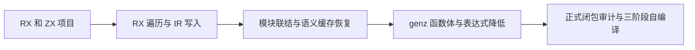

# 自举收敛计划

## Intent

优先迁移能让多个正式入口同时退出手写 Zig 的共享状态和调用。以本文件为持续更新的计划，每批集中验收后更新模块状态、实际退出的职责和下一批入口，随该批代码提交。最终让正式编译器自身的算法、规则和状态由 RX/ZX 提供。

## Data

正式 RX 入口的帧栈和语句推进已由 Source 执行。模块联结的拓扑排序、批量类型登记、窗口内的绑定推进和完整函数行写入已由 Source 执行。普通语义缓存恢复已在 Source 完成前缀快照、函数登记、发布后校验和回滚规则。原生缓存恢复也由一条 Source 路径完成合并、尾部写入和可见长度提交。genz 的普通函数和值 ABI 共用 Source 的正文执行、嵌套语句帧与失败恢复顺序。分支的原子求值和 AST 负载写入仍经 Zig 宿主。

## Edges

完成一批时沿原正式入口证明旧 Zig 职责退出，核对冷暖路径、共享状态和失败清理。保留的通用分配、平台 I/O、ABI 与初始 seed 要能说明归属。通用能力补齐围绕当前链路展开，复用已验收的 Source 引导器和验证产物。每批集中回归并对照受影响路径的性能，沿用固定基线跟踪累计变化。[执行约定](../../WAY.md) · [自举完成标准](../../rules/自举完成标准.md)

## Answer

### 迁移顺序

| 顺序 | 优先模块                      | 要贯通的完整职责                                                           | 完成信号                                                                                                          | 进度                                    |
| ---- | ----------------------------- | -------------------------------------------------------------------------- | ----------------------------------------------------------------------------------------------------------------- | --------------------------------------- |
| 1    | RX 语句遍历和 IR 写入         | 顺序调用、Task、Parallel、分支的开闭和结果汇合，连同帧栈、作用域和失败清理 | 正式 RX 入口由 RX/ZX 持有游标和帧，写回分支及作用域 IR。同职责的 Zig 遍历与帧栈撤出。                             | **正式遍历已迁移**                      |
| 2    | 模块联结和语义缓存恢复        | 类型登记、普通与原生模块绑定、结果与缓存提交、失败回滚                     | 正式联结和恢复步骤由 RX 调用，状态与提交约定由 ZX 持有。旧 Zig 阶段状态机和同职责桥撤出。                         | **正式发布与验证已贯通**                |
| 3    | genz 函数体、表达式与语句降低 | 普通函数、值 ABI 函数与共享特殊构造的递归上下文、符号、引用块和 AST 发布   | 源码入口以 RX/ZX 执行降低。同职责的 Zig Lower 状态、递归调度和临时适配撤出。                                      | **嵌套语句帧已迁移，接续 AST 负载发布** |
| 4    | 编译器全入口收尾              | 词法与语法、语义、所有权、诊断、优化、后端和缓存等剩余传递依赖             | 逐项核对剩余手写原生边界的归属。完成 seed、stage 1、stage 2、stage 3 的自编译，核对固定输入下的产物、行为与性能。 | 待核对                                  |

第 1 项先贯通共享游标和作用域状态的全部分支。第 2 项从联结入口及语义缓存恢复切入，统一核对普通与原生写回。第 3 项一起验收共享控制、值 ABI 和普通生成路径。[RX 语句降低](../../packages/compiler/src/rx/analysis/program/statements/traversal.zig) · [IR 写入](../../packages/compiler/src/rx/analysis/program/control/writer.zig) · [联结入口](../../packages/compiler/src/zx/modules/link.zig) · [Lower 工作区](../../packages/genz/src/zx/lower.zig)

#### 第 2 项执行顺序

1. **普通语义缓存预检和类型提交已迁移。** 预检与重绑定共用一条 RX 路径，类型写入与正文恢复在同一条发布链执行。
2. **普通与原生模块的联结推进已迁入 Source。** Source 在固定大小的借用窗口内逐模块绑定，发布函数编号并回收临时区。
3. **共享函数列与普通缓存提交。** 依赖正文、递归入口和普通缓存恢复共用函数行构造。检查普通缓存的函数、类型和名义来源前缀，验证成功后交付新前缀。
4. **原生缓存发布。** 同一条 RX 恢复路径推进准入、类型合并、尾部登记和提交。无缓存的原生导入复用最终写入规则。
5. **联结结果验证。** 正式工件联结借用已发布的函数、类型和导出，在 RX 发布路径内完成最终 IR 验证。普通缓存恢复复用同一入口。

模块联结仍从宿主借用固定窗口、函数存储和分配器。缓存恢复由宿主提供列内存、物理分配位置与错误解绕，Zig 继续负责项目级缓存索引和原生导入后的验证标记失效。

工件联结先完成递归入口登记，再刷新函数和导出视图。已组装程序的直接追加也在 Source 内验证，宿主继续负责创建借用视图与资源清理。正式联结和缓存恢复的剩余原生接口随第 4 项梳理传递闭包。[联结入口](../../packages/compiler/src/zx/modules/link.zig) · [结果发布](../../packages/compiler/src/zx/modules/link/result/publication/publish.rx) · [共用验证](../../packages/compiler/src/zx/modules/artifact/validation/verify.rx)

#### 第 3 项执行顺序

1. 从 `Lower.function` 和 `Lower.valueMode` 的共用函数体入口开始，迁移每个函数的符号、引用块、暂存状态以及进入和退出时的恢复。
2. 在同一上下文接管表达式与语句的递归推进，包括分支、循环、调用和所有权相关的生成路径。
3. 从普通函数、值 ABI 和递归入口验证相同输入的 AST 与 Zig 产物，确认正式生成闭包退出旧 `Lower` 调度。第 4 项再逐类清点剩余的编译器自有实现和允许保留的原生边界。[Lower 工作区](../../packages/genz/src/zx/lower.zig)

普通入口、同文件函数与独立函数文件已共用 Source 的工作区预留和初始化。正文的 `If`、`Switch`、块边界与分段顺序，以及普通和值 ABI 的缓存读取、增长和表示转换计划均由 Source 决定。普通、值 ABI 和迭代共用条件表达式的求值计划与发布入口。匹配表达式的默认结果、分支计划和汇合也在正式路径接入 Source，宿主继续执行单次递归求值、临时缓存的安装和 AST 写入。[正文计划](../../packages/genz/src/analysis/statements/traversal/build.rx) · [条件与匹配](genz条件与匹配表达式自举.md)

下表记录已接入共享降低路径的职责和各自的退出判据。下面的阶段记录注明哪些宿主依赖仍在执行，当前优先项见本节末尾。

| 顺序 | 共享职责                               | 本组退出信号                                                                                                                                      |
| ---- | -------------------------------------- | ------------------------------------------------------------------------------------------------------------------------------------------------- |
| 3.1  | 聚合表达式的操作数与字段求值           | 从普通、值 ABI 和迭代的对象、元组入口入手。将操作数顺序、临时缓存、失效引用和字段表示的决策接到同一条 Source 路径。常规与迭代保留各自的借用视图。 |
| 3.2  | 循环与集合表达式的状态推进             | 贯通初始状态、迭代参数、回调、返回值和退出恢复。由 Source 决定状态推进和借用生命周期，逐项消除 Zig 遍历与回写。                                   |
| 3.3  | 普通与值 ABI 调用、Task 和共享入口分派 | 贯通参数求值、转换、函数请求、错误返回和分支汇合。核对普通、递归和独立函数入口，逐项收掉仍持有专用状态的 Zig 调度。                               |

聚合入口已共用 Source 的临时缓存记账和回收规则，字段与序列表示也由 Source 选择。现有 IR 提供求值顺序，宿主负责递归执行和提交 AST。[聚合阶段](genz聚合求值与字段表示自举.md)

循环的名称捕获、安装与恢复已迁入 Source，投影和普通路径共用测试及回调求值的作用域。集合操作数的表示已由 Source 选择。循环符号按 Source 计划逐项恢复，借用视图仍由宿主收尾。[循环阶段](genz循环参数与视图生命周期自举.md)

普通 map 与 filter 的分配、循环体写入和循环 AST 已接入 Source。在循环结果消费中，Source 负责从 IR 生成读取路径并选择借用或转换。宿主继续执行回调、转换和 AST 行安装。[集合回调与循环结果](genz集合回调与循环结果消费自举.md)

普通调用的资源、函数引用和调用在 Source 一次构造。值 ABI 的引用和调用也已贯通，借用作用域同表示切换共用 Source 规则。循环消费者的候选及回退由 Source 决定。宿主继续安装缓存和类型列、执行递归参数求值及转换。[调用阶段](genz调用边界与依赖发布自举.md)

Task 启动与绑定、等待与取消、并行等待与结果发布已接到 Source 编排。worker 保存和恢复实际捕获的名称槽，去掉名称表整列复制。宿主继续递归执行子表达式与 worker 正文，并安装借用状态及 AST 行。[任务阶段](genz任务捕获与并行发布自举.md)

嵌套投影由 Source 解析字段名称、下标键和路径段边界。普通、值 ABI 回退及迭代共用字段、元组、长度和可空值的构造。宿主继续执行递归求值、状态表示转换和列安装。[表达式访问阶段](genz共享表达式访问自举.md)

普通、值 ABI 和迭代入口在一次读取中复用同一个普通缓存查询结果，计数发生在实际消费时。值 ABI 的回退与普通命中延后 IR 解码，已确认的常量标签直接降低。增长处理仍在表达式求值后执行。[读取与回退阶段](genz表达式读取与回退自举.md)

三路表达式作用域共用 Source 的逆序绑定请求和读取方式。末项融合候选、迭代局部符号筛选及迭代声明的使用状态均由 Source 决定。宿主提交原有成员表及 AST 列，并回收本层已提交的键。成员表的只读切片 ABI 丢失可写容量，待迁移通用成员表时统一解决。[作用域阶段](genz表达式作用域自举.md)

未命中缓存的普通表达式按 Source 分派。普通和值 ABI 的条件分支、普通及迭代的固定读值、运算符的操作数顺序分别复用请求。Source 分派和固定操作数顺序在 Zig 编译期固化。复杂表达式继续借用 IR，宿主负责递归调用和 AST 提交。[未缓存表达式阶段](genz未缓存表达式调度自举.md)

被请求函数、独立签名、Task worker、排序 worker 和契约谓词按 Source 规则继承、建立和发布局部状态。函数正文和契约的列替换由编译期计划选择。排序和 Task 共用名称槽恢复，排序退出整列名称复制。宿主继续执行递归求值、安装列及回收临时分配。[递归工作区阶段](genz递归工作区自举.md)

值函数、借用参数、循环与 ABI 适配器共用 Source 的作用域发布和恢复规则。普通和转换类型列保持原位置。借用和迭代调用共用缓存槽回收。[表示作用域阶段](genz表示作用域发布与恢复自举.md)

成员索引的批量容量预留和原地回收已接入正式作用域。Source 写入并发布 AST 成功前缀的行头。宿主执行实际的负载复制和失败行回滚。[成员索引与选中行阶段](genz成员索引与选中行发布自举.md)

`Lower.function` 的普通函数和值 ABI 入口已共用 RX 的正文、契约、前置声明、引用块和 Store 提交顺序。Source 提交语句结果并按融合成功与否推进游标，也在同一生成入口发布引用区间的行头和可见长度。[函数正文阶段](genz函数正文与语句结果发布自举.md)

嵌套语句的槽位、写入窗口和出错后的释放顺序均由 Source 决定，宿主退出 `depth`、`occupied`、`selection_depth` 和作用域内的 Switch 指针。无分支时沿用直接执行。[语句帧阶段](genz语句帧与失败恢复自举.md)

**下一批优先收拢 AST 负载发布。** 从 `Switch.finish` 和 `Lower.hoistReferences` 追到选中行导入，与密集行共用的借用、复制及失败前缀提交一起核对。把编译器自有的行选择与写入事务留在 Source，区分底层通用列复制和仍需迁移的宿主状态，保持原有文本和负载生命周期。随后沿普通、值 ABI 与递归入口核对剩余求值调度。[选中行导入](../../packages/genz/src/node/import_selected.zig) · [密集行导入](../../packages/genz/src/node/import_rows.zig)

#### 第 4 项执行顺序

1. **先收掉前三项遗留的编译器状态和适配。** 沿正式 RX 和 ZX 入口追查表达式求值、导入绑定、项目缓存索引、验证标记，以及 AST、IR 和类型表的写入。对每个仍在执行的专用桥记录调用方、持有的状态和移除条件，从共享调用方最多的状态入手，连同读写和错误恢复一批迁移。
2. **再补齐编译前后的其余语义。** 按源码加载、词法与语法、类型与所有权、诊断与优化、目标生成的顺序审计正式调用链。先处理共用路径，再核对独立的命令和后端入口。已经由 Source 执行的模块沿用现有证据，只迁移审计确认仍由手写 Zig 执行的职责。
3. **最后锁定正式构建闭包。** 对保留的 Zig 路径写明平台或初始 seed 的用途，确认正式编译器不调用 seed 的语义。使用同一工具链、配置和清单执行 `seed → stage 1 → stage 2 → stage 3`，核对约定产物、行为、冷暖用时和内存峰值。[自举完成标准](../../rules/自举完成标准.md)

### 收敛门槛

**进入集中收尾的信号**是普通函数、值 ABI 和递归入口共用 Source 的上下文和推进规则，旧 `Lower` 调度退出正式路径。到达这个门槛后，沿正式编译器闭包逐项消除剩余专用 Zig 职责。与迁移退出无直接关系的功能扩展和性能探索留到这条路径稳定后。

**完成自举的信号**是正式闭包的手写边界逐项核实，只保留允许的通用原生边界，且 `seed → stage 1 → stage 2 → stage 3` 的约定产物、行为和性能均通过验收。

每批收口时在这里更新优先项状态和进度，写明退出的 Zig 函数和状态、仍在执行的过渡接口，以及同输入回归、产物和性能证据。随后写明下一条正式入口和它的退出信号。恢复会话从该入口接续，复用对应阶段已经通过的验收。初始 seed 单列。各项完成以实际调用和状态归属为准。

### 进度

| 日期       | 阶段                          | 已退出的职责及证据                                                                                                                                                                                              | 当前余量                                                                                                |
| ---------- | ----------------------------- | --------------------------------------------------------------------------------------------------------------------------------------------------------------------------------------------------------------- | ------------------------------------------------------------------------------------------------------- |
| 2026-11-20 | Gateway 存储契约与 Store 状态 | Zig 还原常量、合并四份 AST 并选择根的步骤退出正式入口。移除四条分段生成适配。已推送 `89b703dd2`。[验收](Gateway存储契约与Store状态直接打印自举.md)                                                              | 宿主保持输出缓冲与借用 ABI                                                                              |
| 2026-11-20 | 应用宿主直接打印              | 八条入口退出 Zig 声明装配和打印接线。97 份生成文件一致。已推送 `3be9dcdb2`。[验收](应用宿主生成与直接打印自举.md)                                                                                               | 库构建、元数据和 ABI 视图另在正式发布链                                                                 |
| 2026-11-20 | 共享类型命名空间              | 计划和声明生成合并到 RX，退出逐声明索引和表头复制。七组回归通过，最终 11,753 份生成文件一致。冷生成 CPU 比上一代减少 2.72 秒。[阶段记录](共享类型命名空间声明与输出区间自举.md)                                 | AST 仍由宿主借用和追加，逐声明工作区由宿主复用                                                          |
| 2026-11-20 | RX 语句遍历和 IR 写入         | 正式正文入口退出 Zig 帧栈及逐事件往返。Source 决定作用域位置和分支 IR 写入范围。八组回归、1,481 项测试通过，11,753 份生成文件一致。[验收](RX语句遍历帧栈与分支写入自举.md)                                      | 表达式求值、调用导入、实际绑定长度及 IR 列的内存适配保留在 Zig。初始 seed 保留旧遍历。                  |
| 2026-11-20 | 普通语义缓存事务与类型写回    | 正式路径移除枚举调度、独立预检调用和 Zig 类型提交入口。八组回归、199 项 Zig 测试和 5 项磁盘检查通过。99 个源码缓存项和 2 个原生接口缓存项全部命中。[验收](普通语义缓存事务与类型写回自举.md)                    | 递归函数登记及验证前缀仍有 Zig 宿主代码。下一批迁移联结绑定游标和共享函数表写入。                       |
| 2026-11-20 | 模块联结正文与入口发布        | 移除按模块查询当前行、阶段枚举，以及保留正文经过 Zig 函数再转回 Source 的往返。八组回归和 300 项测试通过，128 模块联结结果及 11,753 份固定清单产物一致。[验收](模块联结正文与入口发布自举.md)                   | 拓扑顺序迭代、模块工作区切换和递归入口行 ABI 仍在 Zig。                                                 |
| 2026-11-20 | 模块联结遍历与临时区          | Source 接管逐模块绑定、编号发布和临时区回收。339 项回归和 4 项安装版集成检查通过。冷生成墙钟与上一代持平，进程树峰值 RSS 下降 13.46 MB，11,753 份产物一致。[验收](模块联结批量遍历与工作区自举.md)              | Zig 仍安装最终正文描述符、装配递归入口行并持有缓存回滚边界。                                            |
| 2026-11-20 | 函数行发布与普通缓存提交      | 去掉依赖正文补写队列和递归入口 Zig 行装配。普通缓存的发布后验证归同一条 RX 链。199 项回归、5 项磁盘缓存集成检查通过。11,753 份固定清单产物和 14,247 份当前清单产物一致。[验收](函数行发布与语义缓存提交自举.md) | 原生缓存还需贯通合并、尾部登记和最终成员可见长度。宿主提供列借用、分配位置和错误解绕。                  |
| 2026-11-20 | 原生缓存与成员提交            | Zig 的合并与发布之间的往返以及缓存路径上的独立最终登记已退出。135 项回归和 9 项安装版检查通过，14,253 份当前清单产物一致。[验收](原生缓存与成员提交自举.md)                                                     | 项目级缓存索引与异常清理由宿主持有。下一批把联结结果的 IR 验证接入 Source 发布链。                      |
| 2026-11-20 | 联结结果验证与共享视图        | 正式工件联结在 RX 发布链内验证结果。两条发布路径共用列视图和前缀验证。228 项回归与 6 项集成检查通过，14,253 份当前清单产物一致。[验收](联结结果验证与共享视图自举.md)                                           | 宿主继续借用列、管理分配区和处理异常。下一优先项为 genz 函数上下文。                                    |
| 2026-11-20 | genz 函数工作区与 AST 区间    | 普通和值 ABI 共用工作区预留与正文准备。去掉 Zig 符号解包及独立函数文件重复分配，ZX 决定缓存转换和区间借用。391 项回归与 5 项安装版检查通过，14,700 份产物一致。[验收](genz函数工作区与AST区间自举.md)           | 下一批迁移正式的反向语句遍历、作用域及分支帧。共享表达式上下文、表示恢复和 AST 容量提交仍在 Zig。       |
| 2026-11-20 | genz 正文遍历与作用域         | 正式路径退出 Zig 的 If 与 Switch 递归。Source 决定分支顺序、分段执行与符号回收。九组回归、346 项测试通过，14,360 份产物一致。[验收](genz正文遍历与作用域自举.md)                                                | 宿主仍执行原子降低、终值融合后的槽写入和 AST 提交。下一批迁移表达式缓存和表示作用域。                   |
| 2026-11-20 | genz 表达式缓存与值表示作用域 | 缓存命中和计数合并，增长规则由 Source 静态生成。值表示批量转换与发布，移除宿主逐槽游标。八组回归共 740 项测试通过，14,811 份产物一致。[验收](genz表达式缓存与值表示作用域自举.md)                               | 宿主仍执行单项转换和安装、恢复视图。下一批收口条件与 match 表达式的分支顺序和汇合。                     |
| 2026-11-20 | genz 条件与匹配表达式         | 三路条件共用 Source 计划及节点发布。值 ABI 通用发布与迭代 Zig 节点构造退出该路径。1,702 项回归和 3 项集成检查通过，14,820 份生成文件一致。[验收](genz条件与匹配表达式自举.md)                                   | 宿主仍执行递归请求和 AST 安装。下一批迁移聚合操作数、字段求值和临时缓存。                               |
| 2026-11-20 | genz 聚合求值与字段表示       | 普通、值 ABI 和迭代共享临时缓存记账和回收，Source 选择字段与序列表示。十二组回归共 992 项测试，另有两项 CLI 集成检查通过，14,836 份生成文件一致。[验收](genz聚合求值与字段表示自举.md)                          | 宿主仍处理递归求值和 AST 安装。下一批迁移循环参数、更新、返回和退出恢复。                               |
| 2026-11-20 | genz 循环参数与视图生命周期   | Source 保存和写入参数名，并提供首测和回调计划。普通与投影循环共用视图恢复，集合操作数由 Source 定位。3,001 项测试与 6 项 CLI 检查通过，14,849 份生成文件一致。[验收](genz循环参数与视图生命周期自举.md)         | 宿主继续处理递归调用与 AST 安装。下一批推进集合回调和循环结果消费。                                     |
| 2026-11-20 | genz 集合回调与循环结果消费   | 普通 map、filter 的分配、更新和循环 AST 由 Source 发出。循环结果路径与表示判断已迁移。979 项 Zig 测试和 6 项 CLI 检查通过，14,871 份生成文件一致。[验收](genz集合回调与循环结果消费自举.md)                     | 宿主执行回调、类型转换和 AST 安装。下一批收敛参数作用域与普通、值 ABI 调用。                            |
| 2026-11-20 | genz 调用边界与依赖发布       | 普通调用的分配器 AST、值 ABI 的引用和调用构造、借用视图恢复规则及循环消费回退已接入 Source。564 项 Zig 测试、46 项集成检查通过，14,878 份生成文件一致。[验收](genz调用边界与依赖发布自举.md)                    | 宿主仍执行递归参数求值、原子转换和列安装。下一批贯通 Task 捕获、启动、等待、取消与并行结果发布。        |
| 2026-11-20 | genz 任务捕获与并行发布       | 退出捕获名称整表复制、参数投影及并行结果配置的 Zig 扫描。1,625 项 Zig 测试、68 项集成检查通过，14,883 份引导产物与 14 份 Task 夹具生成文件一致。[验收](genz任务捕获与并行发布自举.md)                           | 宿主继续递归执行 worker 及各任务分支并安装列。下一批收拢普通、值 ABI 和迭代表达式的共用访问与递归推进。 |
| 2026-11-20 | genz 共享表达式访问           | Source 解析投影键、字段名与段边界，组合字段 AST、长度和可空值。2,819 项 Zig 测试及 1 项 CLI 检查通过，14,892 份引导产物与 20 份现有夹具生成文件一致。[验收](genz共享表达式访问自举.md)                          | 宿主继续递归执行下标键及原子转换，安装 AST 列。下一批贯通三路表达式的缓存、表示回退和后置增长。         |
| 2026-11-20 | genz 表达式读取与回退         | 值 ABI、迭代和普通入口复用一次普通缓存查询，常量标签直接降低，迭代调用由 Source 选择 ABI。586 项 Zig 测试、8 项集成检查通过，14,900 份引导产物及 19 份夹具生成文件一致。[验收](genz表达式读取与回退自举.md)     | 宿主执行原子降低、安装借用和 AST。下一批收口作用域的符号登记、逆序绑定推进与退出恢复。                  |
| 2026-11-20 | genz 表达式作用域             | 三路共用 Source 的绑定游标与求值方式。Source 选定末项融合及迭代新增成员，迭代发布前读更新后的名称和类型。957 项 Zig 测试与 3 项集成检查通过，14,911 份引导产物一致。[验收](genz表达式作用域自举.md)             | 宿主提交成员键和 AST 区间，执行递归子表达式。下一批处理未缓存表达式的共享请求和旧分派。                 |
| 2026-11-20 | genz 未缓存表达式调度         | 普通表达式由 Source 选择分派，三路共用固定操作数请求。1,297 项 Zig 测试通过，14,916 份引导产物一致，冷生成墙钟和 CPU 各增加 0.02 秒。[验收](genz未缓存表达式调度自举.md)                                        | 宿主递归执行具体操作并安装 AST。下一批迁移递归工作区的继承、隔离与回收。                                |
| 2026-11-20 | genz 递归工作区               | 被请求函数、独立签名、Task、排序和谓词共用 Source 工作区规则，排序退出整列名称复制。11,595 项测试通过，14,933 份引导产物一致。[验收](genz递归工作区自举.md)                                                     | 宿主递归执行、安装列和回收分配。下一批收口表示视图的发布和恢复。                                        |
| 2026-11-20 | genz 表示作用域               | Source 决定表示、迭代和 ABI 临时状态的发布与恢复，退出类型表描述符的来回替换。495 项测试通过，14,935 份引导产物一致。[验收](genz表示作用域发布与恢复自举.md)                                                    | 继续迁移成员表与 AST 行发布及失败前缀。                                                                 |
| 2026-11-20 | genz 成员索引与选中行发布     | 作用域恢复共用无分配的 Source 成员回收，Source 发布 AST 成功前缀的标签、偏移和可见长度。1,488 项测试通过，14,944 份引导产物一致。[验收](genz成员索引与选中行发布自举.md)                                        | Zig 仍执行 AST 负载复制与失败行回滚。下一批贯通普通和值 ABI 函数正文的执行。                            |
| 2026-11-20 | genz 函数正文与语句结果发布   | 正式路径用 RX 确定函数正文的执行和输出顺序，Source 提交语句融合结果及引用区间行头。1,276 项测试和两项集成检查通过，14,954 份引导产物一致。[验收](genz函数正文与语句结果发布自举.md)                             | Zig 仍维护嵌套语句帧槽位、失败恢复和 AST 负载写入。先迁语句帧，再核对递归求值及 AST 负载的剩余依赖。    |
| 2026-11-20 | genz 语句帧与失败恢复         | Source 决定语句与 Switch 槽位、列窗口和失败恢复链。退出宿主三个计数器和可空 Switch 指针，遍历按值保留父帧。236 项 Zig 测试与 9 项集成检查通过，14,951 份引导产物一致。[验收](genz语句帧与失败恢复自举.md)       | 宿主执行原子求值、资源释放与 AST 负载写入。下一批收拢选中行与密集行的 AST 负载发布。                    |
