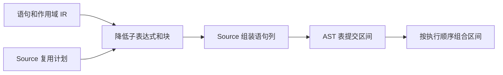
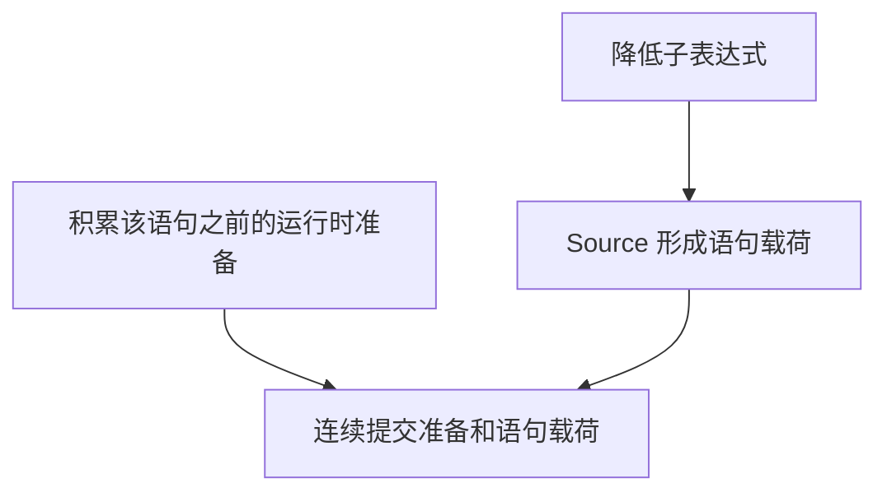

# 语句与作用域直接发布自举

## Intent

让普通语句与表达式作用域将 Source 产生的 AST 列直接提交到正式语句表。作用域复用的字段改写计划由 Source 持有，只为实际改名的绑定保存恢复信息。

## Data

`statements.lower` 和 `scope.lowerMode` 反向降低子表达式与块，最后按执行顺序组装已提交区间。声明、解构、显式返回、条件、丢弃和 Store 写入仍先将 Source 列还原为 Zig 语句列表，随后重新拆列入表。作用域复用还另外复制计划和原绑定名称。

## Edges

保留原有子表达式处理顺序、Store 事务起点、返回处理和作用域名称恢复。生成器读取的名称要在 AST 存续期间有效。直接发布只复制列元素或名称视图，临时生成的文本在边界取得正确归属。初始 seed 保留原语句构造路径。

## Answer

通过已有的聚合、作用域、分支、字段所有权、Store 和分配失败回归，核对冻结清单与 seed 样例的生成文件。以同工具链和缓存条件对照上一代和固定基线的生成耗时与内存。记录仍由宿主执行的递归求值和表容量维护。

### 实现

普通声明、字段原地更新、解构、返回、条件、丢弃、Store 写入和并行语句从 Source 取得列。原先已经积累的求值准备语句先提交，Source 列紧跟其后，调用者直接获得 AST 区间。并行分支的内外层共用一次列提交，外层只返回自己的区间。源结果的借用只持续到列提交，AST 留存的名称继续由调用者或生成器静态存储持有。

作用域的 RX 保持候选准入、最后使用位置收集、初始化和规划顺序。ZX 发布实际发生的别名，按绑定顺序应用并逆序恢复，保留链式改名的含义。宿主在作用域结束时释放规划内存，未改名的绑定无需保存名称。计划与候选字段直接供后续降低使用，移除 Zig 端重复预检、计划复制和全表名称恢复。

### 固定清单回测

macOS arm64，Zig 0.17.0，ReleaseSmall，16 分区，关闭常驻。候选由 `fc0038873` 的 Source 引导器生成。固定基线、上一代和候选均执行各自的 Source 分析与生成。三套工具在同一 735 入口冻结清单交错运行三轮，取中位数。

| 指标                   |  固定基线 |    上一代 |      候选 |
| ---------------------- | --------: | --------: | --------: |
| 冷生成墙钟             |    2.85 s |    2.59 s |    2.58 s |
| 冷生成 CPU             |   12.46 s |   12.17 s |   12.17 s |
| 进程树采样峰值 RSS     | 894.55 MB | 709.49 MB | 711.43 MB |
| 单进程系统记录峰值 RSS | 920.90 MB | 743.47 MB | 741.92 MB |
| 热重建墙钟             |    2.25 s |    2.00 s |    2.02 s |
| 热重建 CPU             |    8.52 s |    8.22 s |    8.25 s |
| 无改动墙钟             |    0.04 s |    0.03 s |    0.03 s |

冷生成墙钟较上一代减少 0.01 秒，CPU 持平。进程树采样峰值增加 1.93 MB，单进程系统峰值减少 1.56 MB。较固定基线，冷生成墙钟与 CPU 分别减少 0.27 秒和 0.29 秒，两种 RSS 峰值分别减少 183.12 MB 和 178.98 MB。候选三轮冷生成墙钟为 3.81、2.58 和 2.57 秒，对应 CPU 为 12.17、12.15 和 12.20 秒。

排除工具身份戳，上一代与候选的 11,753 个生成文件逐字节一致。两者的所有权缓存 v18 正文 SHA-256 均为 `cdf9fa7e0f33002a95dc097b2837de781d67e6e519a452fb97f89f7c0bbf3a23`。三套工具各自的热重建与冷生成一致。

### 引导与增量

Source 引导器完成 25 步构建，初始 seed 完成 14 步。旧 seed、新 seed 与候选 Source 在六个已有输入上生成的 22 个文件逐字节一致。常驻首次生成、编辑读取位置、改动调用依赖和恢复源码，四次生成各自与独立冷生成一致。上一代与候选在每次请求的 22 个生成文件上均一致。

候选引导器构建的 14 个回归入口完成 733 步，1,188 项检查全部通过。覆盖解构、显式返回、switch 求值与分支绑定、带类型的错误捕获、字段原地更新、聚合循环、Store 所有权，以及 RX 并行的原生运行与编译库消费。

### 自我审查

Zig 继续执行递归表达式求值、作用域工作区分配、节点表容量维护和错误适配。Task 和 Store 事务生成的一些辅助语句仍经过旧有暂存接口。冻结清单覆盖编译器分析、生成、缓存和写出，完整冷构建的后端时间与峰值还需单独核验。
