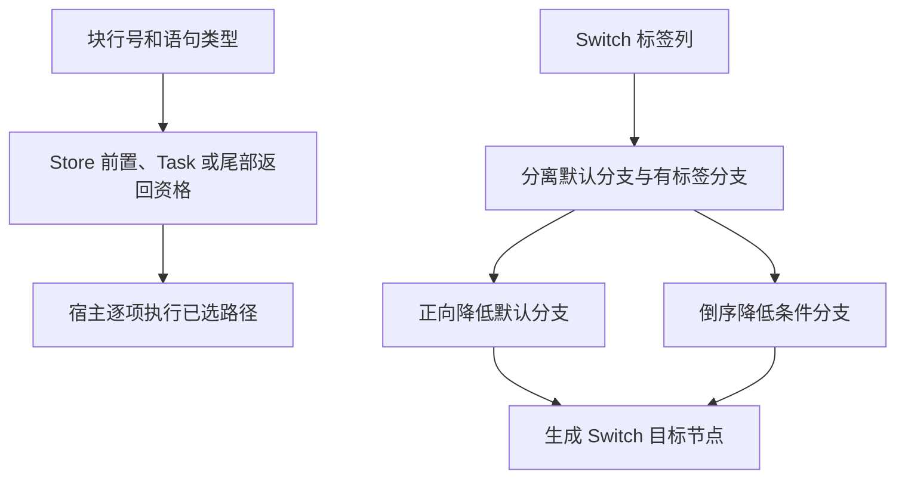

# 语句块与分支降低调度自举

## Intent

让正式 GenZ 在降低函数体、循环返回和 Switch 分支时，由 Source 决定语句的静态处理路径与分支顺序。保留动态求值、局部引用使用状态、结点编号和 Store 事务语义。

## Data

`Lower.statements → statements.lower` 先登记块的局部值布局，再倒序降低语句。现有宿主逐条调用 Store 候选检查、任务绑定判定和末尾返回合并检查。Switch 宿主先正向找默认分支和标签，再倒序降低各个非默认分支，最后交给已有 Source 构造目标 AST。

## Edges

Source 只提前计算对当前块不变的事实。绑定是否已被引用、返回合并是否实际成功、分支内递归和 Store 生成副作用仍依原降低顺序处理。初始 seed 沿用旧规则。显式 Switch 条件与默认分支分别保存原来的遍历顺序，重排元数据继续借用原控制表。

## Answer

一次验收生成形态、相关回归、初始引导和固定清单冷暖性能。用字节对照核对语句和分支编号。明确宿主仍承担的动态降低和存储职责。

### 正式路径

- [块规划](../../packages/genz/src/analysis/statements/block/plan.zx) 借用控制列、表达式类型和 Store 信息，
  一次生成每条语句的处理标志。删除逐条 Store 候选查询和尾部返回资格查询。普通绑定的引用状态仍在
  倒序降低时读取，保证后文先登记的引用继续影响绑定。
- [Switch 分区](../../packages/genz/src/analysis/statements/switch/partition.zx) 先收集标签和行号。
  默认分支按旧顺序正向降低，命名分支按旧顺序倒序降低。选择快路径仍使用既有标签判断，
  比较和字面量的生成时机保持原顺序。
- 在每个分段完成时累加最终语句数。宿主为整个块预留一次结果容量，再按源码顺序写出，
  省去逐段扩容及缩容。

Source 引导器通过 25 个构建步骤，初始 seed 通过 14 个步骤。两套工具对四个已有入口生成的 17 个文件
逐字节一致，排除工具身份戳。

以候选引导器重新生成后，Switch 求值顺序、嵌套、作用域和标量分支、ZX Task、返回合并及 Gateway
的八组回归通过 336 个构建步骤、347 项 Zig 测试和 86 项 Gateway 运行检查。

### 性能与产物

使用 735 个入口的冻结清单，macOS arm64、Zig 0.17.0、ReleaseSmall、16 分区、关闭常驻。
候选由上一代 `37a1f1cdd` 的 Source 引导器生成，固定基线沿用引导声明准备阶段。三套工具均执行
Source 分析和生成。以下为三轮交错的中位数，热重建复用同次冷生成缓存。

| 指标                 |  固定基线 |    上一代 |      候选 |
| -------------------- | --------: | --------: | --------: |
| 冷生成墙钟           |    2.80 s |    2.58 s |    2.54 s |
| 冷生成 CPU           |   12.35 s |   12.20 s |   12.10 s |
| 冷生成进程树采样峰值 | 885.03 MB | 701.60 MB | 697.73 MB |
| 冷生成单进程系统峰值 | 924.35 MB | 739.39 MB | 795.16 MB |
| 热重建墙钟           |    2.21 s |    2.00 s |    1.93 s |
| 热重建 CPU           |    8.33 s |    8.27 s |    8.13 s |

候选与上一代的 11,753 个生成文件及所有权 memo 逐字节一致，排除工具身份戳。三套工具各自
冷暖输出一致。候选与上一代的输出清单 SHA-256 均为
`7248304214a4e61487c037e6ebc0017ce4f9adb96d7071e985dc963a8c43dc4b`。

第一轮三组对照中，单进程系统峰值的中位数比上一代高 55.77 MB，但两代单次结果分布重叠。
为核对这一差异，在回归结束后对同一冷生成路径追加六组交错样本，直接取 `wait4` 的峰值，
并约每 5 ms 采样生成器的驻留内存。复测系统峰值中位数为 **734.99 → 734.52 MB**，
密集采样峰值为 **715.83 → 721.11 MB**。六次系统峰值的分布重叠，首组对照的增幅未重现。
密集采样中位数增加 5.28 MB，继续按独立口径记录。冷生成墙钟和 CPU 相对固定基线分别减少
0.26 秒和 0.25 秒。

### 自我审查

块内选择、Switch 行序和静态资格在 Source 计算。Zig 宿主仍处理表达式求值、嵌套块递归、
局部符号的动态使用情况、成功合并后的游标推进和最终语句写入。Switch 计划多用了每个分支
一个行号槽，和原标签工作区合配，求值期间继续借用原控制表。性能口径覆盖分析和 Zig 生成。
