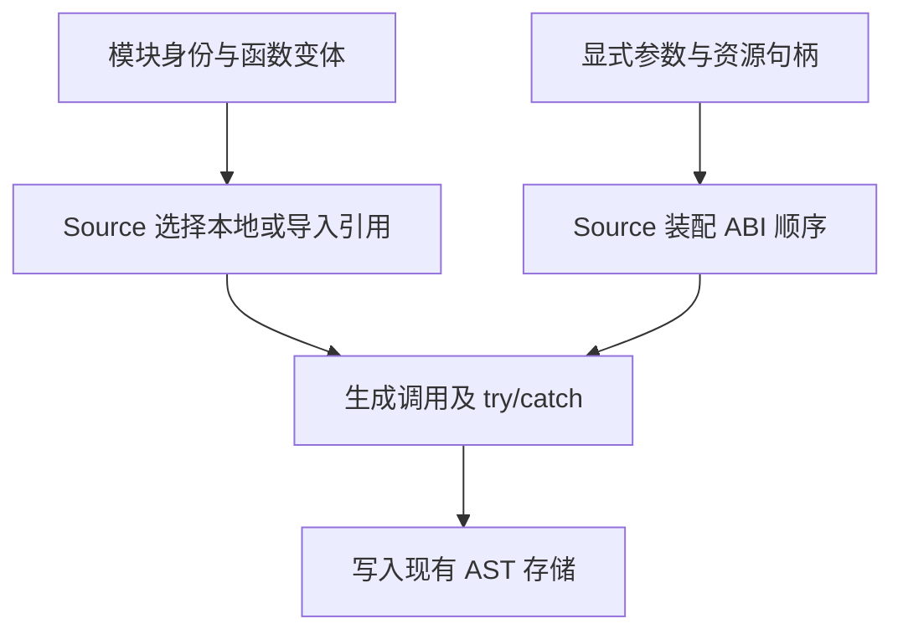

# 调用 ABI 装配与函数引用自举

## Intent

将普通调用的 ABI 参数列表与静态函数引用迁入 Source。普通和值调用复用函数引用与参数顺序规则，保持原有求值次序、错误出口和生成形态。

## Data

`Lower.regular → regular_call.lower` 在显式参数和 Store 实参降低后，宿主仍创建 I/O 和进程参数、解析被调函数、分配参数列表并调用通用发射入口。值调用也在宿主生成函数引用。现有 Source 已处理调用资格、外部元组 ABI 和异常节点，它们继续参与正式路径。

## Edges

保留普通调用先建立分配器引用、再求显式实参、再求 Store 实参的次序。函数请求仍登记到实际请求表。内联生成请求、本文件的递归函数和跨文件导入继续使用各自目标。临时字段和函数名依原生命周期处理。

## Answer

比较普通、值、Store、原生和分区入口的结果及产物形态。沿固定清单采集冷暖生成 CPU、墙钟和内存。记录宿主保留的实际求值和存储职责。

普通调用现在由 [RX 发射入口](../../packages/genz/src/analysis/invocation/regular/emission/build.rx)连接 I/O 与进程参数、静态被调引用、有序参数及错误出口。值调用沿用同一套参数顺序和函数引用规则。Source 直接装配目标节点列，宿主一次写入现有 AST，普通调用省去通用发射入口对参数数组的再复制及分配器实参扫描。

实际参数求值与规则仍从 [普通调用宿主入口](../../packages/genz/src/zx/regular_call/root.zig)进入，Store 存储的绑定、函数请求登记、AST 存储和错误适配继续由宿主管理。该阶段完成调用目标与 ABI 节点的装配迁移。

模块生成、值返回、原生值边界、原生生成、Gateway、类型化错误执行和统一库链接回归共通过 256 个构建步骤和 298 项检查。

### 生成物与开销

上一代 Source 和该阶段 Source 对 735 入口冻结清单生成的 11,753 个文件逐字节一致，排除工具身份戳。所有权 memo 内容哈希相同，为 `46dd27d8d112d91aab0397d8b5170be88d1ca798c063c85821fd95462bb61876`。初始 seed 与该阶段 Source 对四个借用入口生成的 17 个文件逐字节一致，比较时同样排除工具身份戳。Source 引导构建通过 25 步，初始引导器构建通过 14 步。

冻结构建输入及工具配置为 macOS arm64、Zig 0.17.0、ReleaseSmall、16 分区，关闭常驻。三套工具均由 Source 生成并执行 Source 分析和后端。取三轮交错结果的中位数。热重建从同轮冷生成取缓存。

| 指标                 |  固定基线 |    上一代 |      候选 |
| -------------------- | --------: | --------: | --------: |
| 冷生成墙钟           |    2.83 s |    2.58 s |    2.58 s |
| 冷生成 CPU           |   12.40 s |   12.22 s |   12.20 s |
| 冷生成进程树采样峰值 | 885.44 MB | 699.84 MB | 701.56 MB |
| 冷生成单进程系统峰值 | 921.70 MB | 765.69 MB | 796.56 MB |
| 热重建墙钟           |    2.20 s |    1.99 s |    1.97 s |
| 热重建 CPU           |    8.43 s |    8.28 s |    8.28 s |
| 无改动墙钟           |    0.04 s |    0.03 s |    0.03 s |

相对固定基线，冷生成墙钟下降 0.25 秒、CPU 下降 0.20 秒、进程树采样峰值下降 183.88 MB。单进程峰值中位数比上一代高 30.87 MB，候选单次读数在 727.02～800.10 MB 之间。进程树采样峰值比上一代高 1.72 MB。每轮暖缓存输出等于该工具的冷生成输出。

### 自我审查

常规调用的返回类型转换和实际参数求值仍在宿主。当前测量覆盖冻结清单的前端与 Zig 生成，完整冷构建及 Zig 后端链接成本沿用历史证据。
