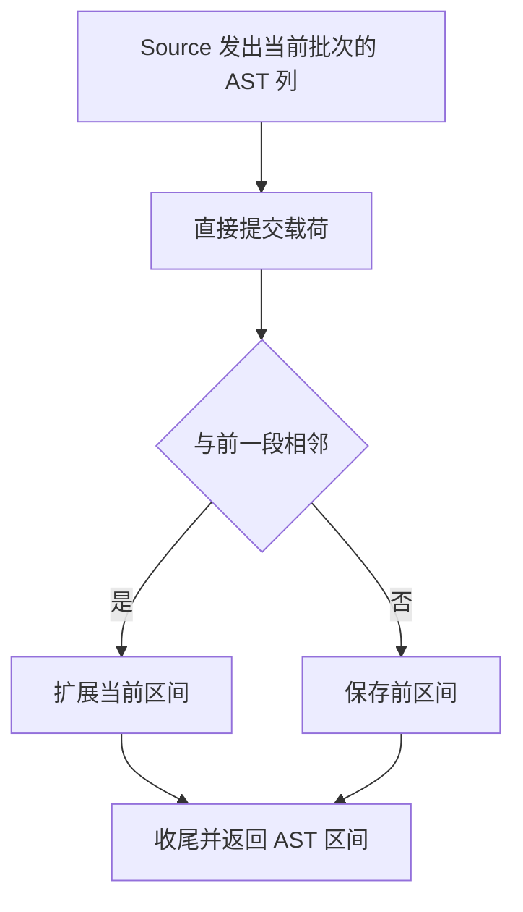

# 调用边界语句直接发布自举

## Intent

普通调用、值返回调用和借用调用直接使用 Source 生成的 AST 列。跨调用的声明、裁剪与返回转换保留求值顺序，并复用已经提交的语句。

## Data

调用降低器已经用 Source 决定调用参数表示、入参与返回转换和所有权裁剪。实参绑定、转换及丢弃语句仍被宿主还原为 Zig 语句列表，之后再写回 AST。在嵌套调用中，这些列表和子块同时占用工作区。

## Edges

参数按原求值顺序降低。借用存储声明仍先于使用点，嵌套子块先使用其计划中的表基址发布。块连续时直接复用，遇到间隔时保留区间，在收尾时按逻辑顺序写入头部。调用路径以外的旧列表消费者和初始 seed 沿原接口执行。

## Answer

使用语义、性能和增量对照核对普通调用、嵌套调用、借用返回、Store、所有权裁剪与公开边界。跟踪冷暖生成相对上一代与固定基线的变化，并记录留在宿主的递归求值和 AST 存储边界。

### 实现

调用表达式和借用局部绑定直接提交声明、丢弃和转换语句。返回和公开入口也使用同一条路径，借用槽仍先发布在函数入口。紧邻的提交扩展已有区间，只有实际不连续时才在临时区记录额外区间。组装块时以语句头部引用原载荷。

值调用复用普通操作数绑定和结果块的 Source 实现。值调用的 RX 继续负责调用发射、结果解引用和返回借用的选择。

### 固定清单回测

macOS arm64，Zig 0.17.0，ReleaseSmall，16 分区，关闭常驻。候选由 `71a5c2da6` 的 Source 引导器生成。固定基线、上一代和候选均执行各自的 Source 分析与生成。用同一 735 入口冻结清单交错运行三轮，取中位数。

| 指标                   |  固定基线 |    上一代 |      候选 |
| ---------------------- | --------: | --------: | --------: |
| 冷生成墙钟             |    2.88 s |    2.60 s |    2.60 s |
| 冷生成 CPU             |   12.46 s |   12.15 s |   12.17 s |
| 进程树采样峰值 RSS     | 885.15 MB | 705.82 MB | 715.36 MB |
| 单进程系统记录峰值 RSS | 960.91 MB | 735.66 MB | 735.41 MB |
| 热重建墙钟             |    2.25 s |    1.99 s |    1.98 s |
| 热重建 CPU             |    8.52 s |    8.27 s |    8.25 s |
| 无改动墙钟             |    0.04 s |    0.03 s |    0.03 s |

冷生成墙钟较上一代持平，CPU 增加 0.02 秒。进程树采样峰值增加 9.54 MB，单进程系统峰值下降 0.25 MB。测量中两版均无实际子进程，采样进程 footprint 的峰值中位数增加 3.99 MB。相较固定基线，冷生成墙钟和 CPU 分别降低 0.28 秒和 0.29 秒。候选三轮冷生成墙钟为 4.88、2.59 和 2.60 秒，CPU 均为 12.17 秒。

排除工具身份戳，上一代与候选的 11,753 个生成文件逐字节一致。两者所有权缓存 v18 正文的 SHA-256 均为 `cdf9fa7e0f33002a95dc097b2837de781d67e6e519a452fb97f89f7c0bbf3a23`。三套工具各自的热重建与冷生成一致。

### 引导与增量

Source 引导器完成 25 步构建，初始 seed 完成 14 步。选取已跟踪的直接值返回、包装调用和链式调用入口，执行首次生成、修改实参、改变调用依赖和恢复源码。两版每次常驻生成均与独立冷生成一致，产物数依次为 15、15、14、15，逐次内容也一致。旧 seed、新 seed 和候选 Source 在原输入上的 15 个文件逐字节一致。

用候选引导器构建的 12 个回归入口完成 434 步，631 项检查全部通过。覆盖原生与普通借用视图、值返回、调用和循环融合、字段及 Store 所有权、带类型的错误捕获、跨模块生成和统一库执行。

### 自我审查

普通调用的递归求值、目标函数登记和 AST 容量维护仍由 Zig 执行。循环和集合处理的其他旧语句列表消费者仍按原接口发布。本批性能验证覆盖 Source 分析、生成、缓存和写出，完整冷构建的后端成本仍需独立核验。
