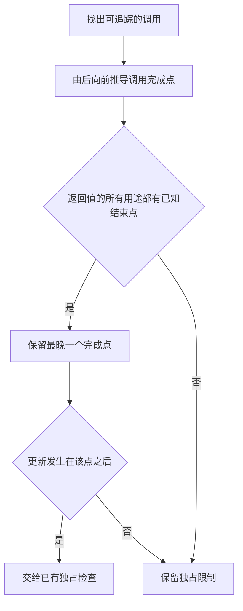

# 跨多次调用推导借用结束点

## Intent

推导跨多次调用的静态借用结束点。视图最后一次读取完成后，允许原有独占检查复用底层存储。ZX 用户继续使用普通值和函数。

## Data

此前的研究阶段已经将 [Morphic §5.1](../fully_automatic_borrow_inference.pdf) 的跨调用来源、[MVS §4.4](../mutable_value_semantics.pdf) 的路径重叠和 [Perceus §2.2、§2.4](../perceus.pdf) 的最后使用与存储复用落实到一个调用边界。现有分析遇到另一次返回视图的调用时停止，哪怕下游只读。

## Edges

只有实参槽范围已知、该范围不写入、函数只通过返回值转交该范围时才跟随返回值。返回值的所有用途都要证明为观察或通过同一条件继续转交。转交限制在同一循环或异步上下文中。未知用途、回边和外逃保留原保护。更新与观察的顺序以完整表达式的求值结束点为准。

## Answer

通过同一程序在修改前后的生成 Zig 和实际分配计数验证省去复制。覆盖多个观察分支、晚读及返回逃逸，核对 Source 与 seed 一致，按固定清单验收编译器 CPU、墙钟和内存。

### 实现

- Source 先收集实参槽可能借给结果的调用，再按完成点倒序求解。同一完成点中，外层调用先于其操作数求解。每个调用的返回用途只求解一次。多个用途汇合时取最晚的结束点，所以一条晚读路径仍足以保护来源。[调用结束点求解](../../packages/genz/src/analysis/uniqueness/sites/borrow_uses/solve.zx)
- 保留原有用途表，在本来就要发布的查询列中补写观察角色和完成点。旧实现为每个可结束的借用复制多条用途记录，新实现每个候选只需一条标记。初始 seed 同步规则，所有权程序身份升至 v21，持久缓存按新规则重新计算。[用途发布](../../packages/genz/src/analysis/uniqueness/sites/publish.zx)
- 从 Morphic 引用结果与输入的关系，从 MVS 引用投影范围，从 Perceus 引用最后使用和独占复用条件。ZX 可在类型和效果已知时静态生成普通 Zig 的原地更新。无须让用户写指针或生命周期参数，也无须在生成程序中维护借用记录或引用计数。[论文索引](../所有权推导论文.md)

### 运行结果

同一组输入分别使用公开 allocator 和 arena 执行。分配计数覆盖构造、反转和随后追加。

| 场景                       |       修改前 |       修改后 |
| -------------------------- | -----------: | -----------: |
| 两次转交，最后读取后反转   | 2 次 / 160 B |  1 次 / 80 B |
| 反转后再读视图             | 2 次 / 160 B | 2 次 / 160 B |
| 两条转交路径均读完再反转   | 2 次 / 160 B |  1 次 / 80 B |
| 两条转交路径中仍有一条未读 | 2 次 / 160 B | 2 次 / 160 B |
| 嵌套调用，读取后反转       | 2 次 / 160 B |  1 次 / 80 B |
| 函数返回视图和反转结果     | 3 次 / 192 B | 3 次 / 192 B |

三个受益入口生成原地反转。晚读和外逃入口的生成实现保持相同，返回视图仍保留原始顺序。各入口在多组输入上的值相同。

### 编译器开销

macOS arm64，Zig 0.17.0，ReleaseSmall，16 分区，关闭常驻。使用同一份 735 入口冻结清单，三轮交错取中位数。固定基线沿用引导声明准备阶段，上一代为 `b156ece56`。候选由上一代生成，三套工具均执行 Source 分析和发射。

| 指标                 |  固定基线 |    上一代 |      候选 |
| -------------------- | --------: | --------: | --------: |
| 冷生成墙钟           |    2.85 s |    2.57 s |    2.60 s |
| 冷生成 CPU           |   12.45 s |   12.22 s |   12.22 s |
| 冷生成进程树采样峰值 | 890.93 MB | 700.37 MB | 701.68 MB |
| 冷生成单进程系统峰值 | 928.97 MB | 737.85 MB | 741.83 MB |
| 热重建墙钟           |    2.23 s |    1.98 s |    1.97 s |
| 热重建 CPU           |    8.48 s |    8.27 s |    8.25 s |
| 无改动墙钟           |    0.04 s |    0.03 s |    0.03 s |

首次实现为每个表达式预留结束点。复测前收紧到每个调用表达式一个 `u32`，复用调用载荷的唯一索引。
最终冷生成较上一代墙钟多 0.03 秒，CPU 持平，进程树采样峰值增加 1.31 MB，单进程系统峰值增加 3.98 MB。
相对固定基线，冷生成墙钟下降 0.25 秒，CPU 下降 0.23 秒，两种内存峰值分别下降 189.25 MB 和 187.14 MB。
上一代与候选的 11,753 个生成文件逐字节相同，排除工具身份戳。每套工具的热重建等于各自的冷生成。

Source 引导构建完成 25 步。完整规则通过 326 步构建及 574 项现有回归，包含
416,710 次具体存储观察比较。压缩临时表后，六个运行样例的 22 个生成文件与压缩前逐字节相同。
初始 seed 完成 14 步构建，对同一批样例生成的 22 个文件与候选一致，排除工具身份戳。
最终紧凑表版本通过四组相关回归，共 110 步构建、269 项检查。
沿用上一代的缓存，分别验证初次生成、将最后一次读取移动到更新之后、恢复源码。三次各 22 个文件均与独立冷生成一致。

### 自我审查

借用效果已细化至输入槽。跟随返回借用时仍检查完整的返回值用途，某个无关返回字段外逃也可能使这项优化停止。循环或异步上下文变化同样保留保护。进一步精化需要返回字段到输入槽的来源信息。

分配数据量化了原地更新带来的收益，编译器计时覆盖分析和 Zig 生成。同一算法与编译配置下的 Rust 吞吐量，以及完整冷构建的 Zig/LLVM 峰值，需要单独对照。
