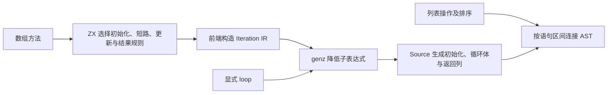
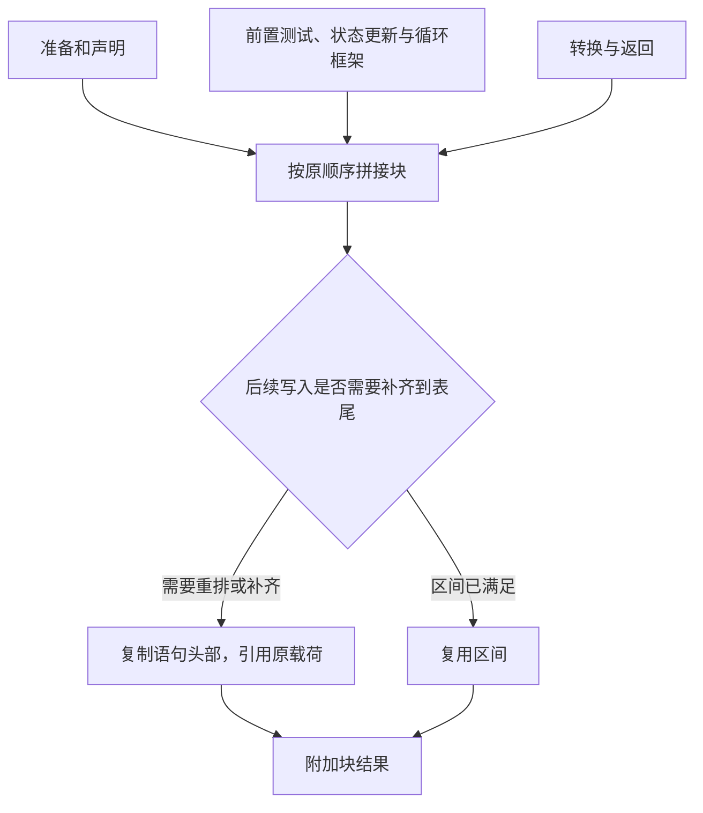

# 集合与迭代语句直接发布自举

## Intent

迁移集合方法的迭代规则。集合操作和循环代码生成直接使用 Source 产出的 AST 列，去掉将这些列还原成 Zig 语句列表再写回的过程。

## Data

ZX 前端在 `collections/lower.zig` 将 map、filter、reduce、every 和 some 降为 `Iteration`，随后由 genz 的 `iteration.zig` 生成代码。sort 使用独立的排序路径。集合方法的初始值、短路条件、回调参数与结果规则原来在手写 Zig 中分别选择。genz 已有 Source 初始化、更新、结果和列表变换规则，旧调用方暂存部分语句时会逐条转换。

## Edges

保持回调、捕获、初始值及返回转换的求值顺序。reduce 省略初始值时，从第一个元素取初值，下一下标作为循环起点。every 和 some 先检查长度，再依据当前结果决定是否短路。保持原有结果元组方向、失败和缓冲区语义。生成时子块和声明按各自语句区间发布，后续拼接按运行顺序引用。

## Answer

沿正式前端的 `Iteration` 入口核对映射、过滤、归约、谓词、显式循环和缓冲区。列表操作覆盖切片、追加、拼接、删除、反转、排序和弹出。初始 seed 保留独立实现。用同一候选对照生成文件、已有回归和固定基线性能。

### 实现

- `iteration_plan.zx` 决定集合方法的初始状态、短路、回调累加器位置和元组结果。前端继续使用已有的 IR 构造器。
- 循环声明、前置判定、状态更新、投影还原以及返回转换复用连续的已提交语句。后续还有子表达式写入时，保留区间供最终拼接。
- 列表变换及排序消费已有 Source 实现。值捕获和元素转换写入同一逻辑块，由 AST 存储负责列发布。

### 固定清单回测

macOS arm64，Zig 0.17.0，ReleaseSmall，16 分区，关闭常驻。候选由 `3bc837f2b` 的 Source 引导器生成。三套工具均使用各自的 Source 分析和生成，以同一 735 入口冻结清单交错运行三轮，表内为中位数。

| 指标               |  固定基线 |    上一代 |      候选 |
| ------------------ | --------: | --------: | --------: |
| 冷生成墙钟         |    2.87 s |    2.59 s |    2.58 s |
| 冷生成 CPU         |   12.45 s |   12.21 s |   12.16 s |
| 进程树采样峰值 RSS | 895.81 MB | 707.46 MB | 717.46 MB |
| 单进程系统峰值 RSS | 924.89 MB | 736.03 MB | 734.66 MB |
| 热重建墙钟         |    2.24 s |    1.98 s |    2.00 s |
| 热重建 CPU         |    8.48 s |    8.23 s |    8.28 s |
| 无改动墙钟         |    0.04 s |    0.03 s |    0.03 s |

较上一代，冷生成墙钟下降 0.01 秒，CPU 下降 0.05 秒。进程树采样峰值增加 9.99 MB，单进程系统峰值下降 1.38 MB。采样期间没有额外子进程。相对固定基线，冷生成墙钟和 CPU 均下降 0.29 秒，进程树采样峰值下降 178.36 MB。热重建较上一代墙钟增加 0.02 秒，CPU 增加 0.05 秒。候选三轮冷生成墙钟分别为 3.81、2.58 和 2.56 秒。

排除工具身份戳，上一代与候选的 11,753 个生成文件逐字节一致。两者的所有权缓存 v18 正文 SHA-256 均为 `cdf9fa7e0f33002a95dc097b2837de781d67e6e519a452fb97f89f7c0bbf3a23`。三套工具各自的热重建与冷生成一致。

### 引导与增量

Source 引导器完成 25 步构建。使用已跟踪的四个映射和过滤输入与两个排序输入，对照首次生成、修改回调、将映射改为过滤和恢复源码。两版各次常驻生成都与独立冷生成一致，新旧版的每次生成也逐字节一致，每次共 21 份文件。

初始 seed 完成 14 步构建。旧 seed、新 seed 和候选 Source 对照六个输入，21 份输出逐字节一致。修正 seed 的 `unpack` 仍借用公共求值函数后，重新构建的 Source 工具与计时工具 SHA-256 相同。

### 回归

同一 Source 引导器完成 22 个回归目标，共 1,168 个构建步骤、12,820 项测试全部通过。覆盖回调顺序、reduce 省略初始值、every 和 some 短路、嵌套循环与缓冲区、数组所有权，以及移动已编译库后重新发布并执行。

### 自我审查

最初沿旧 `Transform` 的 map/filter 分支追查。前端实际生成的是 `Iteration`，最终实现覆盖此前端入口和相同的显式循环路径。普通列表操作及独立排序也使用区间提交。

递归子表达式降低、IR 节点分配与 AST 容量仍由 Zig 管理。循环体内的深层调用借用适配和旧 seed 仍有手写语句路径。性能对照覆盖生成器流程，完整冷构建的后端耗时未在本批复测。
