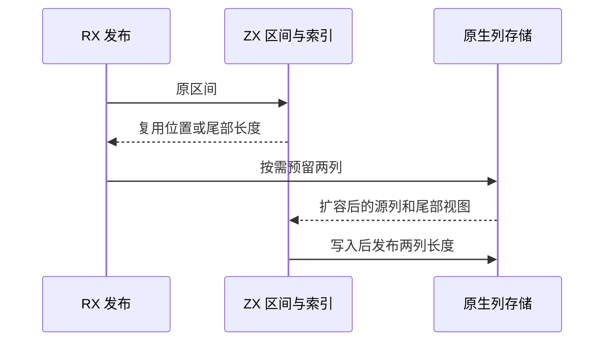

# AST 区间累计与列提交自举

## Intent

让正式 genz 的语句与声明共享 Source 区间累计、辅助声明拼接、尾部布局和表头提交。

## Data

`builder.statementSequence` 与 `node/declarations.zig` 共用 Zig 的 `Spans`。它负责跳过空区间、延伸连续尾部、保存间断区间。模块装配还在 Zig 逐项接入辅助声明与后缀。区间发布已由 Source 计算布局和写表头，分支选择与两列预留仍由 Zig 执行。正式打印器按索引直接读原声明列，复制索引表头的调用只剩初始 seed。

## Edges

保留表头对原载荷的引用、原提交顺序和分配失败行为。间断区间使用一个连续的机器字缓冲，两个 u32 标量保存原起点与长度。连续区间只更新内联尾部。预留完成后重新借用现有列，避免从扩容前的地址读数据。初始 seed 保留独立路径。

## Answer

辅助声明拼接、连续尾部累计和断点保存使用相同的 ZX 操作。尾部发布直接读取最后一个区间，省去临时写入和缩回区间列表。间断区间只复制标签与载荷下标，两列都写完才提交长度。声明索引的旧生成入口已移除，seed 保留其复制与边界校验。[区间累计](../../packages/genz/src/analysis/node_headers/block/sequence/append.zx) · [区间发布](../../packages/genz/src/analysis/node_headers/block/build.rx) · [索引打印](../../packages/genz/src/render.zig)

正式 Source 路径移除了 Zig 的区间合并条件、后缀遍历、布局分流和表头提交顺序。Zig 继续绑定 AST 列和区间缓冲，通用内存原语负责扩容、刷新借用视图和复制连续标量区间。窄范围生成确认累计和发布自身没有临时堆分配。

五组回归通过 246 个构建步骤。Zig 汇总 161 项测试，库打包的八种组合及并行场景的集成执行也通过。

最终候选由 `77ae67022` 的 Source 引导器构建，25 步通过。该工具使用 Source 分析和发射重生成四份引导清单，15,972 份文件逐字节一致，排除工具身份戳。初始 seed 词法引导也通过 19 步。

## 性能

沿用 Zig 0.17.0、ReleaseSmall、735 个入口和 16 分区。上一阶段与候选的工具本体和运行的分析、发射都由 Source 提供。三次交错对照取中位数，两代冷暖生成的 11,753 份文件一致，排除工具身份戳。对照覆盖本批的真实区间累计与列提交。随后清除未被正式工具调用的索引复制入口，复用这些路径的回归和计时证据，并用最终产物复核重新生成。

| 状态   | 工具     | 墙钟（秒） | CPU（秒） | 进程树峰值（字节） | 单进程峰值（字节） |
| ------ | -------- | ---------: | --------: | -----------------: | -----------------: |
| 冷生成 | 固定基线 |       2.82 |     12.43 |        884,768,768 |        934,051,840 |
| 冷生成 | 上一阶段 |       2.60 |     12.87 |        663,126,016 |        690,601,984 |
| 冷生成 | 本批     |       2.63 |     12.85 |        661,815,296 |        685,981,696 |
| 热重建 | 上一阶段 |       1.94 |      8.30 |        643,760,128 |        643,776,512 |
| 热重建 | 本批     |       1.92 |      8.27 |        643,596,288 |        643,612,672 |

相对上一阶段，冷生成墙钟增加 0.03 秒，CPU 减少 0.02 秒，进程树峰值下降 1.31 MB，单进程峰值下降 4.62 MB。相对固定冷基线，墙钟减少 0.19 秒，CPU 累计增加 0.42 秒，进程树峰值下降 222.95 MB。无改动场景的墙钟和 CPU 都为 0.03 秒。本批计时范围为引导生成与缓存，完整 Zig 冷构建沿用既有记录。[固定基线](引导输出树和分区发布自举.md)

接续 AST 的密集与选定载荷导入。两条入口共用现有 Source 写入和清理。Zig 仍控制列描述、分组容量预留和载荷导入准备。
