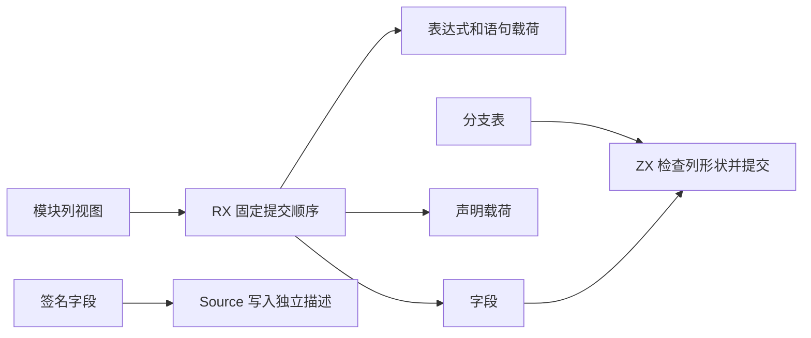
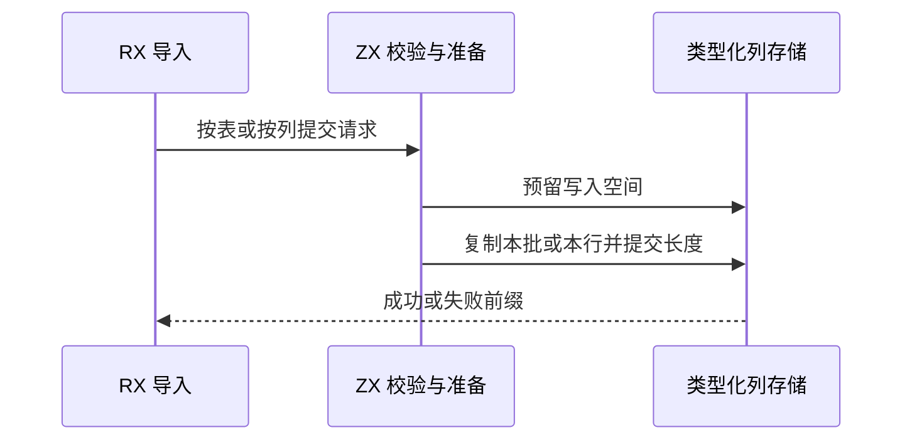

# AST 字段、分支与模块列导入自举

## Intent

迁出字段、对象默认字段、分支表和模块 AST 的导入调度。完整模块由 RX 依次提交表达式、语句、字段和声明。保持借用文本、复制文本和失败前缀。

## Data

正式路径通过 `import_fields` 和 `import_arms` 逐行填表。独立字段描述用于函数签名与原生签名。模块导入还在 Zig 串行提交各类列，已有载荷导入则能在 Source 中检查、预留和提交。

## Edges

按原顺序校验与提交，后续表失败保留先前成功表。带文本所有权的字段和分支逐行提交，保留分配失败前缀。借用值批量写入，只有省略的对象字段需要写入默认值。绑定列时只借用源数据并布置描述符。

## Answer

正式入口在 RX 中按表达式、语句、字段、声明的顺序提交。每张表通过校验后才预留和发布，失败会停止后续表。模块表的字段长度由 Source 根据表头计数检查。独立字段、对象字段和匹配分支共用长度校验与提交流程。空默认值从栈上的类型化常量写入，签名字段直接填充连续的最终描述符数组，名称继续借用原始字节。

[模块导入](../../packages/genz/src/analysis/node_headers/module/append.rx) · [载荷校验](../../packages/genz/src/analysis/node_headers/payload/validated.rx) · [字段和分支写入](../../packages/genz/src/analysis/node_headers/plain/write.zx) · [签名字段](../../packages/genz/src/analysis/node_headers/plain/materialize.zx)

Zig 保留编译期字段布局绑定和通用列存储。`import_rows` 与 `import_selected` 的独立入口仍由 Zig 准备字段长度和索引范围，按索引发布继续使用上一阶段的 Source 流程。

### 引导一致性

Source 引导器通过 25 个构建步骤，初始引导入口通过 19 个构建步骤。上一代 Source 引导器 `b835c6ae0` 生成候选。候选用相同输入重新生成主清单、增长、集合和执行四份清单，16,029 个文件逐字节一致，比较时排除工具身份戳。

候选引导器 SHA-256 为 `c4c7efb1ee06a4a7925dc398de216b9a454b9351f5b787509b7318f887b3567b`。

### 运行回归

统一库、模块集合循环、原生借用、Store 请求 I/O、跨模块匹配与类型查询共通过 220 个构建步骤和 203 项 Zig 测试。Gateway JSON 输出另通过 52 项应用用例，覆盖导入模块列后生成的服务执行与序列化。

### 性能

三轮交错取中位数。平台为 macOS arm64、Zig 0.17.0、ReleaseSmall。沿用 735 个入口和 16 分区的冻结清单，关闭常驻。三套工具均由 Source 生成并使用 Source 分析和生成。固定冷基线沿用载荷导入阶段记录。

| 场景   | 工具     | 墙钟（秒） | CPU（秒） | 进程树峰值（字节） | 单进程峰值（字节） |
| ------ | -------- | ---------: | --------: | -----------------: | -----------------: |
| 冷生成 | 固定基线 |       2.82 |     12.43 |        884,768,768 |        934,051,840 |
| 冷生成 | 上一阶段 |       2.61 |     12.94 |        659,963,904 |        691,814,400 |
| 冷生成 | 本批     |       2.60 |     12.84 |        664,535,040 |        686,702,592 |
| 热重建 | 上一阶段 |       1.93 |      8.29 |        644,923,392 |        644,939,776 |
| 热重建 | 本批     |       1.92 |      8.26 |        643,891,200 |        643,923,968 |

冷生成较上一阶段墙钟减少 0.01 秒、CPU 减少 0.10 秒，进程树峰值增加 4.57 MB、单进程峰值下降 5.11 MB。相对固定基线，墙钟减少 0.22 秒，CPU 累计增加 0.41 秒，进程树峰值下降 220.23 MB。无改动的墙钟和 CPU 均为 0.03 秒。本轮计时覆盖分析和 Zig 生成。[固定基线](AST载荷导入与容量自举.md)

冻结清单两代生成的 11,753 个文件逐字节一致，暖缓存重建的输出也与各自冷生成一致。所有权缓存正文 SHA-256 均为 `cdf9fa7e0f33002a95dc097b2837de781d67e6e519a452fb97f89f7c0bbf3a23`。

### 自我审查

模块导入的字段形状检查、表间顺序和签名字段写入已从正式 Zig 路径退出。宿主仍持有物理列及声明布局。独立密集与索引导入的字段范围准备仍待迁移。性能结果覆盖生成器，完整 Zig 后端冷构建和三个阶段自编译留在收敛最终验收。
