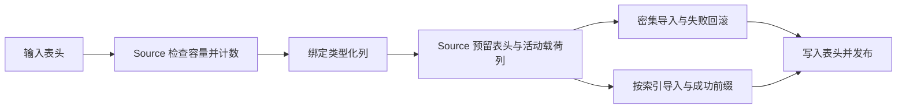
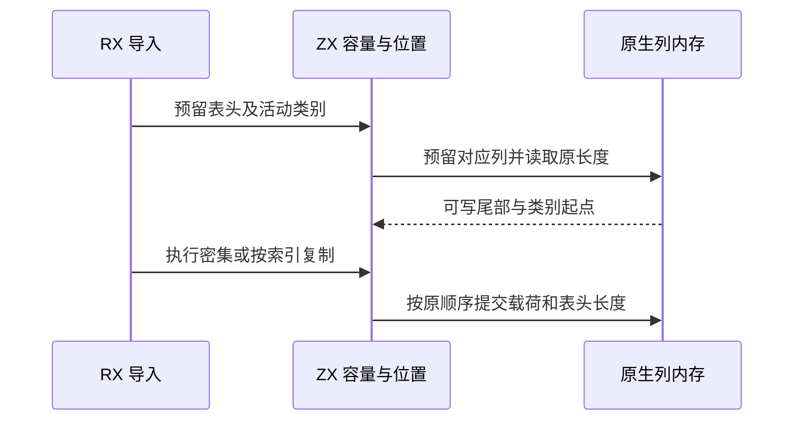

# AST 载荷导入与容量自举

## Intent

密集和按索引两条 AST 导入共用 Source 的表头检查、容量预留、载荷位置登记和提交。保留密集导入的整批提交及按索引导入的成功前缀。

## Data

`import_rows` 与 `import_selected` 绑定目标列与输入列。原 Zig 在调用 Source 写入之前预留标签、载荷下标以及各类别的载荷列，并重新遍历类别读取起点。现有 Source 已负责复制、回滚和写入表头。

## Edges

先检查行数与下标，再预留表头和载荷。预留失败时已分配容量可以复用，已提交的行长度保持原值。绑定使用原列和类型化存储，扩容后从实际列表读取写入地址。密集复制失败回滚未提交载荷，按索引复制失败保留已有成功行。

## Answer

表头检查在 Source 区分无效 AST 与行数超限。RX 将共用的表头预留和 ZX 载荷准备放在密集、按索引两路之前。载荷准备按输入计数选择活动类别，在预留后直接记录原始行数，删除正式 Zig 路径上的分组预留和起点遍历。

通用列描述保存原列表和其类型化增长函数，分配只在剩余容量不足时发生。复制、清理和提交从同一列表读取最新地址及长度，避免扩容后的旧指针。Zig 仍将具体 AST 形状绑定到通用描述，并检查密集字段长度或计算按索引导入的可用范围。初始 seed 继续使用自己的表头与载荷准备路径。[校验流程](../../packages/genz/src/analysis/node_headers/check.rx) · [导入流程](../../packages/genz/src/analysis/node_headers/payload/append.rx) · [列内存](../../packages/core/src/memory/column_transfer.zig)

候选由 `46be0ce5c` 的 Source 引导器构建，25 步通过。候选重新生成四份清单，15,978 份文件逐字节一致，排除工具身份戳。窄范围生成确认新增接线没有临时堆分配。

六组回归通过 205 个构建步骤，Zig 汇总 185 项测试。覆盖类型查询、并入编译库的声明、源文件与库的借用载荷、模块化循环、Store I/O 和磁盘 RX 项目。初始 seed 词法引导单独通过 19 步。

## 性能

沿用 Zig 0.17.0、ReleaseSmall、735 个入口和 16 分区。两套引导器都由 Source 构建并运行 Source 分析与发射。三轮交错取中位数。上一阶段与候选的冷暖生成文件共 11,753 份一致，排除工具身份戳。两代所有权缓存正文的 SHA-256 均为 `cdf9fa7e0f33002a95dc097b2837de781d67e6e519a452fb97f89f7c0bbf3a23`。

| 状态   | 工具     | 墙钟（秒） | CPU（秒） | 进程树峰值（字节） | 单进程峰值（字节） |
| ------ | -------- | ---------: | --------: | -----------------: | -----------------: |
| 冷生成 | 固定基线 |       2.82 |     12.43 |        884,768,768 |        934,051,840 |
| 冷生成 | 上一阶段 |       2.64 |     12.97 |        661,520,384 |        682,491,904 |
| 冷生成 | 本批     |       2.61 |     12.84 |        661,061,632 |        690,044,928 |
| 热重建 | 上一阶段 |       1.92 |      8.31 |        644,759,552 |        644,775,936 |
| 热重建 | 本批     |       1.93 |      8.29 |        644,464,640 |        644,497,408 |

冷生成较上一阶段墙钟减少 0.03 秒，CPU 减少 0.13 秒，进程树峰值下降 0.46 MB，单进程峰值增加 7.55 MB。相对固定冷基线，墙钟减少 0.21 秒，CPU 累计增加 0.41 秒，进程树峰值下降 223.71 MB。无改动场景的墙钟和 CPU 均为 0.03 秒。本轮计时覆盖引导生成与缓存。[固定基线](引导输出树和分区发布自举.md)

接续字段、分支表与模块级列导入，并合并检查密集字段长度和按索引导入的边界。
