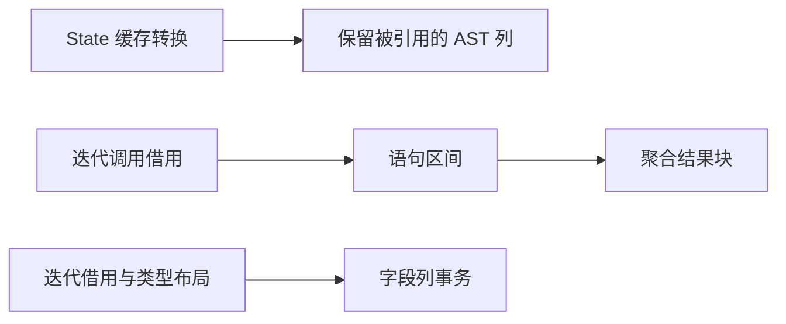
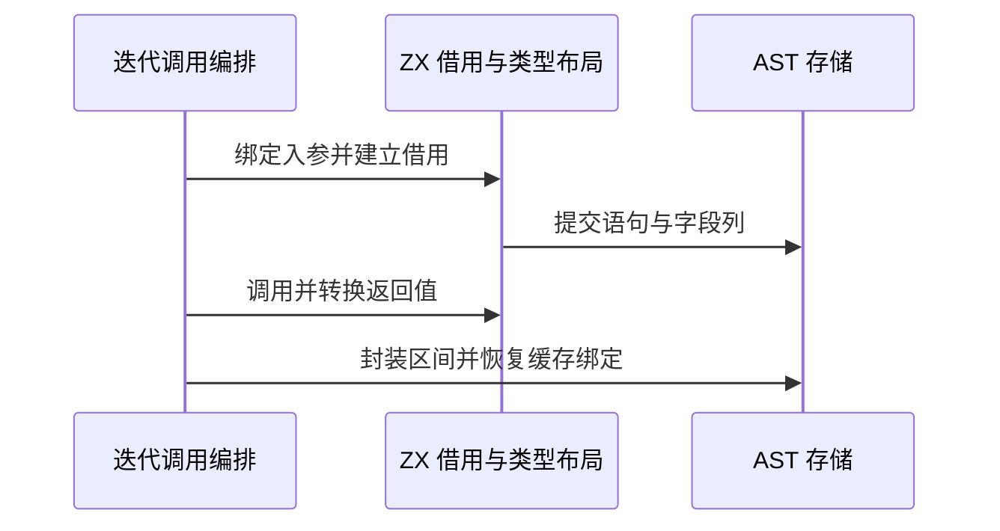

# State 返回与迭代借用列交接自举

## Intent

让 State 表示转换和迭代调用借用直接交接 AST 列。移除这两条正式路径上的平坦语句数组，并统一迭代借用和类型布局的字段发布。

## Data

State 缓存转换已在 Source 把生成的正文封进结果表达式，宿主仍创建临时数组接收附加语句。迭代调用借用把 Source 语句列逐项转成 Zig 联合体，之后再转回语句列。借用和类型布局的字段也由宿主逐项发布。

## Edges

State 入口保留表达式内部的正文与共享声明。调用借用保持入参绑定、执行、结果转换及缓存恢复顺序。发布区间保持源代码的语句顺序。借用字段名称继续使用类型表持有的存储，布局字段保留已有的所有权边界。

## Answer

State 缓存转换继续发布结果表达式引用的 AST 和共享声明，RX 跳过无接收者的正文写入。迭代调用的参数绑定、借用和结果转换共用语句区间，结果块按原顺序组装。迭代借用与布局构造直接生成字段列，宿主复用已有 Source 提交流程。

[State 发布](../../packages/genz/src/analysis/state/publication/run.rx) · [迭代调用区间](../../packages/genz/src/zx/iteration_value/invocation.zig) · [借用字段](../../packages/genz/src/analysis/iteration/borrow/emit/aggregate.zx) · [布局字段](../../packages/genz/src/analysis/iteration/types/emit/aggregate.zx)

集合谓词、map、filter 和 reduce 仍在 Zig 中缓冲平坦语句，以满足循环更新与外层块的延后发布。通用 State 发布接口继续接收这些数组，迭代类型缓存仍由 Zig 登记。

### 引导一致性

Source 引导器通过 25 个构建步骤，初始引导入口通过 19 个构建步骤。上一代 Source 引导器 `e29a9e2ce` 生成候选。候选用相同输入重新生成主、增长、集合和执行四份清单，16,035 个文件逐字节一致，比较时排除工具身份戳。

候选引导器 SHA-256 为 `a158f782149c85b4b882b5544cfe9b281935fd595ad317bb50c516d29a17cd22`。

### 运行回归

迭代调用、聚合循环、循环调用来源、值返回、选定循环列和字段所有权共通过 455 个构建步骤和 594 项 Zig 测试。迭代库的跨目录消费及归档重新发布也通过 CLI 回归。

### 性能

macOS arm64、Zig 0.17.0、ReleaseSmall。三轮交错取中位数，沿用 735 个入口、16 分区的冻结清单，关闭常驻。各工具由 Source 生成并执行 Source 分析和生成。固定冷基线沿用前批记录。

| 场景   | 工具     | 墙钟（秒） | CPU（秒） | 进程树峰值（字节） | 单进程峰值（字节） |
| ------ | -------- | ---------: | --------: | -----------------: | -----------------: |
| 冷生成 | 固定基线 |       2.82 |     12.43 |        884,768,768 |        934,051,840 |
| 冷生成 | 上一阶段 |       2.60 |     13.03 |        662,994,944 |        682,688,512 |
| 冷生成 | 本批     |       2.56 |     12.93 |        665,714,688 |        686,325,760 |
| 热重建 | 上一阶段 |       1.91 |      8.26 |        643,678,208 |        643,710,976 |
| 热重建 | 本批     |       1.90 |      8.24 |        643,596,288 |        643,629,056 |

冷生成较上一阶段墙钟减少 0.04 秒，CPU 减少 0.10 秒。进程树峰值增加 2.72 MB，单进程峰值增加 3.64 MB，同轮采样的物理内存峰值中位数增加 0.62 MB。相对固定基线，墙钟减少 0.26 秒，CPU 累计增加 0.50 秒，进程树峰值下降 219.05 MB。无改动的墙钟和 CPU 均为 0.03 秒。[固定基线](AST载荷导入与容量自举.md)

冻结清单的 11,753 个输出文件逐字节一致，暖缓存输出与各自冷生成一致。所有权缓存正文 SHA-256 均为 `cdf9fa7e0f33002a95dc097b2837de781d67e6e519a452fb97f89f7c0bbf3a23`。

### 自我审查

State 缓存转换此前的临时数组没有后续读取，现只提交结果和声明。迭代调用的语句区间保留源顺序，分散区间可能在合并时复用已有载荷并复制表头。谓词和集合转换仍需按控制流先后迁移延后组装，完整 Zig 后端冷构建与三阶段自编译留在正式闭包审计之后。
