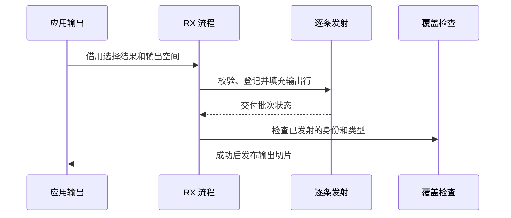

# Store 初始化器变换与发射自举

## Intent

迁移 Zig 后端的 Store 初始化器发布链。应用由 Source 选择原始声明、借用声明和已联结声明，执行名称校验、登记、发射和覆盖检查。公开库由 Source 遍历工件声明。两个入口共用单条初始化器的发射实现和输出格式。

## Data

应用和库的外层循环都在 Zig。应用已有 Source 关联选择、IR 校验和名称比较，也有独立的登记与覆盖规则。应用需要校验输入及覆盖，库入口使用已经联结的程序。两边都借用原有函数表和程序，不复制 IR 存储。[应用入口](../../packages/compiler/src/backends/zig/store_initializers.zig) · [库入口](../../packages/compiler/src/backends/zig/library_initializers.zig) · [单条发射](../../packages/compiler/src/backends/zig/publication/initializer.zig)

## Edges

应用遵循原有错误优先序。每条先检查 IR 和类型命名，再报告重复身份并发射。所有条目成功后才检查缺失项和类型冲突并提交最终结果。库不重做应用的校验。保留已经约定的名称、缓存键、归属和底层分配器。

登记索引只记录槽和类型编号，键直接借用最终元数据。桶命中时读取的是已发射的行。发射失败立即退出，索引随临时区释放，未发布的文件由调用方原有的输出 arena 持有。零条或一条初始化器时不建桶。链接程序继续借用原 IR 的列，类型名比较沿用单条名称工作区。发射循环用标量推进位置，两个无法成为已分配输出行号的常量用于提前退出。

## Answer

实际应用入口由 RX 调用 ZX 发射循环，收到成功状态才校验 Store 覆盖并提交。库入口改由 ZX 按工件顺序发射，两侧共用单条代码生成。原 Zig 外层循环、登记适配和名称比较适配已退出正式路径。Zig 承担输入借用、IR 验证接口、工作区和实际目标发射。初始 seed 保留原生流程。[应用编排](../../packages/compiler/src/backends/zig/store_initializers/workflow/application.rx) · [库遍历](../../packages/compiler/src/backends/zig/store_initializers/workflow/library.zx) · [宿主边界](../../packages/compiler/src/backends/zig/store_initializers.zig)

从 `93208f8b1` 的 Source 引导器构建本批候选，25 个步骤通过。两代工具都执行 Source 分析与发射，四份清单共 15,670 个生成文件逐字节一致。冻结清单的 11,753 份产物也一致。核对了两条编排的生成调用链。应用与库入口通过空容量分配器执行编排，工作区和单条发射仍由已存在的分配器承担。

五组回归通过 125 个构建步骤、87 项 Zig 测试、Store 与库的 41 项集成检查及 Gateway 的 86 项检查。覆盖多 Store 顺序、视图生命周期、错误与分配失败、缺失初值、已编译库重定位和再发布。

Zig 0.17.0、ReleaseSmall、16 分区，三次交错生成取中位数。记录范围是 zxc 分析和 Zig 文件写出。

| 场景 | 工具     | 墙钟（秒） | CPU（秒） | 进程树峰值（字节） | 单进程峰值（字节） |
| ---- | -------- | ---------: | --------: | -----------------: | -----------------: |
| 冷   | 固定基线 |       2.82 |     12.43 |        884,768,768 |        934,051,840 |
| 冷   | 上阶段   |       2.60 |     12.86 |        662,290,432 |        683,425,792 |
| 冷   | 本批     |       2.54 |     12.84 |        660,799,488 |        681,721,856 |
| 热   | 固定基线 |       2.16 |      8.40 |        892,633,088 |        933,937,152 |
| 热   | 上阶段   |       1.90 |      8.24 |        643,743,744 |        643,760,128 |
| 热   | 本批     |       1.89 |      8.22 |        644,661,248 |        644,677,632 |

相对上阶段，冷生成少用 0.06 秒墙钟和 0.02 秒 CPU，进程树峰值下降约 1.5 MB。热生成进程树峰值增加约 0.9 MB。相对固定冷基线，墙钟下降 0.28 秒，CPU 增加 0.41 秒，进程树峰值下降约 224.0 MB。未经单独计时的 Zig 后端编译与链接不计入这组结果。

公开库 Store 夹具也用两代安装版交错发布。14 份库文件逐字节一致。三次冷发布墙钟中位数从 4.28 降到 4.27 秒，CPU 从 4.26 降到 4.25 秒，单进程峰值相差约 0.07 MB。热发布两代均为 0.03 秒。
