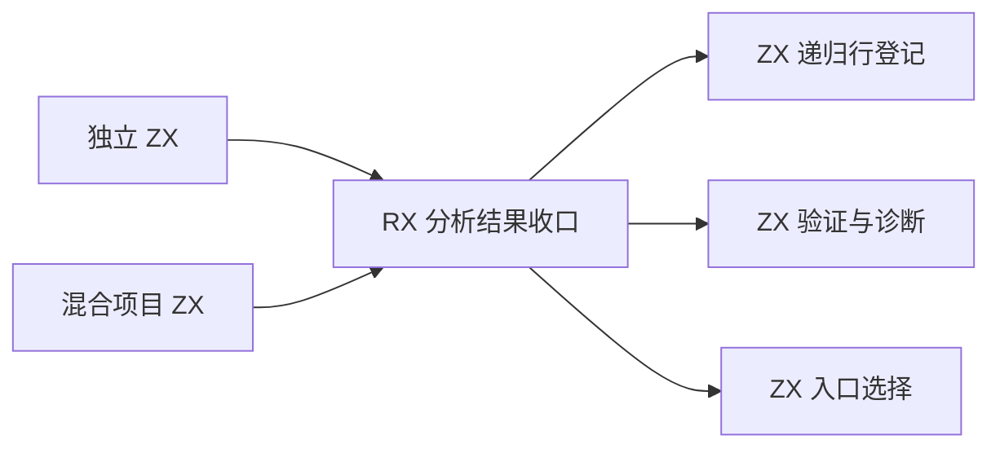
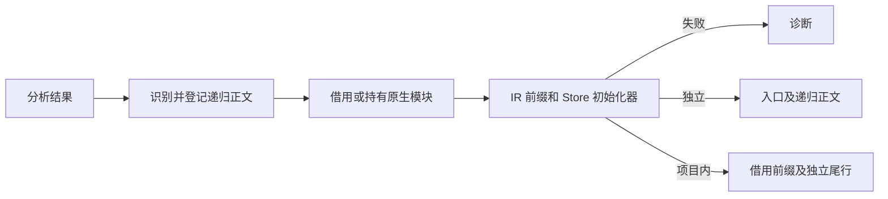

# ZX 入口递归登记与验证自举

## Intent

让独立 ZX 和项目内已绑定导入的 ZX 共用 RX/ZX 的结果发布链。沿原调用顺序登记递归正文、交接原生模块、检查 IR 前缀和 Store 初始化器，再决定是否生成独立入口。

## Data

正式路径在 `analyzeInputIn` 中登记递归正文并拼接函数表。混合项目联结随后拆下新增正文、重新借用已有函数前缀。现有联结入口支持直接接收独立的函数尾部。Store 初始化器已有按列借用能力，验证可沿用已验收的 IR 前缀判断。[分析入口](../../packages/compiler/src/zx/analysis/analyze.zig) · [函数联结](../../packages/compiler/src/zx/modules/link/source.zig)

## Edges

解析、分析和类型发布沿用上批入口。独立结果持有原生模块和入口正文，已绑定导入的结果借用项目表。递归正文以单行尾部交给混合联结。Debug 校验需要完整函数视图时在临时区合并，保留原诊断优先级。初始 seed 使用现有的所有权分析和入口判定。

## Answer

按原入口核对错误顺序、递归调用、原生模块生命周期和成功产物。验收包含初始 seed、同输入生成、受影响回归和固定基线性能。批次通过后更新收敛计划。

### 已迁移的职责

- RX 按登记、验证、入口发布的顺序执行。ZX 判断当前正文能否自调用，复用与联结器相同的扫描函数，按分析模式选择借用或持有原生模块。独立模式保留递归正文及生成的转发入口。
- 项目内的递归正文以独立单行交给混合联结，函数前缀继续借用项目表。移除了先合并前缀与新行、联结时再拆开的过程。Debug 校验临时拼接完整视图并在返回前释放。校验顺序保持 IR 前缀在先，初始化器依次与原函数前缀核对。
- Store 检查借用原始行的函数列，发现首个无效引用后发布原诊断。失败和成功都可在同一段 RX 调用内结束。编排层使用零容量临时分配器，函数行和原生列沿用分析分配区。

宿主继续负责函数列物理写入、分配和 Debug 验证的列接口。这些存储职责进入 4.2c。原生的自调用扫描保留给初始 seed。[结果发布](../../packages/compiler/src/zx/analysis/publication/entry/finish.rx) · [物理写入](../../packages/compiler/src/zx/analysis/publication/entry/host.zig) · [混合联结](../../packages/compiler/src/rx/analysis/project/mixed/zx.zig)

### 引导与 Debug 核验

候选由 `7c4d34525` 的 Source 引导器生成，26 个构建步骤通过。初始 seed 的解析器和词法器生成共 33 个步骤通过。候选重生成四份清单，15,570 份产物逐字节一致。候选 SHA-256 为 `70320a0a65cecee88da6c51fb34cc5fc4b28ddd31cc0ccfaa17c1287f3ca2c74`。

默认 Debug 回归的 Zig 编译进程收到 SIGSEGV。在同一命令中为各模块关闭调试符号，保留 Debug 模式和内部 IR 校验，RX 推导的 138 项现有测试全部通过。默认 Debug 编译故障仍待在工具链路径定位。

### 集中回归

合约、库联结、联结边界、语义缓存、RX 推导、原生声明和项目 CLI 七组通过，共 137 个构建步骤、272 项 Zig 测试和 9 项 CLI 检查。回归程序由 `7c4d34525` 引导器为最终源码生成，候选对同一源码的生成一致性已经单独核对。

### 性能对照

固定基线、上一批和候选均使用已生成的 Source 分析和生成实现。三套工具在同一份 735 入口冻结清单上分别运行三轮，配置为 `ReleaseSmall` 和 16 个分区。下表为中位数。

| 指标                       | 固定基线 | 上一批 |  候选 |
| -------------------------- | -------: | -----: | ----: |
| 冷生成墙钟（秒）           |     2.85 |   2.64 |  2.65 |
| 冷生成 CPU（秒）           |    12.55 |  12.87 | 12.99 |
| 冷进程树采样峰值 RSS（MB） |    886.1 |  708.6 | 709.0 |
| 冷单进程最大 RSS（MB）     |    962.4 |  726.8 | 739.4 |
| 热生成墙钟（秒）           |     2.22 |   1.97 |  1.96 |
| 热生成 CPU（秒）           |     8.51 |   8.29 |  8.30 |

相对上一批，冷生成墙钟增加 0.01 秒，CPU 增加 0.12 秒，进程树采样峰值增加 0.4 MB，单进程最大 RSS 增加 12.6 MB。较固定基线，墙钟减少 0.20 秒，CPU 累计增加 0.44 秒，进程树采样峰值减少 177.1 MB。无源码变化中位数保持 0.03 秒。

上一批与候选的 11,753 份冻结产物一致，候选冷暖产物一致。memo 载荷哈希保持 `cdf9fa7e0f33002a95dc097b2837de781d67e6e519a452fb97f89f7c0bbf3a23`。常驻编辑和恢复产物一致，编辑中位数为 0.424 → 0.425 秒，常驻 RSS 峰值为 1,271.1 → 1,270.4 MB。

### 下一批

从解析器临时区到持久语法列的交接开始，贯通模块和表达式两类结果及 RX 属性消费。核对哪些列可直接构造到结果区，保留临时解析状态的独立回收，并用同输入检查持久内存、峰值与长期缓存复用。之后接续分析的 IR 和类型列、项目索引及历史前缀。[模块解析](../../packages/compiler/src/zx/frontend/parse.zig) · [语法保留](../../packages/compiler/src/zx/frontend/retention/host.zig)
