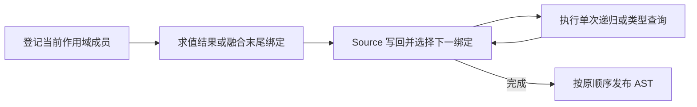

# genz 作用域绑定推进自举

## Intent

让普通函数、值 ABI 和迭代共用 Source 的逆序绑定推进。已求值的绑定先写回，再读取当前符号使用状态并选择下一个请求。

## Data

三种入口以作用域结果为起点向前求值。递归求值会改变 `used`，所以绑定动作不能提前批量确定。普通和值 ABI 写入语句区间，迭代路径还需在值求出后决定是否查询并记录局部类型。作用域中的对象复用候选扫描此前也由宿主逐行执行。

## Edges

保留结果先求值、末尾融合减少有效范围以及递归更新使用标记的顺序。类型表达式只为声明查询。暂存列仍由现有分配区持有，作用域退出时按既有次序恢复别名和成员。

## Answer

RX 的绑定入口先完成上一次请求，再决定在同一绑定查询类型，或从它之前开始选择下一项。连续跳过的绑定在 Source 内写入空区间或空值。宿主每次只执行返回的递归操作，保持语句序列、缓存和类型上下文的实际借用。普通和值 ABI 复用 Source 给出的末尾融合长度。迭代暂存中移除了独立的动作列，从值、类型和原符号列确定最终 AST。[推进编排](../../packages/genz/src/analysis/scope/bindings/advance.rx) · [迭代输出](../../packages/genz/src/analysis/iteration/scope/collect.zx)

对象复用的候选扫描改由 Source 批量读取同一份表达式、类型和成员视图，返回复用候选列与别名计划。宿主去掉逐绑定匹配和临时事实表，按既有生命周期借用候选列。退出时仍使用原有资源清理和成员恢复接口。[候选扫描](../../packages/genz/src/analysis/scope/reuse/scan.zx) · [列借用](../../packages/genz/src/zx/scope/reuse.zig)

候选由上一批 Source 引导器生成，Zig 0.17.0 ReleaseSmall、16 个生成分区，25 个构建步骤通过。初始词法 seed 的 14 个构建步骤也通过。主清单、增长清单和集合清单的 14,418、464 和 97 份生成文件与上一批在同一输入上逐字节一致，共 14,979 份。候选引导器 SHA-256 为 `9561f5451c4af7a531e883e5b48a730be0f7f7e0d15e13b35b5c2374b0dbd53b`。

八组既有回归覆盖迭代调用、循环策略和编译分配失败、函数更新、对象 reduce 与求值效果、If 和 Switch 求值顺序，以及类型化 Try 库。373 个构建步骤、873 项 Zig 测试和 5 项集成检查均通过，安装版回归复用本地校验过的 Zig 归档。

### 性能

三个工具均由 Source 引导构建，运行时启用 Source 分析及生成。macOS arm64、Zig 0.17.0 ReleaseSmall、固定 735 个入口、16 个分区，关闭常驻生成。三轮交错运行取中位数，测量源码分析与 Zig 生成。

| 场景与指标                     | 固定基线 | 上一批 |  本批 |
| ------------------------------ | -------: | -----: | ----: |
| 冷生成墙钟（秒）               |     2.93 |   2.62 |  2.60 |
| 冷生成 CPU（秒）               |    12.44 |  12.69 | 12.69 |
| 冷生成进程树采样峰值 RSS（MB） |    891.4 |  712.2 | 713.6 |
| 冷生成单进程峰值 RSS（MB）     |    953.6 |  727.7 | 731.4 |
| 热生成墙钟（秒）               |     2.23 |   1.95 |  1.97 |
| 热生成 CPU（秒）               |     8.48 |   8.19 |  8.20 |
| 无修改生成墙钟（秒）           |     0.04 |   0.03 |  0.03 |

较上一批，冷生成墙钟减少 0.02 秒，CPU 持平，进程树采样峰值增加 1.4 MB，单进程峰值增加 3.8 MB。较固定基线，冷生成墙钟减少 0.33 秒，CPU 累计增加 0.25 秒，进程树采样峰值下降 177.9 MB。

相邻两批在固定清单上的 11,753 份冷生成文件一致，候选自身冷暖生成也一致。两批所有权缓存的内容 SHA-256 均为 `cdf9fa7e0f33002a95dc097b2837de781d67e6e519a452fb97f89f7c0bbf3a23`。

### 剩余工作

宿主继续管理物理暂存区和退出资源，执行单次递归、类型查询与节点写入。普通、值 ABI 和迭代的调用仍分别推进参数和结果的表示转换及借用恢复，接续按同一完整调用链收拢。[自举收敛计划](../2026-11-20/自举收敛计划.md)
