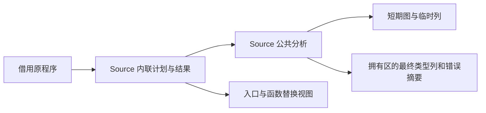
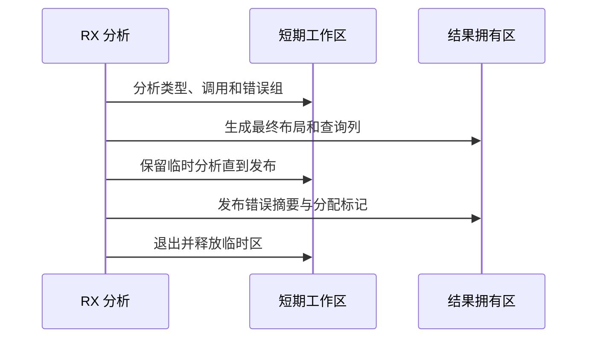

# genz 公共分析结果与内联发布自举

## Intent

迁移公共分析输出的所有权选择及内联结果的发布。类型事实直接在拥有区生成，错误摘要共用组内的名称视图。内联区分入口与函数改动，并保留未修改的符号列。

## Data

函数事实在短期工作区计算。布局与类型查询结果生成后再次复制，错误名称按递归组复制再展开到各函数。内联结果原先通过宿主判断末行是否为入口，并为每个改动重建全部列。

## Edges

保留原分析顺序和错误传播。错误名称字节沿用 IR 生命周期，拥有区持有组内名称视图。内联只接受完整重建，失败时继续使用旧单位。提交新程序前保留原函数表与入口。

## Answer

用已有内联、函数事实、所有权、类型化异常和独立生成测试验收，并在同输入上核对引导产物及固定清单性能。结果写入收敛计划。

布局和状态查询的数据列在最终拥有区生成，分析图与其余中间列继续使用短期工作区。RX 在错误组分析完成后接续发布，每组保留一份名称切片，函数按所属组引用它。分配标记在发布阶段一起计算。宿主退出错误名称视图的逐组复制、两次独立生成调用和两份类型列复制。[函数事实编排](../../packages/genz/src/analysis/facts/analyze.rx) · [错误发布](../../packages/genz/src/analysis/facts/function_errors.zx)

Source 在发布内联结果时分开返回普通函数和入口。内联的符号改动是追加，数量未变时保留原符号列。实际改动仍由宿主安装，函数表的外层引用列需要为新视图复制，部分函数事实仍从短期工作区复制到拥有区。[内联结果](../../packages/genz/src/analysis/inline/apply.zx) · [宿主安装](../../packages/genz/src/zx/inline_call/generated.zig)

### 验收

候选由上一代 Source 引导器构建，工具链为 Zig 0.17.0 ReleaseSmall，使用 16 个生成分区。候选构建 25 步和初始词法 seed 构建 14 步全部通过。主清单 14,483 份、增长清单 464 份和集合清单 100 份生成文件，共 15,047 份与同输入的上一代引导器产物逐字节一致。候选引导器 SHA-256 为 `0f15a6b562e3f8d7558fe46611a941cef5312445e7503931c639ad8e021c75ef`。

九组影响回归覆盖函数分析及其独立执行、函数效果、类型化异常的库与运行时、原生引用、借用返回视图、库入口和循环初始所有权。构建报告为 297 步与 288 项 Zig 测试通过，另有 33 项运行脚本检查通过。

### 性能

三个工具均由 Source 引导构建，运行时使用 Source 分析和生成。使用 macOS arm64、Zig 0.17.0 ReleaseSmall、固定 735 个入口和 16 个生成分区，关闭常驻生成。三轮交错取中位数，测量范围为源码分析与 Zig 生成。

| 指标                           | 固定基线 | 上一批 |  本批 |
| ------------------------------ | -------: | -----: | ----: |
| 冷生成墙钟（秒）               |     2.82 |   2.59 |  2.57 |
| 冷生成 CPU（秒）               |    12.37 |  12.59 | 12.54 |
| 冷生成进程树采样峰值 RSS（MB） |    885.4 |  704.4 | 706.3 |
| 冷生成单进程峰值 RSS（MB）     |    938.0 |  731.4 | 727.7 |
| 热生成墙钟（秒）               |     2.17 |   1.89 |  1.92 |
| 热生成 CPU（秒）               |     8.28 |   8.02 |  8.09 |
| 无修改生成墙钟（秒）           |     0.04 |   0.03 |  0.03 |

相对上一批，冷生成墙钟减少 0.02 秒、CPU 减少 0.05 秒，进程树采样峰值增加 1.9 MB，单进程峰值减少 3.7 MB。热生成墙钟增加 0.03 秒。相对固定基线，冷生成墙钟减少 0.25 秒、CPU 累计增加 0.17 秒、进程树峰值下降 179.1 MB。

上一批与本批的 11,753 份固定清单产物逐字节一致，候选自身冷暖产物一致。两批所有权缓存内容 SHA-256 均为 `cdf9fa7e0f33002a95dc097b2837de781d67e6e519a452fb97f89f7c0bbf3a23`。固定性能基线的生成布局和缓存版本早于两批等价性对照工具。
