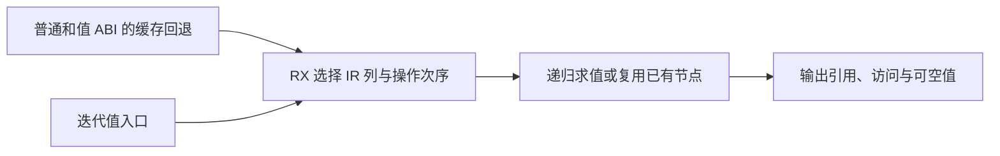

# genz 共享递归读取自举

## Intent

普通、值 ABI 和迭代入口共用 Source 定义的读取顺序。把可空值、引用、字段、下标及长度的操作数定位和递归请求纳入同一计划。

## Data

普通分派先取得结果类型，值 ABI 的回退复用普通缓存查询，迭代有独立的表达式布局。迭代下标先读取缓冲的 `items` 再求值下标。元组字段优先复用集合结果。原生读取函数还负责从 IR 选择列，嵌套投影由宿主逐段计算字段范围。

## Edges

保留普通类型求值的先后顺序、元组投影的提前返回和缓存命中的可见行为。嵌套投影按原有顺序求值下标，区间复用遍历形成的原始边界。编译器仍执行个别递归调用和目标分配。

## Answer

RX 定位操作数和下标所在的 IR 列，并给出普通或迭代路径的操作次序。该结果在 Zig 编译期展开。普通分派直接传递已查询的类型，值 ABI 的缓存回退共用同一入口。Source 还负责引用使用标记与迭代引用的直接结果。[读取编排](../../packages/genz/src/analysis/expressions/read/plan.rx) · [引用使用标记](../../packages/genz/src/analysis/access/reference.zx)

嵌套投影在 Source 确定首个下标及剩余字段区间。相邻区间的起点和终点借用同一列边界，回退时按已选前缀借用，省去宿主的活动字段边界推进。宿主实际调用单个操作数的求值，安装缓存和输出 AST。[区间选择](../../packages/genz/src/analysis/access/projection/segments.zx) · [读取执行](../../packages/genz/src/zx/expressions/read.zig)

候选使用上一批 Source 引导器、Zig 0.17.0 ReleaseSmall 和 16 个生成分区，25 个构建步骤通过。主清单、增长清单和集合清单共 14,973 份生成文件在同一输入上逐字节一致。候选引导器 SHA-256 为 `a254697db36b905be9e8216dd36cd2ded417d44de04b195e352965b1eeb6a93e`。

七组既有回归覆盖求值次序、循环策略、迭代调用、借用视图、函数更新、原生引用和类型化 Try 库。457 个构建步骤、1,610 项 Zig 测试和 31 项 Node 集成检查均通过。CLI 回归复用了已核验的 Zig 归档。

### 性能

三个工具均由 Source 引导构建，启用 Source 分析和生成。macOS arm64、Zig 0.17.0 ReleaseSmall、固定 735 个入口、16 个分区，关闭常驻生成。三轮交错运行取中位数，覆盖源码分析与 Zig 生成。

| 场景与指标                     | 固定基线 | 上一批 |  本批 |
| ------------------------------ | -------: | -----: | ----: |
| 冷生成墙钟（秒）               |     2.84 |   2.61 |  2.61 |
| 冷生成 CPU（秒）               |    12.45 |  12.65 | 12.69 |
| 冷生成进程树采样峰值 RSS（MB） |    891.5 |  711.2 | 706.1 |
| 冷生成单进程峰值 RSS（MB）     |    921.2 |  733.9 | 731.3 |
| 热生成墙钟（秒）               |     2.20 |   1.95 |  1.96 |
| 热生成 CPU（秒）               |     8.41 |   8.20 |  8.22 |
| 无修改生成墙钟（秒）           |     0.04 |   0.03 |  0.03 |

较上一批，冷生成墙钟持平，CPU 增加 0.04 秒，进程树采样峰值下降 5.2 MB，单进程峰值下降 2.6 MB。较固定基线，冷生成墙钟减少 0.23 秒，CPU 累计增加 0.24 秒，进程树采样峰值下降 185.5 MB。

固定清单中上一批和本批的 11,753 份冷生成文件一致，候选自身冷暖生成也逐字节一致。相邻两批所有权缓存内容的 SHA-256 均为 `cdf9fa7e0f33002a95dc097b2837de781d67e6e519a452fb97f89f7c0bbf3a23`。

### 剩余工作

普通、值 ABI 和迭代的作用域仍由宿主推进绑定游标、暂存结果并安装局部状态。下一批收拢作用域进入、递归结果求值、逆序绑定写回和失败恢复。[自举收敛计划](../2026-11-20/自举收敛计划.md)
