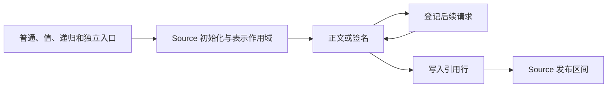
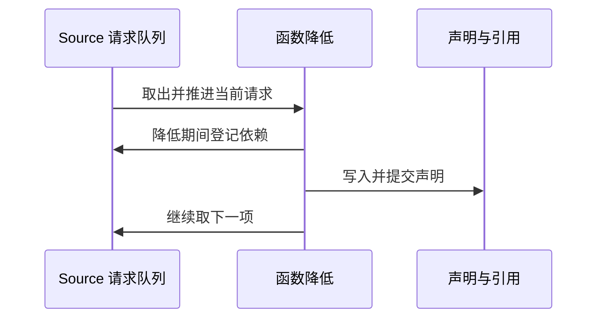

# genz 函数入口与请求发布自举

## Intent

让普通、值 ABI、递归请求和独立函数文件共用 Source 定义的入口初始化、表示恢复和发布边界。将请求形态在登记时确定，并让引用列在行安装成功后由 Source 发布。

## Data

现有入口分别重置正文、指针适配器和公共状态视图的部分字段。值入口按表示、输入符号和输出模式嵌套，恢复顺序与安装相反。函数请求队列在生成函数时仍会追加；每次只能先消费当前请求。引用区要求先准备目标容量，再写入语句行，最后提交区间。

## Edges

保留请求跨递归追加的可见性、重复请求过滤、首次请求的 Store 声明、原生分支及有错时的状态清理。引用语句行写入失败时保留原区间长度。初始 seed 保留原回退路径。

## Answer

集中检查递归、值 ABI、普通与独立模块的既有回归。同输入比较相邻 Source 工具的生成文件，沿固定基线复测并更新收敛计划。

Source 定义正文、指针适配器和状态视图各自需要重置的字段。值 ABI 的正文与签名沿同一 RX 编排进入表示、参数和输出作用域，退出时逆序释放。生成器编译时展开各阶段，原有 Zig 引导沿用同一资源释放约定。[状态重置](../../packages/genz/src/analysis/functions/context/reset.zx) · [值 ABI 编排](../../packages/genz/src/analysis/functions/value/plan.rx)

函数请求登记时确定首次普通、首次值 ABI 和已有请求的形态。队列只保留函数编号与形态两列，移除了分别保存首次标记和 ABI 变体的列。Source 取出请求后就地推进游标，宿主在生成当前函数后进入下一次请求。引用区借出预留好的目标位置，在语句写入成功后由 Source 写下区间头并发布长度。宿主仍负责单次递归、容量预留和 AST 行写入。[请求登记](../../packages/genz/src/analysis/functions/requests/push.zx) · [请求消费](../../packages/genz/src/analysis/functions/requests/take.zx) · [引用发布](../../packages/genz/src/analysis/functions/references/publish.zx)

### 验收

候选由上一代 Source 引导器构建，Zig 0.17.0 ReleaseSmall，16 个生成分区。25 个候选构建步骤和 14 个初始词法 seed 构建步骤通过。主清单、增长清单和集合清单的 14,448、464、100 份生成文件与上一代在同一输入上逐字节一致，共 15,012 份。候选引导器 SHA-256 为 `5ff5478fd7d617470b10d24549f95b679e073c3ca9b358890fbcddd20bb523c9`。

九组既有回归覆盖函数分析、独立生成单元、函数效果、类型化 Try、本地 ABI、Store I/O、安装版库入口与 Store 重发布、普通借用视图。221 个构建步骤与 130 项 Zig 测试通过，独立安装版集成也通过。

### 性能

三个工具均由 Source 引导构建，运行时启用 Source 分析和生成。macOS arm64、Zig 0.17.0 ReleaseSmall、固定 735 个入口、16 个分区，关闭常驻生成。三轮交错取中位数，范围为源码分析和 Zig 生成。

| 场景与指标                     | 固定基线 | 上一批 |  本批 |
| ------------------------------ | -------: | -----: | ----: |
| 冷生成墙钟（秒）               |     2.84 |   2.63 |  2.61 |
| 冷生成 CPU（秒）               |    12.44 |  12.59 | 12.67 |
| 冷生成进程树采样峰值 RSS（MB） |    885.2 |  715.8 | 707.2 |
| 冷生成单进程峰值 RSS（MB）     |    969.0 |  729.5 | 735.6 |
| 热生成墙钟（秒）               |     2.23 |   1.97 |  2.01 |
| 热生成 CPU（秒）               |     8.46 |   8.20 |  8.27 |
| 无修改生成墙钟（秒）           |     0.04 |   0.03 |  0.03 |

较上一批，冷生成墙钟减少 0.02 秒，CPU 增加 0.08 秒，进程树峰值 RSS 下降 8.6 MB，单进程峰值增加 6.1 MB。单进程峰值连续两批小幅增加，接续批次继续与同轮基线核对。较固定基线，冷生成墙钟减少 0.23 秒，CPU 累计增加 0.23 秒，进程树采样峰值减少 177.9 MB。

相邻两批的 11,753 份固定清单文件一致，候选自身冷暖产物一致。两批所有权缓存内容 SHA-256 均为 `cdf9fa7e0f33002a95dc097b2837de781d67e6e519a452fb97f89f7c0bbf3a23`。
