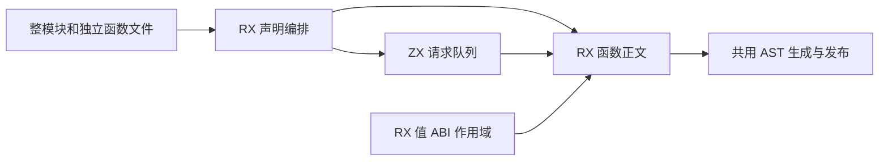
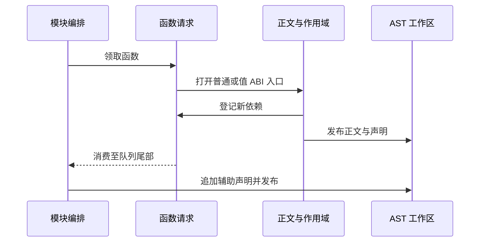

# genz 函数正文与模块声明执行自举

## Intent

把 genz 的函数正文、值 ABI 作用域、模块声明及函数请求的实际推进交给 Source，完成进入集中收尾前的共用函数生成链。

## Data

普通函数在 Zig 执行正文步骤表和值区间布局。值 ABI 在 Zig 嵌套进入三个作用域，表示切换时还逐个转换已有缓存行。整模块和独立函数文件分别在 Zig 执行声明步骤表，整模块另有请求领取和输出遍历。子表达式、语句帧、函数请求登记、依赖布局和 AST 列发布已接入 Source。

## Edges

保留正文、契约、前置声明、Store、引用区间和签名的求值次序，正文区间按原布局合并。值 ABI 在退出时逆序恢复输出表示、参数成员及借用缓存。请求领取后使用最新的队列长度，因为函数发射可能登记新依赖。整模块、类型入口、独立函数和原生函数继续使用各自的声明与前缀顺序。编排借用调用者持有的存储，沿用原生内存与错误解绕。

## Answer

沿普通、值 ABI、整模块和独立文件入口核对旧 Zig 调度退出。同批比较固定清单与新引导产物，运行现有模块、Store、调用与任务回归，记录残留的专用原生状态及下一批迁移入口。

### 正式路径

- 普通函数通过 RX 依序执行工作区准备、正文、契约、前置声明和发布。Source 指定 Store 初始化器和提交的时机，也指定各段正文在 AST 中的最终顺序。
- 值 ABI 的表示、参数和输出作用域都由 Source 进入。普通正文与签名共用这条作用域路径，缓存表示转换由 Source 遍历原槽位。Zig 保存恢复令牌，在失败或完成后逆序恢复。
- 整模块、类型入口与独立函数模块分别进入 Source 声明编排。函数请求持续读最新队列，先发布首次请求的 Store，再发射正文。原生请求沿原入口发射。比较函数和独立签名的遍历也进入 Source。
- 初始 seed 沿用自己的步骤顺序。正式入口保留签名形状、AST 列与分配器的原生适配，后续纳入传递依赖核对。

### 实施复核

首次复编译在 `graph_selection` 崩溃。符号跟踪定位到 AST 列复制，定点诊断确认错误列表的切片描述在调用签名构造前有效，进入构造后失真。签名改为借用原请求，复用原错误列表，并在移除诊断探针后通过同一最小清单。正文发布通过标量段标识传入布局顺序，避免组装临时数组。

### 阶段验收

候选由 `7d283ff9b` 的 Source 引导器生成，运行使用本批的 Source 正文、作用域和模块声明编排。Source 引导构建通过 26 个步骤，初始 seed 词法引导通过 14 个步骤。候选重新生成四份构建清单，15,376 份文件与构建候选所用的产物逐字节一致。候选引导器 SHA-256 为 `53745e115f373841259d115acd7a6296af88833f0204ec2bfefcbcb94f54111b`。

模块生成、函数分析、值 ABI 返回、Store、Task、库入口、聚合循环、循环列和表达式运行时九组现有回归通过，共 469 个构建步骤及 778 项测试。收敛计划将下一批定为项目联结与缓存，沿项目正文的命中和重算入口贯通单元发布、验证前缀与缓存写回。[收敛计划](../2026-11-20/自举收敛计划.md)

### 性能对照

固定基线、上一批与候选各运行三轮同一份 735 入口的冻结清单。配置为 `ReleaseSmall`、16 个分区。下表记录生成阶段的中位数。

| 生成指标                   | 固定基线 | 上一批 |  候选 |
| -------------------------- | -------: | -----: | ----: |
| 冷墙钟（秒）               |     2.90 |   2.63 |  2.65 |
| 冷 CPU（秒）               |    12.50 |  12.90 | 12.91 |
| 冷进程树采样峰值 RSS（MB） |    886.1 |  711.7 | 707.9 |
| 冷单进程最大 RSS（MB）     |    921.7 |  733.9 | 733.1 |
| 热墙钟（秒）               |     2.21 |   2.00 |  1.97 |
| 热 CPU（秒）               |     8.45 |   8.31 |  8.27 |

较上一批，冷生成墙钟增加 0.02 秒，CPU 增加 0.01 秒，进程树峰值下降 3.8 MB。较固定基线，冷生成墙钟累计减少 0.25 秒，CPU 增加 0.41 秒，进程树峰值下降 178.2 MB。未改动时的生成命令中位数仍为 0.03 秒。

候选与上一批的 11,753 份冻结产物一致，候选自身冷暖产物一致，固定基线的历史差异与上一批一致。候选 memo 载荷 SHA-256 为 `cdf9fa7e0f33002a95dc097b2837de781d67e6e519a452fb97f89f7c0bbf3a23`，与上一批相同。常驻生成的编辑中位数由 0.424 秒变为 0.426 秒，峰值由 1,277.2 MB 变为 1,277.7 MB。编辑和恢复产物一致。
