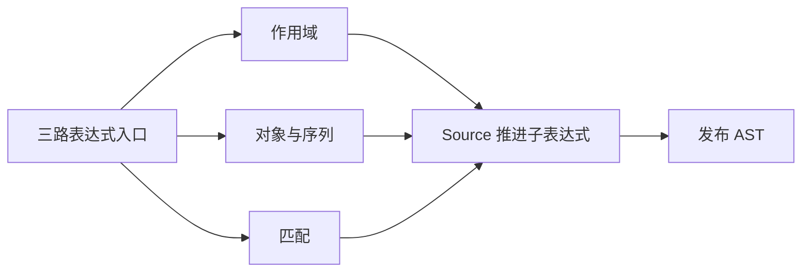
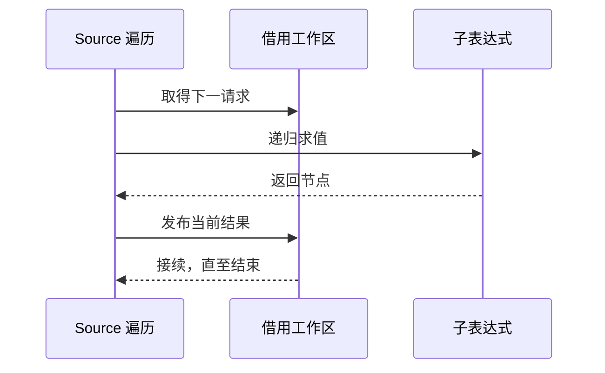

# genz 复合表达式递归自举

## Intent

将三路 Lower 的作用域绑定、聚合元素及匹配分支从 Zig 遍历迁入 Source，沿已经接好的表达式入口执行实际子节点求值和结果交付。

## Data

Source 已提供作用域逆序请求、聚合布局及匹配分支计划，也已经负责三路表达式入口和共用读取。本批开始时，作用域循环仍在 Zig 读取并执行每个请求，聚合和匹配也在 Zig 逐项递归。

## Edges

作用域先求结果再逆序求绑定。对象在字段求值前安装临时引用，失败时恢复缓存。迭代对象保留原读取计数。匹配先求默认分支，再按计划求选中值或等值比较。借用已有 IR 行和输出区，保持作用域清理与现有 AST 顺序。

## Answer

以三路正式入口的旧循环退出为本批验收。复用上一阶段引导器，集中核对固定清单、生成文件、现有失败路径和运行回归，并记录剩余的原生边界。

### 正式路径

普通和值 ABI 的 `scope.lowerMode` 及迭代的 `scope.lower` 都进入 Source 绑定遍历。消费末项的尝试先于常规结果求值。Source 接着按请求求值并发布，覆盖复用、Task、类型、丢弃和普通绑定。Zig 继续持有原分配器、缓存恢复令牌及 AST 存储，负责在错误退出时回收本批资源。

对象、列表、元组和模板的 Source 遍历借用原 IR 子项。对象先登记操作数名称，再执行求值和引用安装。迭代对象保留原读取计数和字段分配顺序。匹配的分支计划直接决定递归请求，写入借用的结果列后交给已验收的 AST 发射路径。默认分支和主体作用域仍由现有 Zig 入口准备。初始 seed 独立保留普通生成路径。

本批已通过集中验收。沿[持续收敛计划](../2026-11-20/自举收敛计划.md)接续调用、循环和 Task 的剩余正式调度，再复核是否达到进入集中收尾的门槛。

### 阶段验收

候选由已验收的 Source 引导器 `4d3a66eda` 生成，实际运行本批的 Source 遍历。Source 引导构建通过 26 个步骤，初始 seed 词法引导通过 14 个步骤。候选对四份当前构建清单重复生成，与生成候选所用的 15,267 份文件逐字节一致。候选引导器 SHA-256 为 `5e0ddade0dc3a9473809ce9325fee0c12b7e856851d48f8c22d4c555cd9a903a`。

表达式执行、Switch 作用域、聚合循环、循环列、值 ABI 返回、函数分析、模块生成和特殊数值八组现有回归通过，共 395 个构建步骤和 1,665 项测试。

### 性能对照

固定基线、上一批与候选各跑三轮同一份 735 入口的冻结清单，使用 `ReleaseSmall`、16 个分区。表中为中位数，测量范围是生成阶段。

| 生成指标                   | 固定基线 | 上一批 |  候选 |
| -------------------------- | -------: | -----: | ----: |
| 冷墙钟（秒）               |     2.76 |   2.56 |  2.56 |
| 冷 CPU（秒）               |    12.35 |  12.74 | 12.71 |
| 冷进程树采样峰值 RSS（MB） |    894.9 |  709.2 | 709.3 |
| 冷单进程最大 RSS（MB）     |    928.4 |  732.1 | 735.6 |
| 热墙钟（秒）               |     2.16 |   1.93 |  1.95 |
| 热 CPU（秒）               |     8.34 |   8.17 |  8.23 |

冷生成与上一批同为 2.56 秒，CPU 下降 0.03 秒，进程树峰值增加 0.1 MB。相对固定基线，冷墙钟累计减少 0.20 秒，CPU 增加 0.36 秒，进程树峰值下降 185.6 MB。常驻编辑中位数分别为 0.425 秒与 0.424 秒，峰值由 1,269.9 MB 增至 1,278.8 MB，保留同一夹具跟踪。

上一批与候选的 11,753 份冻结清单产物及候选自身的冷暖产物逐字节一致。固定基线的历史差异与上一批相同。常驻编辑的结果和恢复后的输出一致，候选 memo 载荷 SHA-256 为 `cdf9fa7e0f33002a95dc097b2837de781d67e6e519a452fb97f89f7c0bbf3a23`。
