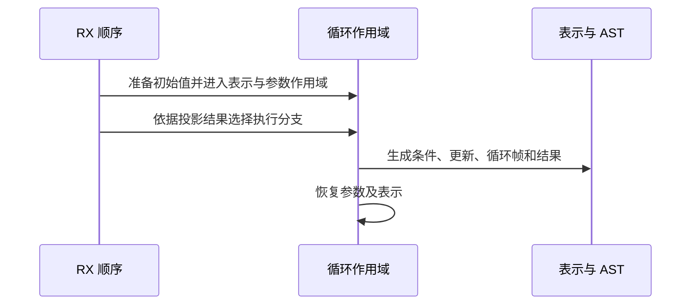

# genz 循环执行与类型准备自举

## Intent

把按引用、按值、丢弃和消费四种循环入口的执行顺序交给 RX。普通与投影路径共用循环帧和写回步骤，迭代输入与返回表示共用类型资源准备。

## Data

普通路径先降低条件和更新，再声明循环状态。投影路径先声明种子，随后降低条件和更新，保留首测失败时原种子的返回路径。已进入的参数区先于表示作用域恢复。输入转换使用迭代类型，输出转换先准备普通布局，再按类型要求选择可空类型、对象布局或堆类型。

## Edges

维持两条循环路径中声明、类型查询、首次失败和条件求值的原次序。作用域依照原有资源生命周期解绕。编译工具在编译期展开流程，避免引入执行器运行时。原 seed 可继续引导阶段构建。

## Answer

用同一批既有普通、投影、按值和借用循环回归验收，核对初始 seed 和 Source 引导器。相邻 Source 工具在同一输入上的生成结果一致后，对照固定基线并更新收敛计划。

RX 分别定义打开循环作用域、准备字段和参数，以及运行普通和投影循环的顺序。四种调用入口共用这些步骤。条件、更新构造、续用和投影恢复在同一生成路径按声明顺序执行。投影分支独立持有语句暂存区，首测未通过时按原种子生成结果。Zig 负责实际递归请求、类型查询、AST 安装和已分配资源的恢复。[循环编排](../../packages/genz/src/analysis/iteration/workflow/plan.rx) · [循环入口](../../packages/genz/src/zx/iteration.zig)

迭代转换的输入与返回共用资源准备。Source 根据操作和返回要求决定原布局、可空类型替换及额外操作数。该决策在构建生成器时展开，运行时按选中请求取类型。原根布局求值及失败传播顺序保留。[资源选择](../../packages/genz/src/analysis/iteration/conversion/resources.zx) · [资源准备](../../packages/genz/src/zx/iteration_value/conversion_emission.zig)

### 验收

候选由上一代 Source 引导器构建。Zig 0.17.0 ReleaseSmall，16 个生成分区，25 个候选构建步骤与 14 个初始词法 seed 构建步骤通过。主清单、增长清单和集合清单分别有 14,433、464、100 份产物，同输入共 14,997 份文件与上一代逐字节一致。候选引导器 SHA-256 为 `b65932f1c48a0622a2edfd7e79ee114cd1cf19cd650648cb2dbc3fb7da7127bb`。

十一组既有回归覆盖循环运行、独立安装版流程、调用与库迁移、缓冲区复用、循环投影与转移、参数规范、函数更新、普通借用视图、初始值所有权和求值顺序。580 个构建步骤和 1,941 项 Zig 测试均通过。

### 性能

三个工具均由 Source 引导构建，运行时启用 Source 分析和生成。macOS arm64、Zig 0.17.0 ReleaseSmall、固定 735 个入口、16 个分区，关闭常驻生成。三轮交错取中位数，范围为源码分析和 Zig 生成。

| 场景与指标                     | 固定基线 | 上一批 |  本批 |
| ------------------------------ | -------: | -----: | ----: |
| 冷生成墙钟（秒）               |     2.84 |   2.59 |  2.56 |
| 冷生成 CPU（秒）               |    12.41 |  12.61 | 12.53 |
| 冷生成进程树采样峰值 RSS（MB） |    885.2 |  706.8 | 702.8 |
| 冷生成单进程峰值 RSS（MB）     |    925.3 |  725.4 | 730.7 |
| 热生成墙钟（秒）               |     2.21 |   1.92 |  1.94 |
| 热生成 CPU（秒）               |     8.43 |   8.09 |  8.12 |
| 无修改生成墙钟（秒）           |     0.04 |   0.03 |  0.03 |

较上一批，冷生成墙钟减少 0.03 秒，CPU 减少 0.08 秒，进程树采样峰值下降 4.0 MB，单进程峰值增加 5.2 MB。相对固定基线，冷生成墙钟减少 0.28 秒，CPU 累计增加 0.12 秒，进程树采样峰值下降 182.4 MB。

相邻两批的 11,753 份固定清单产物一致，候选自身冷暖生成也一致。两批所有权缓存内容 SHA-256 均为 `cdf9fa7e0f33002a95dc097b2837de781d67e6e519a452fb97f89f7c0bbf3a23`。
