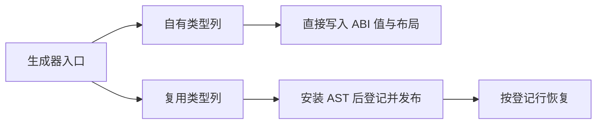
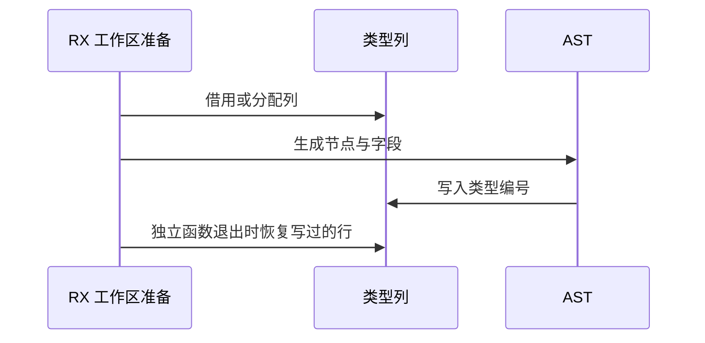

# genz 类型工作区与列发布自举

## Intent

迁移生成器的工作区准备和类型列生命周期。自有 ABI 类型直接写最终位置。独立函数继续复用类型缓存，只清理本次登记的行。

## Data

普通输出和共享类型包拥有 ABI 类型与布局列。当前 ABI 定义还构造一份临时列，安装 AST 后复制进最终列。独立函数使用每个 worker 的复用区，ABI、状态和视图首次写入一行时登记索引，函数完成或失败时清空写过的行。

## Edges

自有列属于本次 AST 生成，失败时整体丢弃。复用列在 AST 行安装后才发布，回收保持稀疏且复用每个 worker 的原缓冲。保持 ABI、状态和视图节点编号及发出顺序。物理分配继续由宿主提供。

## Answer

集中检查普通模块、共享类型包、独立函数和借用视图，同输入核对引导产物并与固定基线比较。阶段结果和剩余宿主职责更新到收敛计划。

RX 确定借用复用区、创建 AST、分配自有类型列及准备正文上下文的顺序。Source 的物理列布局在构建生成器时展开。复用区的 ABI、状态和视图列在初始化时一起获得，退出时由 Source 清空已登记的行。复用原有的整块分配与容量增长策略。[工作区编排](../../packages/genz/src/analysis/types/workspace/prepare.rx) · [复用区恢复](../../packages/genz/src/analysis/types/cache/scratch/reset.zx)

ABI 定义生成直接向自有类型列写入值和布局编号。字段及后续依赖从已经产生的编号读取，移除两份临时列及相应的宿主复制。状态类型的自有列继续由 Source 创建并传给生成器。复用区仍在 AST 安装成功后发布编号并登记触及行。[ABI 定义](../../packages/genz/src/analysis/types/definitions/construct.zx) · [复用区发布](../../packages/genz/src/analysis/types/cache/publish_shared.zx)

回归还发现类型查询在读首个类型标签前分配完整表的包装对象。初次构建有九项针对快速返回的用例失败，生成依赖和上一代相同。修复后由共用的类型标签扫描选择快速返回路径，需要继续查找子类型时才准备完整的表。实际传播和增长算法沿用原有顺序。[快速查询](../../packages/compiler/src/zx/analysis/semantic/querying/first_target.zx) · [子类型查询](../../packages/compiler/src/zx/analysis/semantic/querying/scan.zx)

### 验收

候选由上一代 Source 引导器构建，Zig 0.17.0 ReleaseSmall，16 个生成分区。25 个候选构建步骤与 14 个初始词法 seed 构建步骤通过。修复后的主清单有 14,473 份文件，增长和集合清单有 464 与 100 份，同输入共 15,037 份生成文件与上一代引导器逐字节一致。候选引导器 SHA-256 为 `8393fcc5eee6210cbe66995317729f15905f8d3605ff47b36ba6ef3509b9434e`。

初次回归除上述九项外其余 203 项通过。修复之后单独运行的类型查询回归共 62 项通过。

修复后的五组影响回归覆盖类型查找、类型解析、原生引用、Store I/O 和原生库的安装版发布。165 个构建步骤和 135 项 Zig 测试通过。函数分析、独立函数文件和借用视图沿用首轮已经通过的验收。

### 性能

三个工具均由 Source 引导构建，运行时启用 Source 分析和生成。macOS arm64、Zig 0.17.0 ReleaseSmall、固定 735 个入口和 16 个分区，关闭常驻生成。三轮交错取中位数，范围为源码分析和 Zig 生成。

| 场景与指标                     | 固定基线 | 上一批 |  本批 |
| ------------------------------ | -------: | -----: | ----: |
| 冷生成墙钟（秒）               |     2.87 |   2.62 |  2.62 |
| 冷生成 CPU（秒）               |    12.48 |  12.70 | 12.71 |
| 冷生成进程树采样峰值 RSS（MB） |    886.5 |  707.3 | 704.1 |
| 冷生成单进程峰值 RSS（MB）     |    922.1 |  723.8 | 739.3 |
| 热生成墙钟（秒）               |     2.22 |   1.96 |  1.96 |
| 热生成 CPU（秒）               |     8.47 |   8.22 |  8.23 |
| 无修改生成墙钟（秒）           |     0.04 |   0.03 |  0.03 |

相对固定基线，冷生成墙钟减少 0.25 秒，CPU 累计增加 0.23 秒，进程树峰值下降 182.4 MB。相对上一批，进程树下降 3.2 MB，单进程峰值中位数增加 15.5 MB。上一批三轮单进程峰值为 720.4、723.8、736.1 MB，本批为 739.3、740.1、719.7 MB。两组的范围重叠，采样物理内存占用的峰值中位数增加约 1.5 MB，继续追踪单进程短峰值。

相邻两批的 11,753 份固定清单产物一致，候选自身冷暖产物也一致。两批所有权缓存内容 SHA-256 均为 `cdf9fa7e0f33002a95dc097b2837de781d67e6e519a452fb97f89f7c0bbf3a23`。
