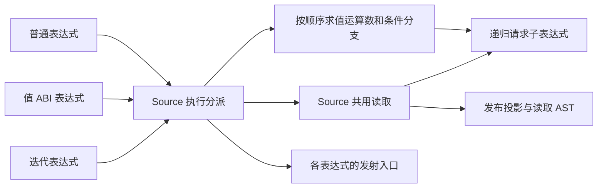
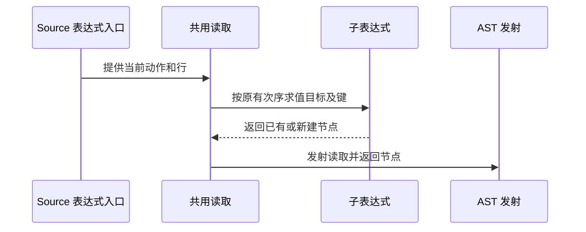

# genz 表达式递归入口自举

## Intent

让普通、值 ABI 和迭代表达式的正式入口由 Source 执行分派。收口三路共用的可空值、字段、下标、长度、运算数及条件分支求值，沿读取链迁入嵌套投影段的推进和结果交付。

## Data

已有 Source 规则选择表达式类别、缓存和表示形式。正式入口仍在 `expressions/dispatch.zig`、`value_call.expression` 和 `iteration_value/evaluation.zig` 执行分派，共用读取又通过 `expressions/read.zig` 的静态步骤表控制递归调用。

## Edges

保持普通入口先解析类型、元组投影可以提前返回、下标先求值目标再求值键。复用投影借用窗口和从里到外的下标推进顺序。迭代入口区分可空类型的表示与长度结果的类型。缓存命中仍记录既有计数，回退时复用已检查的缓存。原生调用只借用现有工作区，普通和值 ABI 的发射入口继续按原作用域运行。

## Answer

移除正式路径重复执行的 Zig 表达式分派和共用读取步骤循环。集中核对引导产物、应用回归、固定清单及常驻编辑。各复杂构造内部仍执行的递归、作用域发布和失败恢复单独记录到收敛计划。

### 正式路径

普通、值 ABI 和迭代入口共用表达式调用边界。普通入口先取结果类型，值 ABI 和迭代入口借用已有计划，后续分派、递归请求和结果交付在 Source 执行。迭代缓存命中登记原有读取计数，回退继续复用已检查的缓存。

共用读取去掉手写步骤循环。元组投影优先取已有结果，可空值保留类型和操作数的求值顺序。嵌套投影由 Source 逆序消费键和字段区间。单目、双目、条件表达式和合成等值比较也在 Source 中逐个求值，原生发射操作直接使用已解析的子节点。

复用所有权阶段的静态生成组，组名扩展为 `execution`。读取与入口声明各自维护，构建期归入同一专用接口。生成编排用空分配器运行，IR、字段区间和 AST 写入沿用已有工作区。原生层仍负责缓存列绑定、每种 AST 节点的物理发射，以及作用域、聚合、调用、循环和匹配内部尚存的递归推进。

### 性能对照

候选由已验收的 Source 引导器 `fc240824d` 构建，运行使用本批 Source 执行链。三组各运行三轮相同的 735 入口冻结清单，配置为 `ReleaseSmall`、16 个分区，表中为中位数。

| 生成指标                   | 固定基线 | 上一批 |  候选 |
| -------------------------- | -------: | -----: | ----: |
| 冷墙钟（秒）               |     2.81 |   2.61 |  2.63 |
| 冷 CPU（秒）               |    12.41 |  12.84 | 12.91 |
| 冷进程树采样峰值 RSS（MB） |    884.9 |  706.9 | 709.0 |
| 冷单进程最大 RSS（MB）     |    921.1 |  728.5 | 731.6 |
| 热墙钟（秒）               |     2.19 |   1.95 |  1.95 |
| 热 CPU（秒）               |     8.46 |   8.24 |  8.27 |

相对上一批，冷墙钟增加 0.02 秒，CPU 增加 0.07 秒，进程树峰值增加约 2.0 MB。相对固定基线，冷墙钟累计减少 0.18 秒，CPU 增加 0.50 秒，进程树峰值下降 175.9 MB。常驻编辑中位墙钟从 0.424 秒降到 0.422 秒，最大采样 RSS 从 1,271.3 MB 降到 1,270.8 MB。

冻结清单的 11,753 份生成文件及候选冷暖产物一致，memo 载荷 SHA-256 仍为 `cdf9fa7e0f33002a95dc097b2837de781d67e6e519a452fb97f89f7c0bbf3a23`。候选引导器 SHA-256 为 `9b15055843a5b4895ceb50f287aad7f5c96253dc7a7d4bc210cfd8fa900ae846`。

### 阶段验收

Source 引导构建通过 26 个步骤，初始 seed 词法引导通过 14 个步骤。上一批与本批引导器在四份当前清单生成的 15,215 份文件逐字节一致。已有表达式执行、值 ABI 返回、聚合循环、循环列、函数分析、模块生成、Switch 作用域和特殊数值回归共通过 1,665 项。两套常驻编辑夹具在每次编辑和恢复后生成相同产物。
