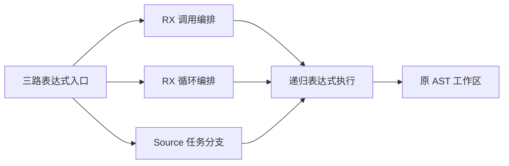
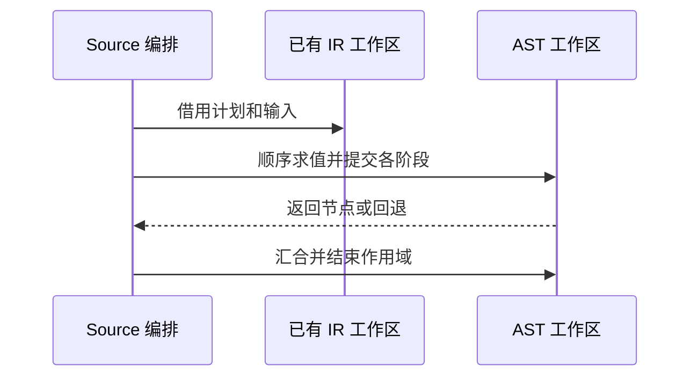

# genz 调用、循环与任务执行自举

## Intent

让普通、值 ABI 和迭代入口在 Source 执行调用、循环和并行任务的剩余调度。清除这些正式入口借用 Zig 步骤表、逐项循环和回退状态推进的路径。

## Data

调用原本由 Zig 消费静态步骤表，分别持有参数、输出和借用恢复状态。循环同样由 Zig 执行开场、参数、投影恢复和结果发射的步骤，消费回退另有一个宿主循环。并行任务先在 Zig 遍历分支，再交给现有 Source 任务汇合。上一批已迁移共用表达式入口、复合表达式和作用域绑定。

## Edges

保持普通调用的 Store 依赖顺序，值 ABI 的转换与 borrowed 路径的封口区别，以及迭代参数对临时缓存的恢复。循环保留 SIMD 到标量的回退、初次测试和投影循环的声明顺序。任务保留名称分配、启动与汇合顺序。Source 借用原工作区及列，Zig 错误解绕负责恢复已经安装的资源。

## Answer

正式运行改用 Source 执行调度，seed 保留独立引导。整批对照引导产物、调用与循环回归、任务执行以及固定清单性能。以原调用入口核对实际退出的 Zig 路径，再更新收敛总表。

### 正式路径

- 普通和值 ABI 调用共用 RX 的准备与发射阶段。Source 决定递归求值、参数适配、所有权裁剪、Store 接入、结果转换及封口。借用入口可把声明留给外层作用域。
- 迭代调用由 RX 先求值和安装参数，再执行并转换结果。Zig 持有已安装缓存槽的恢复令牌，在成功和失败时按原次序恢复。
- 普通和投影循环共用 RX 的准入、初值、参数、更新和发射阶段。Source 的布局请求和消费回退循环替代 Zig 游标，投影读取按从内到外的顺序推进。投影与普通路径保持各自的首次声明顺序。
- 并行任务由 Source 依原顺序发出分支，复用原汇合入口。匹配的主体缓存安装、默认分支与分支计划也由 Source 决定顺序。Zig 继续执行原子 AST 写入和资源解绕。

### 实施复核

首个候选在自编译时因 RX 为循环求值重组对象而调用堆分配。改用同一输入视图，让求值阶段读取工作区已有的投影状态，保持编排空分配器。循环更新的条件、正文与值 ABI 标记通过工作区直接借用。普通与值 ABI 的旧静态调用步骤表已撤出，seed 复用原子写入和恢复操作。

### 剩余入口

本批覆盖表达式内部的调用、循环、并行任务和匹配。沿 `Lower.function`、`Lower.functionValue` 与模块生成入口继续检查，`functions/body.build` 仍消费 Zig 步骤表并合并正文区间，`functions/value.run` 仍在 Zig 逐层进入并恢复表示作用域，`Lower.moduleDeclarations` 仍循环领取函数请求和附加声明。下一批应按同一函数生成链迁移这三处，复用本批的递归表达式入口和已有的语句帧及 AST 发布。初始 seed 的独立调度继续单列。

### 阶段验收

候选由已验收的 Source 引导器 `639dc65e7` 构建，运行使用本批 Source 调用与循环编排。Source 引导构建通过 26 个步骤，初始 seed 词法引导通过 14 个步骤。修复后独立运行首次失败的生成词法入口通过。四份当前构建清单的 15,333 份生成文件与构建候选所用的版本逐字节一致。候选引导器 SHA-256 为 `e340ceafd9ccf25e13a36f4ccda3dea341258f14f487c695e7ca40acbc1efce3`。

表达式、Switch 作用域、聚合循环、循环列、值 ABI 返回、函数分析、模块生成、特殊数值、Task 及 Store 十组现有回归通过，共 498 个构建步骤及 2,020 项测试。

### 性能对照

固定基线、上一批与候选各跑三轮同一份 735 入口的冻结清单，使用 `ReleaseSmall`、16 个分区。表中为生成阶段的中位数。

| 生成指标                   | 固定基线 | 上一批 |  候选 |
| -------------------------- | -------: | -----: | ----: |
| 冷墙钟（秒）               |     2.83 |   2.60 |  2.62 |
| 冷 CPU（秒）               |    12.52 |  12.84 | 12.90 |
| 冷进程树采样峰值 RSS（MB） |    896.1 |  707.6 | 708.7 |
| 冷单进程最大 RSS（MB）     |    921.6 |  732.0 | 740.8 |
| 热墙钟（秒）               |     2.21 |   1.92 |  1.96 |
| 热 CPU（秒）               |     8.47 |   8.18 |  8.27 |

相对上一批，冷墙钟增加 0.02 秒，CPU 增加 0.06 秒，进程树峰值增加 1.1 MB，单进程峰值增加 8.8 MB。相对固定基线，冷墙钟累计减少 0.21 秒，CPU 增加 0.38 秒，进程树峰值下降 187.4 MB。

上一批与候选的 11,753 份冻结清单生成文件一致，候选自身的冷暖产物一致。候选 memo 载荷 SHA-256 仍为 `cdf9fa7e0f33002a95dc097b2837de781d67e6e519a452fb97f89f7c0bbf3a23`。

固定基线的历史产物差异与上一批相同。常驻编辑的中位墙钟分别为 0.424 秒和 0.425 秒，峰值由 1,278.4 MB 降至 1,275.9 MB，编辑与恢复产物均一致。
