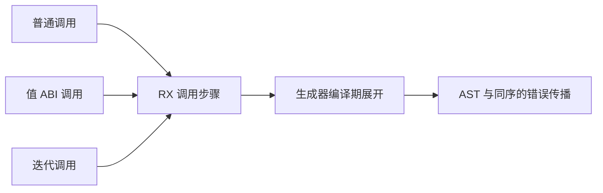
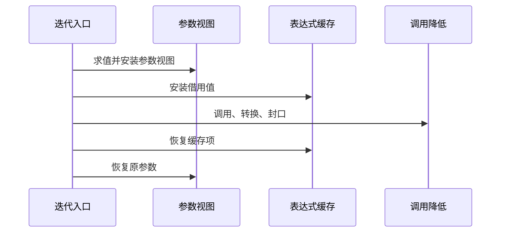

# genz 调用执行与借用恢复自举

## Intent

普通、值 ABI 和迭代调用共用 Source 定义的调用步骤。当前批次覆盖参数求值、表示调整、资源接入、函数求值、结果转换、临时块封口和借用恢复。收敛计划以正式入口实际退出的 Zig 职责为准。

## Data

普通调用在参数准备后接入 Store 资源，再构造调用及转换返回值。值 ABI 在产生调用前适配并裁剪输入，在调用后选择返回表示。迭代调用先求值并建立借用视图，在临时参数与缓存槽可见期间完成调用和结果转换，离开时逆序恢复。

## Edges

生成工具在编译期展开 RX 步骤。每条路径继续借用原 IR 类型列、语句区与缓存位置。迭代缓存安装失败时恢复已经安装的参数视图。初始 seed 继续支持原有入口。

## Answer

在统一收敛计划登记正式路径的退出范围，集中核查调用、迭代、Store 与求值顺序，同输入比较 Source 引导产物，并与上一代和固定基线比较冷生成的墙钟、CPU 和内存。

RX 将普通、值 ABI、借用值 ABI 及迭代调用分开编排。普通和值 ABI 的执行器直接从函数表借用输入和输出类型列。借用值 ABI 沿用调用方的语句块，其他值 ABI 调用按 RX 步骤封口自身语句块。迭代调用在封口后逆序恢复缓存槽和参数槽，失败也执行相同恢复顺序。[共用编排](../../packages/genz/src/analysis/invocation/workflow/plan.rx) · [普通入口](../../packages/genz/src/zx/regular_call/root.zig) · [值 ABI 入口](../../packages/genz/src/zx/value_call/root.zig) · [迭代入口](../../packages/genz/src/zx/iteration_value/invocation.zig)

宿主仍执行单项递归求值、表示转换、Store 资源适配、借用安装及 AST 写入。下一批从迭代结果的投影、传输、缓存和最终布局输出接续。[自举收敛计划](../2026-11-20/自举收敛计划.md)

### 验收

候选由上一代 Source 引导器构建，Zig 0.17.0 ReleaseSmall，16 个生成分区。候选 25 个构建步骤、初始词法 seed 14 个构建步骤通过。主清单、增长清单和集合清单的 14,423、464 和 97 份生成文件与上一代在同一输入上逐字节一致，共 14,984 份。候选引导器 SHA-256 为 `02717fb585d088b91dc0bb3dd7103dee0c43c8c1d95d84664bc4f58dbeb55e5e`。

九个既有回归目标覆盖迭代调用与库迁移、普通借用视图、循环策略、函数更新、原生引用、类型化 Try、Store I/O 和求值顺序。469 个构建步骤与 1,610 项 Zig 测试均通过，包含独立安装版的迭代库发布和迁移检查。

### 性能

三个工具均由 Source 引导构建，运行时启用 Source 分析及生成。macOS arm64、Zig 0.17.0 ReleaseSmall、固定 735 个入口、16 个分区，关闭常驻生成。三轮交错运行取中位数，范围为源码分析和 Zig 生成。

| 场景与指标                     | 固定基线 | 上一批 |  本批 |
| ------------------------------ | -------: | -----: | ----: |
| 冷生成墙钟（秒）               |     2.86 |   2.58 |  2.55 |
| 冷生成 CPU（秒）               |    12.42 |  12.62 | 12.58 |
| 冷生成进程树采样峰值 RSS（MB） |    894.8 |  708.2 | 704.9 |
| 冷生成单进程峰值 RSS（MB）     |    921.4 |  727.3 | 725.4 |
| 热生成墙钟（秒）               |     2.17 |   1.93 |  1.93 |
| 热生成 CPU（秒）               |     8.30 |   8.14 |  8.09 |
| 无修改生成墙钟（秒）           |     0.04 |   0.03 |  0.03 |

较上一批，冷生成墙钟减少 0.03 秒，CPU 减少 0.04 秒，进程树峰值 RSS 减少 3.3 MB。相对固定基线，冷生成墙钟减少 0.31 秒，CPU 累计增加 0.16 秒，进程树峰值 RSS 下降 189.9 MB。

固定清单上，两批的 11,753 份生成文件逐字节一致。候选自身的冷暖生成产物也一致。上一批与本批的所有权缓存内容 SHA-256 均为 `cdf9fa7e0f33002a95dc097b2837de781d67e6e519a452fb97f89f7c0bbf3a23`。
