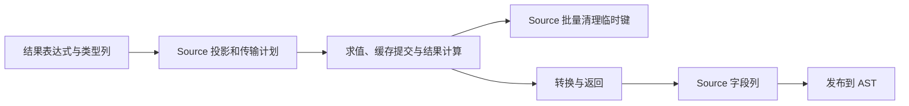
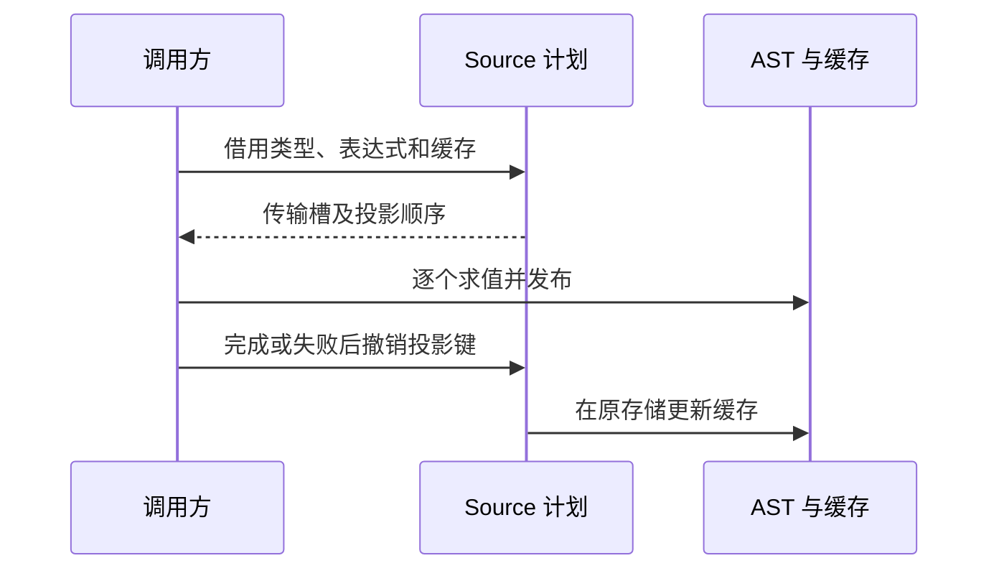

# genz 迭代结果与返回资源自举

## Intent

让 Source 持有迭代结果的传输槽与缓存清理，以及返回表示所需的字段和资源请求。普通和缓冲结果共用投影、缓存提交及退出逻辑。正式路径保留递归求值和物理存储接口。

## Data

正式入口借用投影计划，但缓冲路径仍另行编号传输结果，普通与缓冲路径各自管理临时缓存。迭代转换、缓冲投影和更新分别把返回的字段记录逐行转成 AST 列。状态转换在准备每个类型的布局和成员资源时跨同一个 Source 接口查询。

## Edges

缓冲路径必须先执行传输，再读取其余投影。复用传输槽时仍需执行该投影的求值。缓存清理使用原计划的键和顺序，覆盖成功与失败。保留类型查询、AST 发布和错误传播的原顺序。

## Answer

集中运行迭代、返回表示和所有权相关回归，比较相邻 Source 引导器在同输入的产物，并用固定基线核对生成性能。结果写回统一收敛计划。

普通与缓冲结果共用一个写回入口，在原缓存上批量撤销投影键。Source 决定新建或复用的传输槽。生成器从传输操作直接取出用于复用的值，移除宿主的传输计数和传输历史尾部回读。[投影计划](../../packages/genz/src/analysis/iteration/result/analyze.rx) · [结果写回](../../packages/genz/src/zx/iteration_value/result.zig) · [批量清理](../../packages/core/src/integer/map/remove_keys.zx)

迭代转换、投影、缓冲视图和更新共用 AST 字段列。对象转换在遍历子项时直接追加字段，移除中间字段数组及相应拼接。状态转换的布局、目标、元素和来源选择在编译生成工具时展开为查表，保持逐项读取资源的原顺序。宿主继续负责实际类型资源查询、递归投影和分配。[对象转换](../../packages/genz/src/analysis/iteration/conversion/emit/aggregate.zx) · [状态转换](../../packages/genz/src/zx/state_value/conversion_emission.zig)

### 验收

候选使用上一代 Source 引导器构建。Zig 0.17.0 ReleaseSmall，16 个生成分区，25 个候选构建步骤与 14 个初始词法 seed 构建步骤通过。主清单、增长清单和集合清单的 14,424、464、100 份生成文件与上一代在同一输入上逐字节一致，共 14,988 份。候选引导器 SHA-256 为 `aac81e6cb41b70fac05e19d74f669efb3e5127d19d611fcb8d077c6cee585945`。

九组既有回归覆盖迭代调用、安装版库迁移、缓冲区复用、循环投影与转移、循环策略、函数更新、普通借用视图、初始值所有权与求值顺序。559 个构建步骤与 1,915 项 Zig 测试均通过。

### 性能

三个工具均由 Source 引导构建，运行时启用 Source 分析和生成。macOS arm64、Zig 0.17.0 ReleaseSmall、固定 735 个入口、16 个分区，关闭常驻生成。三轮交错运行取中位数，范围为源码分析和 Zig 生成。

| 场景与指标                     | 固定基线 | 上一批 |  本批 |
| ------------------------------ | -------: | -----: | ----: |
| 冷生成墙钟（秒）               |     2.85 |   2.59 |  2.59 |
| 冷生成 CPU（秒）               |    12.46 |  12.67 | 12.65 |
| 冷生成进程树采样峰值 RSS（MB） |    885.2 |  716.5 | 708.8 |
| 冷生成单进程峰值 RSS（MB）     |    951.5 |  727.2 | 727.7 |
| 热生成墙钟（秒）               |     2.22 |   1.96 |  1.96 |
| 热生成 CPU（秒）               |     8.49 |   8.19 |  8.20 |
| 无修改生成墙钟（秒）           |     0.04 |   0.03 |  0.03 |

较上一批，冷生成墙钟持平，CPU 减少 0.02 秒，进程树采样峰值下降 7.7 MB，单进程峰值增加约 0.6 MB。较固定基线，冷生成墙钟减少 0.26 秒，CPU 累计增加 0.19 秒，进程树采样峰值下降 176.4 MB。

相邻两批的 11,753 份固定清单生成文件一致，候选自身冷暖生成一致。两批所有权缓存内容 SHA-256 均为 `cdf9fa7e0f33002a95dc097b2837de781d67e6e519a452fb97f89f7c0bbf3a23`。
