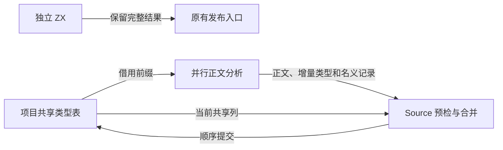
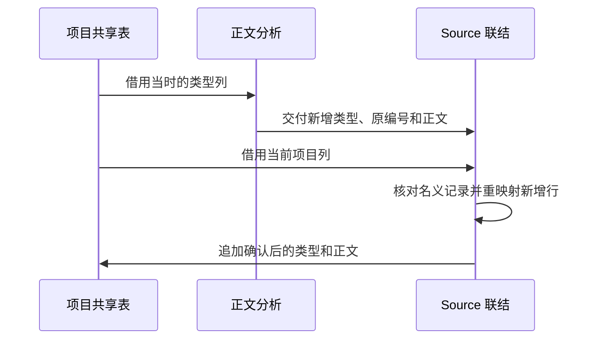

# 共享类型增量发布

## Intent

让混合项目正文只保留新增类型和名义记录。并行分析借用同一份共享前缀，联结顺序提交正文及其新增类型。两步之间取消模块级共享类型表副本。

## Data

[混合正文](../../packages/compiler/src/rx/analysis/project/mixed/zx.zig)借用共享类型表和名义表进行分析。Source 分析返回独立的类型增量，原发布流程先复制前缀、追加增量，联结再跳过此前缀。分析的新增行以本批次为物理起点，其引用仍使用完整类型空间的编号。[原始发布职责](../../packages/compiler/src/zx/analysis/analyzer/host/publish.zig) · [Source 合并](../../packages/compiler/src/zx/analysis/semantic/merging/prepare.rx)

## Edges

同一分析批次的早期正文可能在联结时发现共享表已增长。联结沿用正文分析时的前缀长度，Source 区分物理行号和原类型 ID，按既有顺序去重并重映射。类型名和名义记录在临时分析区回收前保存。完整外部工件的校验继续核对原有类型表和前缀。Debug 的完整校验按现有行为使用平铺类型表。

## Answer

正式 Release 混合正文入口只交付增量。独立 ZX、外部工件和首阶段 seed 保持完整类型表接口。以现有的名义类型、库联结、缓存恢复和混合项目回归覆盖共享表增长、类型编号、失败回滚和输出。清单输出与固定源输入逐字节对照，并对前一 Source 引导器复测冷暖路径。

类型发布、类型登记与联结准备已接入混合正文正式入口。以 `4c43d0d2c` 生成的 Source 引导器构建候选，25 个步骤通过。候选用 Source 分析和生成后端重生成四份清单，15,593 份结果逐字节一致。集中回归 188 个构建步骤、325 项 Zig 测试及 9 项 RX 磁盘项目集成通过。

Zig 0.17.0、ReleaseSmall、固定冻结清单和相同缓存配置下，候选与上阶段的 11,753 份冷暖输出逐字节一致。固定基线用于跟踪累计性能，固定工具自身的冷暖输出一致。当前候选与上一阶段对固定工具的差异完全相同，包括 161 份内容变化和两端仅有的 200、205 个路径。配对中位数如下。

| 场景 | 工具     | 墙钟（秒） | CPU（秒） | 进程树峰值（字节） | 单进程峰值（字节） |
| ---- | -------- | ---------: | --------: | -----------------: | -----------------: |
| 冷   | 固定基线 |       2.84 |     12.49 |        885,620,736 |        928,088,064 |
| 冷   | 上阶段   |       2.62 |     12.94 |        657,850,368 |        686,178,304 |
| 冷   | 候选     |       2.56 |     12.86 |        659,308,544 |        679,165,952 |
| 热   | 固定基线 |       2.22 |      8.51 |        893,059,072 |        934,297,600 |
| 热   | 上阶段   |       1.97 |      8.21 |        642,433,024 |        642,449,408 |
| 热   | 候选     |       1.90 |      8.25 |        643,743,744 |        643,760,128 |

候选冷墙钟减少 0.06 秒，CPU 减少 0.08 秒。冷进程树峰值比上阶段增加 1.5 MB，比固定基线低 226.3 MB。冷单进程峰值比上阶段减少 7.0 MB。热墙钟减少 0.07 秒，CPU 增加 0.04 秒。相对固定冷基线，墙钟减少 0.28 秒，CPU 增加 0.37 秒。

常驻编辑先复现了回到旧版本后进程 RSS 增加约 50 MB。活跃分析 arena 容量从四代缩回同一个旧版本后，两种工具均回到 280,262,674 字节。macOS 进程区域数据表明，候选额外驻留集中在大块 malloc 区域。将常驻分析每代的 arena 改为页分配器，退役时直接释放已无引用的块，一次性生成与临时分析继续使用现有分配器。

修复后，同一常驻编辑序列的中位耗时从 0.419 秒降至 0.412 秒。进程 RSS 峰值从 1,246,740,480 字节降至 1,107,836,928 字节。恢复旧版本后的 RSS 从 1,246,740,480 字节降至 776,437,760 字节。常驻服务首次冷请求结束的 RSS 增加 12.9 MB，后续峰值及恢复旧版本后的驻留均下降。两个工具的逐请求结果哈希一致。
