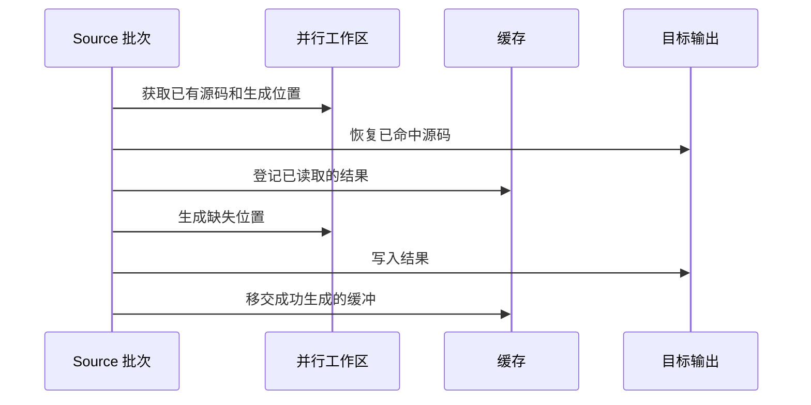

# 函数生成批次编排自举

## Intent

把普通应用和公开库共用的函数生成批次交给 RX 编排。缓存结果恢复、命中采用和生成未命中项继续使用现有 Source 规则。

## Data

原 Zig 入口依据缓存是否存在选择流程，依次获取、分类、恢复已有源码和生成缺失部分。缓存命中采用及生成结果接管已有 Source 实现，但阶段调用顺序和失败出口仍由 Zig 负责。[原入口](../../packages/compiler/src/backends/zig/function_sources.zig)

## Edges

命中的源码必须先从缓存缓冲写入输出，后续缓存替换才可释放旧缓冲。分类保留原有位置和偏移，不重排结果。发生失败时释放尚未移交的磁盘缓冲和生成缓冲。线程、宿主 I/O、输出分配与引导兼容路径保留原有行为。

## Answer

普通应用和公开库共用新批次。关闭缓存时直接生成。缓存全部命中时，恢复并登记结果后直接返回。部分命中时只调度缺失项。缓存登记由 RX 调用原有 Source 实现，移除了专用 Zig 转接。宿主仍负责工作线程、缓冲区与文件操作。初始 seed 保留原流程。[批次入口](../../packages/compiler/src/backends/zig/function_sources/workflow/run.rx) · [宿主接口](../../packages/compiler/src/backends/zig/function_sources.zig)

候选由 `ea8bc9978` 的 Source 引导器构建，25 个构建步骤通过。两代工具均用 Source 分析和生成，四份引导清单的 15,673 个文件逐字节一致。同一冻结清单的 11,753 份生成文件也一致。新批次的生成 Zig 借用现有缓存计划和位置列，没有为编排增加分配或复制。

模块生成、生成缓存运行、原生生成、后端发布、库工件和库入口六组回归通过。构建汇总为 126 个步骤、41 项 Zig 测试，另有 17 项集成检查。覆盖冷暖运行、局部修改、禁用缓存、损坏缓存、缓存键错配、原生声明重排、公开入口选择以及库消费。

Zig 0.17.0、ReleaseSmall、16 分区及相同冻结清单下，三次生成的中位数如下。范围为 zxc 分析和 Zig 文件写出。

| 场景 | 工具     | 墙钟（秒） | CPU（秒） | 进程树峰值（字节） | 单进程峰值（字节） |
| ---- | -------- | ---------: | --------: | -----------------: | -----------------: |
| 冷   | 固定基线 |       2.82 |     12.43 |        884,768,768 |        934,051,840 |
| 冷   | 上阶段   |       2.55 |     12.81 |        661,422,080 |        680,558,592 |
| 冷   | 本批     |       2.61 |     12.83 |        659,718,144 |        684,802,048 |
| 热   | 固定基线 |       2.16 |      8.40 |        892,633,088 |        933,937,152 |
| 热   | 上阶段   |       1.91 |      8.27 |        643,612,672 |        643,629,056 |
| 热   | 本批     |       1.92 |      8.26 |        643,858,432 |        643,874,816 |

冷生成比上阶段多用 0.06 秒墙钟、0.02 秒 CPU，进程树峰值下降 1.7 MB，单进程峰值增加 4.2 MB。比固定基线快 0.21 秒，CPU 增加 0.40 秒，进程树峰值下降 225.1 MB。热生成与上阶段相差 0.01 秒。常驻编辑中位数为 0.422 秒，上阶段为 0.420 秒，进程峰值增加 9.6 MB，五次编辑与恢复的输出哈希一致。

直接用共享分配器打印的试验省去一次生成缓冲的复制，但冷生成进程树峰值较上阶段增加约 27 MB，常驻编辑峰值增加约 23 MB。最终保留线程工作区打印和成功后移交缓存缓冲的做法，保留全部 RX 编排。
