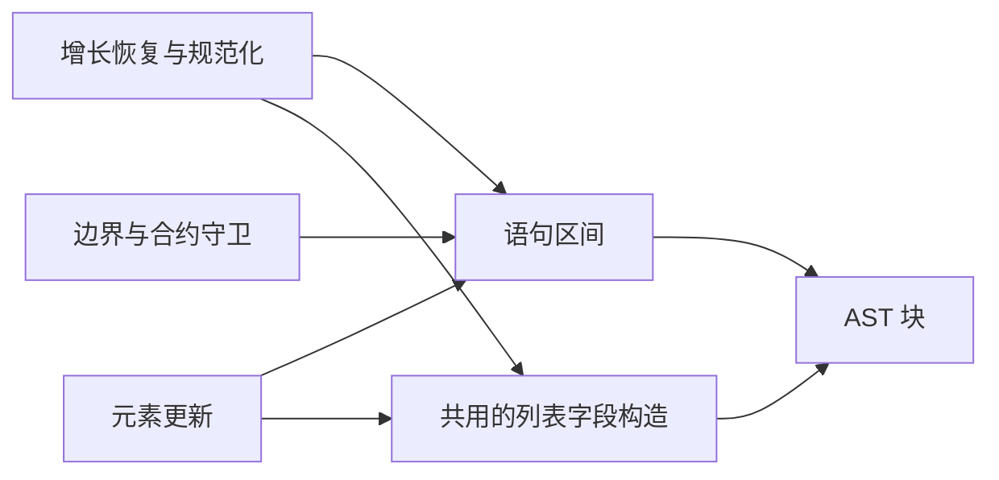
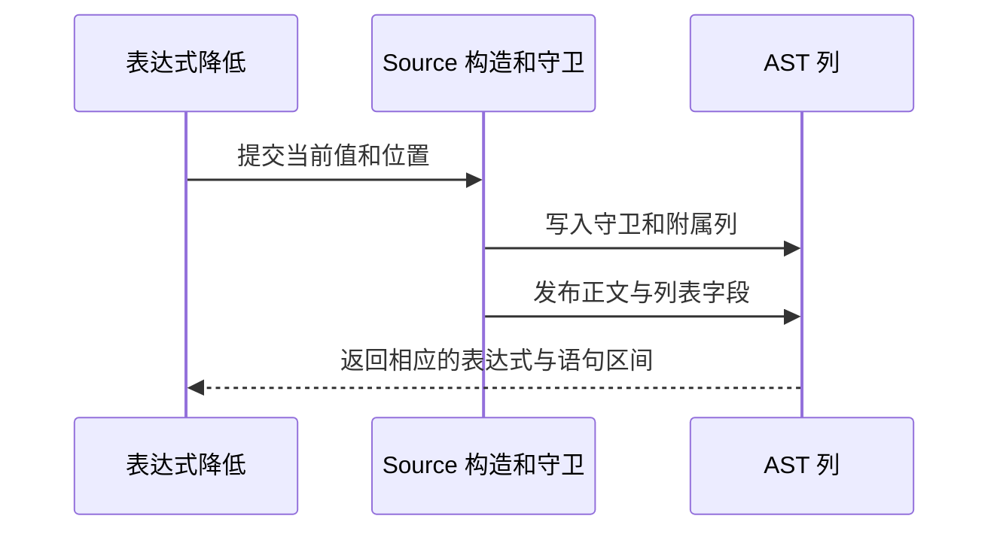

# 列表增长、更新与守卫区间自举

## Intent

让列表增长、元素更新和合约守卫的正式入口直接提交 AST 语句区间，列表字段复用共用的 Source 构造与提交流程。

## Data

增长恢复与规范化在 Source 生成语句列，宿主仍通过 `apply.flat` 将其转回 Zig 联合体数组。列表更新还在宿主组装守卫、正文和字段。引用构造的正式规则已由 Source 直接调用，旧 Zig 转发层仅从 seed 路径可达。

## Edges

元素更新在求值新值之前生成边界守卫。增长路径保留可写性、借用和缓冲复用判断。共享正文引用继续指向已提交的列。列表记录的字段名来自静态常量，底层字节可以借用。初始引导器保留其原生规则。

## Answer

增长恢复、增长规范化、列表元素更新、合约守卫的正式路径使用语句区间。列表字段由同一份 Source 构造规则生成，宿主直接提交列。生成的 Zig 把静态 `items` 与 `storage` 字面量传给原样返回切片的 `bytes.fromText`，字段名因此无需再分配和复制。

[增长正文发布](../../packages/genz/src/zx/growth/call.zig) · [列表更新](../../packages/genz/src/zx/list_update.zig) · [合约守卫](../../packages/genz/src/zx/intrinsics/guard.zig) · [共用字段构造](../../packages/genz/src/analysis/state/list/construct.zx)

seed 直接使用原生引用实现。正式转换和所有权清理仍调用同一个 Source 引用槽规则。旧 Zig 转发层及 `apply.flat` 已删除。宿主继续绑定原生列、提交区间和发布结果引用。

### 引导一致性

Source 引导器通过 25 个构建步骤，初始引导入口通过 19 个构建步骤。上一代 Source 引导器 `95219de74` 生成候选。候选用相同输入重新生成主、增长、集合和执行四份清单，16,035 个文件逐字节一致，比较时排除工具身份戳。

候选引导器 SHA-256 为 `9ce29d5337f951c05da08fc361ba2a14f42596ee7e33a79087933dc116e69cfe`。

### 运行回归

元素更新、迭代、reduce 增长、缓存所有权、合约、类型化错误和跨增长的独立读取七组均通过。构建汇总为 374 个步骤和 832 项测试。

### 性能

macOS arm64、Zig 0.17.0、ReleaseSmall。三轮交错取中位数，沿用 735 个入口、16 分区的冻结清单，关闭常驻。各工具由 Source 生成并执行 Source 分析和生成。

| 场景   | 工具     | 墙钟（秒） | CPU（秒） | 进程树峰值（字节） | 单进程峰值（字节） |
| ------ | -------- | ---------: | --------: | -----------------: | -----------------: |
| 冷生成 | 固定基线 |       2.82 |     12.43 |        884,768,768 |        934,051,840 |
| 冷生成 | 上一阶段 |       2.60 |     13.05 |        663,306,240 |        688,275,456 |
| 冷生成 | 本批     |       2.59 |     12.96 |        660,865,024 |        686,850,048 |
| 热重建 | 上一阶段 |       1.92 |      8.30 |        644,677,632 |        644,694,016 |
| 热重建 | 本批     |       1.93 |      8.29 |        644,415,488 |        644,448,256 |

冷生成较上一阶段墙钟减少 0.01 秒，CPU 减少 0.09 秒。进程树峰值下降 2.44 MB，单进程峰值下降 1.43 MB，同轮采样的物理内存峰值中位数下降 2.82 MB。相对固定基线，墙钟减少 0.23 秒，CPU 累计增加 0.53 秒，进程树峰值下降 223.90 MB。无改动的墙钟和 CPU 均为 0.03 秒。[固定基线](AST载荷导入与容量自举.md)

冻结清单的 11,753 个文件逐字节一致，各自的暖缓存重建与冷生成一致。所有权缓存正文 SHA-256 均为 `cdf9fa7e0f33002a95dc097b2837de781d67e6e519a452fb97f89f7c0bbf3a23`。

### 自我审查

这次移除平坦正文和字段物化。合约列表的宿主遍历和通用 State 发布中其余平坦接收者仍在待迁范围。引导与固定清单覆盖了 Source 的生成阶段，完整 Zig 后端冷构建及三阶段自编译留在正式闭包收口后验收。
