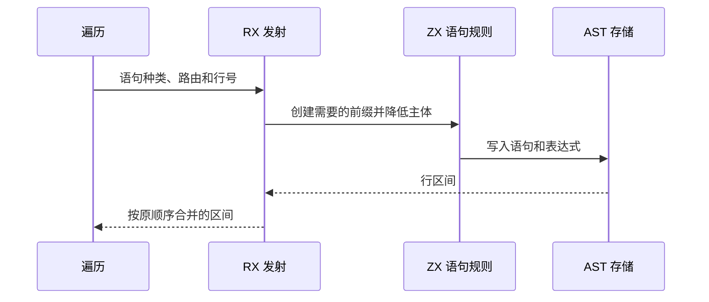

# 单条语句发射与结果发布自举

## Intent

接着迁出正式语句遍历中调用的单条语句降低。让 RX 明示 Store 事务准备、主体发射和跨度合并，让 ZX 决定语句类型、绑定与借用、返回融合以及结果转换。

## Data

正式遍历已经由 Source 推进游标，仍经 `lowerStatementAt` 调用 Zig 的整条 `emit`。这条路径读原控制列和预计算的路由字节，准备可选 Store 前缀，选择语句实现并合并跨度。绑定和返回还在原生函数内选择普通值、借用和融合。物理写入和相邻跨度复用已有实现。

## Edges

复用原语句、路由和 AST 存储，只交接标量与借用列。保持前缀、值求值、所有权裁剪和返回转换的顺序。出错后由既有 Source 遍历恢复作用域。初始 seed 保留自己的单条发射。

## Answer

原来的路由字节同时记录语句种类与已有的任务、Store、融合标记。RX 先按需准备 Store 前缀，再调用主体发射，成功后按需合并并提交跨度。ZX 选择局部绑定的借用、尾部融合、所有权裁剪和公开视图转换。跨度提交继续使用原有的 Source 游标规则，消费前一条语句时清空对应区间。[路由计划](../../packages/genz/src/analysis/statements/block/plan.zx) · [发射流程](../../packages/genz/src/analysis/statements/emit/run.rx)

把跨度和绑定复合值直接跨原生接口返回时，窄范围生成退回堆上参数与循环状态。改用已有帧中的物理跨度和标量状态后，实际发射闭包生成按值调用，未出现堆分配或载荷拷贝。Zig 继续持有 AST 列和分配器，提供表达式与语句的单项写入。初始 seed 的发射随其遍历单独保留。

候选由 `ea4fef837` 的 Source 引导器构建，25 步通过。同一候选用 Source 分析和发射重新生成四份清单，15,959 份生成文件逐字节一致，排除工具身份戳。

六组回归合计通过 300 个构建步骤和 508 项测试，覆盖普通返回、模块化循环和值输出、Store 事务和 I/O、资源清理以及错误捕获。初始 seed 词法引导单独通过 19 个步骤。

### 性能

使用 Zig 0.17.0、ReleaseSmall 和固定的 735 入口、16 分区清单。上一阶段与候选都由 Source 生成，运行 Source 分析和发射。交错三轮取中位数，冷生成和热重建的 11,753 份文件一致，排除工具身份戳。两代所有权缓存正文的 SHA-256 均为 `cdf9fa7e0f33002a95dc097b2837de781d67e6e519a452fb97f89f7c0bbf3a23`。

| 状态   | 工具     | 墙钟（秒） | CPU（秒） | 进程树峰值（字节） | 单进程峰值（字节） |
| ------ | -------- | ---------: | --------: | -----------------: | -----------------: |
| 冷生成 | 固定基线 |       2.82 |     12.43 |        884,768,768 |        934,051,840 |
| 冷生成 | 上一阶段 |       2.58 |     12.90 |        660,078,592 |        684,933,120 |
| 冷生成 | 候选     |       2.57 |     12.88 |        659,390,464 |        690,061,312 |
| 热重建 | 上一阶段 |       1.92 |      8.28 |        643,563,520 |        643,579,904 |
| 热重建 | 候选     |       1.92 |      8.28 |        643,563,520 |        643,579,904 |

相对上一阶段，冷生成墙钟减少 0.01 秒，CPU 减少 0.02 秒，进程树峰值减少 0.69 MB，单进程峰值增加 5.13 MB。相对固定冷基线，墙钟减少 0.25 秒，CPU 累计增加 0.45 秒，进程树峰值减少 225.38 MB。无改动时墙钟与 CPU 均为 0.03 秒。本批测量覆盖生成和重建缓存，完整 Zig 冷构建沿用此前记录。[固定基线](引导输出树和分区发布自举.md)

正式闭包接续语句和声明的跨度累计、尾部提交及 AST 列存储。跨度布局和发布循环已有 Source 实现，路径仍从 Zig 的累积容器推进。
